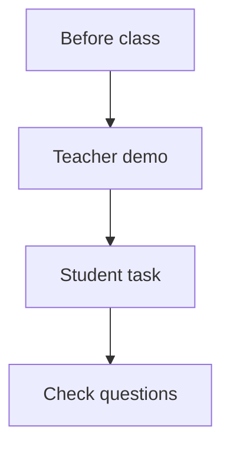

# AICT Course Guide

This book is for the 1-year AICT computer course. It is written for complete beginners. You do
not need to know anything about computers to start.

The book has 16 modules. Each module teaches one subject. Each lesson in a module is one class.

## How to use this book in class

Every lesson follows the same steps.

**Diagram in words:** First, the teacher reads the lesson before class. In class, the teacher
shows the steps, then the students practise, and then the teacher asks the check questions.
