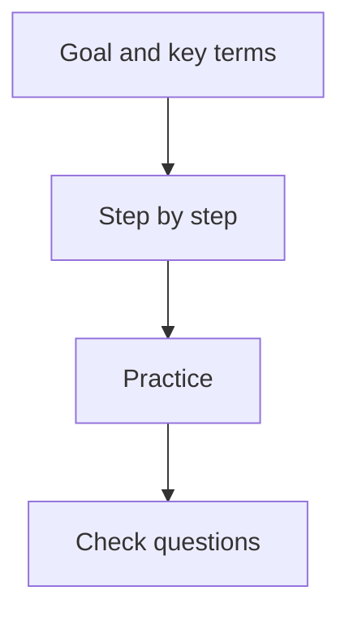

# Start Here

This book is for the 1-year AICT computer course. It is written for complete beginners. You do
not need to know anything about computers to start.

The book has 16 modules. Each module teaches one subject. Each lesson is about one hour of
learning.

## How to use this book

Every lesson has the same parts, in the same order. So you always know what comes next.

**Diagram in words:** First, read the goal and the new words. Then follow the steps on your
computer. Then practise alone, and answer the check questions.

- **Step by Step**: follow a worked example on your own computer. Each step tells you why you
  do it, and what you should see.
- **Practice**: try a new real-life task alone. At the end, **Check your work** tells you what a
  correct result looks like.
- **Common Mistakes**: read these if something goes wrong. Each one tells you how to fix it.
- **If your screen looks different**: some boxes show another way to do a step. Your computer
  may show a slightly different screen. Use the way in the box.
