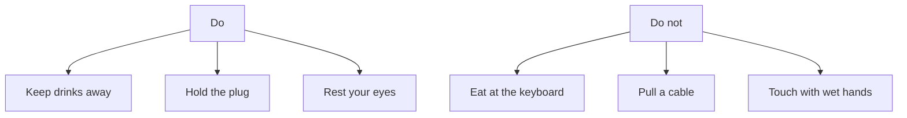

## Goal

By the end of this lesson, you can follow basic rules to keep yourself and your computer safe.

## Why It Matters

A shopkeeper keeps a cup of chai next to the counter computer. One spill can stop the keyboard
from working. At a tuition centre, many people walk past the computers every day. A loose cable
on the floor can trip someone, or someone can pull it by accident. If you sit badly for hours,
your neck, back and eyes can hurt.

**Diagram in words:** Three good habits are: keep drinks away, hold the plug, and rest your
eyes. Three things to avoid are: eating at the keyboard, pulling a cable, and touching the
computer with wet hands.

## Key Terms

| Term | Simple meaning |
|------|----------------|
| Cable | A covered wire. It brings electricity to the computer, or joins one part to another. |
| Plug | The hard end of a cable. You push it into a socket on the wall or on a board. |
| Extension board | A board with several sockets on it. Its own cable goes into a wall socket. |
| Surge | A sudden jump in the electricity coming to the computer. It can damage the computer. |
| Surge protector | A device that protects the computer from a surge. The computer plugs into it. |
| UPS | Uninterruptible power supply. A box that works as a surge protector. It also keeps the computer on for a short time when the electricity goes. |
| Posture | The way you hold your body when you sit. |
| Glare | Bright light that shines on the screen and makes it hard to see. |

## Step by Step

Follow these steps at the computer you use: at home, in a shop or at a tuition centre. Most
steps ask you to look, or to change the way you sit. Do not unplug anything now. Steps 6 and 11
tell you how to unplug safely when you need to.

**Keep food and drink away**

Food and drink can damage a keyboard. Keep them away from the computer.

1. Move any cup, glass or bottle off the computer table. A drink can spill. Liquid can damage
   the computer, and a wet keyboard may never work again. *You see no drinks on the table.*
2. Eat your food away from the computer. Crumbs can get stuck under the keys and stop them
   working.

**Clean, dry hands**

3. Wash your hands and dry them well before you start. Dirt and oil from your hands get onto
   the keys. The computer runs on electricity, so never use it with wet hands.

**Look after the cables**

Cables carry electricity. A damaged cable can give an electric shock or start a fire.

4. Look at the floor around the computer. Check that no cable lies where people walk. People
   can trip over a cable or pull it by accident.
5. Check that no cable is knotted, bent sharply or squashed under a chair or table leg. This
   damages the cable. *You see each cable lying loose and straight.*
6. When you need to unplug something, hold the plug and pull it out. Never pull the cable
   itself, because that can damage it.
7. Look for a cable that is cracked or worn. If a cable looks like this, or feels warm, stop
   using it. Ask the person in charge of the computer to replace it.

**Use power safely**

8. Find where the computer's power cable goes. It is safest when it goes into a surge protector
   or a UPS. A surge can damage a computer that is plugged straight into the wall.
9. If the computer has a UPS, remember what it does in load shedding. When the electricity goes,
   the UPS keeps the computer on for a short time. Work you have not saved is lost when the
   power goes off ([Lesson 1.4](./starting-up-and-shutting-down.mdx)). So save your work while
   the UPS keeps the computer on.
10. Count the plugs in one socket or extension board. Do not put too many plugs in one place.
    Never plug one extension board into another extension board.
11. In a storm with lightning, shut down the computer. Then unplug its power cable, holding the
    plug. This keeps the computer safe during the storm.
12. Check that no books, papers or bags are on top of or around the computer. The computer gets
    warm inside. Fans push the heat out, and they need space for air.

**Sit correctly**

Good posture lowers the chance of pain in your back, neck and shoulders.

13. Sit back in your chair so it supports your back. Keep your back straight and your shoulders
    relaxed.
14. Put your feet flat on the floor. If your feet do not reach the floor, rest them on a
    footrest, such as a low stool.
15. Keep your elbows close to your body. When you type, keep your wrists straight, not bent up,
    down or to the side.
16. Check the [monitor](./parts-of-a-computer.mdx). It should be straight in front of you, so
    you do not twist your neck.
17. Sit back and raise one arm straight towards the screen. Your fingers should touch the
    screen. *You see the screen about one arm's length away.* This distance helps your eyes
    and neck.
18. Look straight ahead. The top of the screen should be at your eye level, or a little below
    it. Then you do not bend your neck up or down.
19. Look for glare on the screen. If a window or a light shines on it, move the screen a little
    or close the curtain. Glare makes the screen hard to see.

**Rest your eyes**

Looking at a screen for a long time makes you blink less often. It can also make your eyes
tired.

20. Every 15 minutes, look away from the screen. Look at something far away, more than 20 feet
    (about 6 metres) away, for a minute or two. This lets the muscles inside your eyes relax.
21. Blink quickly a few times. Blinking refreshes the thin layer of tears on your eyes and clears
    away dust.
22. About once every hour, take a short break. Stand up, stretch or walk around. Breaks rest
    your eyes and your muscles.

## Practice

Use this checklist at the computer you use most. It may be at home, in a shop or at a tuition
centre. For each check, fix anything that is not right. Then answer yes or no.

1. **Drinks and food:** no cup, glass, bottle or food is on the computer table.
2. **Hands:** your hands are clean and dry.
3. **Cables on the floor:** no cable lies where people walk.
4. **Cable condition:** no cable is knotted, bent sharply, squashed, cracked or worn.
5. **Air space:** no books, papers or bags are on top of or around the computer.
6. **Sitting:** you sit back in the chair, with your back straight and shoulders relaxed. Your
   feet are flat on the floor or on a footrest.
7. **Screen:** the screen is straight in front of you, about one arm's length away. Its top is
   at your eye level or a little below. There is no glare on it.
8. **Eye break:** look at something far away for one minute, and blink quickly a few times.
9. Check your work: you can say yes to all eight checks. Your table has no food or drink, the
   cables are safe, and you sit correctly at arm's length from the screen. You also know your
   two breaks: look far away every 15 minutes, and stand up once every hour.

## Check Questions

1. Point to the plug of the computer's power cable. How should you hold it when you unplug it?

   

   
Show answer

   **Answer:** Hold the plug and pull it out. Never pull the cable itself.

   

2. Why should you keep a cup of chai away from the keyboard?

   

   
Show answer

   **Answer:** A drink can spill. Liquid can get under the keys and damage the keyboard, so it
   may stop working.

   

3. Sit at your computer. Raise your arm towards the screen. How far away should the screen be?

   

   
Show answer

   **Answer:** About one arm's length. When you sit back and raise your arm, your fingers should
   touch the screen.

   

## Common Mistakes

- **Spilling a drink on the keyboard** → Shut down the computer quickly. Unplug the keyboard and
  turn it upside down, so the liquid drains out. Next time, keep drinks on another table.
- **Pulling a cable out by the wire** → Always hold the plug when you unplug something.
- **Moving closer to the screen to read small writing** → Stay at arm's length. Make the
  writing bigger on the screen instead.
- **Working for hours without a break** → Look far away every 15 minutes. Stand up and move
  about once every hour.
- **Ignoring pain that keeps coming back** → If your hands, arms, neck or back keep hurting,
  tingling or going numb, see a doctor soon.

## Sources

*These official pages were checked when this lesson was written.*

- [GCFGlobal, "Computer Basics: Keeping Your Computer Clean" (archived copy, November 2025)](https://web.archive.org/web/20251124044411/https://edu.gcfglobal.org/en/computerbasics/keeping-your-computer-clean/1/): "Dust, food, liquid, and other particles can get stuck underneath the keys on your keyboard, which can prevent it from working properly"; if you spill liquid, "quickly shut down the computer and disconnect the keyboard. Then turn the keyboard upside down and allow the liquid to drain"; the keyboard "may not be fixable"; "we recommend keeping drinks away from the computer area"; the computer case "has fans that keep it from overheating. Avoid stacking papers, books, and other items around your computer."
- [GCFGlobal, "Computer Basics: Setting Up a Computer" (archived copy, January 2026)](https://web.archive.org/web/20260117153359/https://edu.gcfglobal.org/en/computerbasics/setting-up-a-computer/1/): plug the computer into a surge protector; a UPS "acts as a surge protector and provides temporary power if there is a power outage"; plugging straight into the wall "is not recommended because electrical surges can damage your computer."
- [Oxford Advanced Learner's Dictionary, "surge protector"](https://www.oxfordlearnersdictionaries.com/definition/english/surge-protector): a surge protector is "a device used to protect computers and other electrical equipment from a sudden increase in the flow of electrical power" (the meaning of surge and surge protector).
- [Microsoft Support, "Product safety warnings and instructions - 3"](https://support.microsoft.com/en-us/surface/hardware-warranty/product-safety-warnings-and-instructions-3) (for wired Microsoft keyboards such as Keyboard 600): damaged cables "can pose an electric shock or fire hazard"; arrange cables so people are not "likely to trip over or accidentally pull on them"; protect cords from being "crushed", "pinched or sharply bent"; do not "knot" them; "pull on the plug—do not pull on the cord"; if a cable is "warm, frayed, cracked or damaged in any way, stop using it immediately"; "Unplug your power cord during lightning storms"; "Avoid getting contaminants such as food debris, dust, dirt, oil, or chemicals on your device"; a device "can be damaged … if it comes in contact with liquids"; "Do not place objects on top of your device."
- [Microsoft Support, "Product safety warnings and instructions - 2"](https://support.microsoft.com/en-us/surface/hardware-warranty/product-safety-warnings-and-instructions-2) (keyboards and mice), "Musculoskeletal disorders": with "persistent or recurring discomfort, pain, throbbing, aching, tingling, numbness … PROMPTLY SEE A QUALIFIED HEALTH PROFESSIONAL."
- [UMass Lowell Environmental Health and Safety, "Electrical Safety"](https://www.uml.edu/eem/ehs/osha/electrical-safety.aspx): "Never use electrical equipment when your hands are wet"; "Do not overload outlets"; "Do not plug multi outlet strips into other multi bar strips"; "Use surge protectors when possible"; "Unplug cords by gripping the plug, not the cord."
- [Microsoft Surface, "Computer Ergonomics in Your Workspace"](https://www.microsoft.com/en-us/surface/do-more-with-surface/ergonomic-computing-tips): feet "rest flat on the floor"; "back is straight, shoulders relaxed, and elbows close to your body"; the monitor "about an arm's length away, with the top of the screen at or just below eye level"; the monitor position "helps in reducing strain on your neck and eyes"; good posture "reduces the risk of developing pain or discomfort in your back, neck, and shoulders"; "Taking short breaks every hour can help to alleviate eye strain and prevent muscle fatigue. Use these breaks to stretch or walk around."
- [Microsoft, "A Guide to Healthy Computing" (PDF, linked from Microsoft Support's product safety page)](https://download.microsoft.com/download/1/3/4/1340dfe4-a8c1-485f-be3b-4e8991323df3/Healthy_Computing_Guide.pdf): a badly set up workspace "can cause neck, shoulder and back pain, eye strain"; "Chair adjusted so feet are flat on ground (or use a footrest)"; "Keep wrists in line with their forearms and not bent upwards, downwards or to one side"; "Take frequent breaks. Stand up and stretch, walk around"; "Avoid glare by placing their monitor away from light sources."
- [Cornell University Ergonomics Web, "Ergonomic Guidelines for arranging a Computer Workstation"](https://ergo.human.cornell.edu/ergoguide.html): the monitor "directly in front of you and facing you"; "sit back in your chair and raise your arm and your fingers should touch the screen"; "If text looks too small then either use a larger font or magnify the screen image … rather than sitting closer"; "sits back in the chair and has good back support"; glare: "move the screen" or "use a shade or drapes"; eye breaks: looking at a screen "causes you to blink less often"; "Every 15 minutes you should briefly look away from the screen for a minute or two to a more distant scene, preferably something more that 20 feet away. This lets the muscles inside the eye relax. Also, blink your eyes rapidly for a few seconds. This refreshes the tear film."
