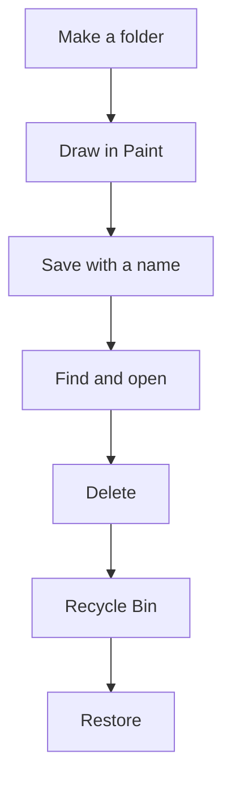

import Tabs from '@theme/Tabs';
import TabItem from '@theme/TabItem';

## Goal

By the end of this lesson, you can make a folder, save a file into it, find it again, delete it,
and get it back.

## Why It Matters

Think of a shop owner in Lahore. She keeps each bill in a cardboard folder, so she can find it
again. A computer works the same way. Your work is kept as a **file**, and you keep files in
**folders**. If you save your work in the right folder, you can always find it. If you delete a
file by mistake, you can often get it back.

**Diagram in words:** Make a folder, draw in Paint, and save the drawing with a name in your
folder. Find it and open it. When you delete it, it goes to the Recycle Bin, and you can restore
it from there.

## Key Terms

| Term | Simple meaning |
|------|----------------|
| File | One piece of saved work, such as a drawing or a letter. Every file has a name. |
| Folder | A place on the computer that holds files, like a cardboard folder holds papers. |
| File Explorer | The Windows app you use to see and open your folders and files. |
| Paint | A Windows app for drawing pictures. |
| Save | Keep your work on the computer as a file, with a name, so you can open it later. |
| Delete | Remove a file from its folder. |
| Recycle Bin | The place where deleted files go first. You can get them back from here. |
| Restore | Bring a deleted file back from the Recycle Bin to its folder. |

## Teacher Demo

Use one lab computer that the whole class can see. In this demo, the folder is called
**Sana Work** and the drawing is called **My House**. You will use the window buttons from
[Lesson 1.7](./operating-system-and-desktop.mdx).

**Make a folder**

1. Select the **File Explorer** icon on the taskbar. *The class sees File Explorer open.*
2. In the left pane, select **Documents**. Say: "Documents is a folder that is already on the
   computer."
3. Select **New**, then **Folder**. *The class sees a new folder appear.*

   :::warning[UNVERIFIED]

   Microsoft gives the steps "New, then Folder" for Windows 10 and Windows 11. It does not say
   where **New** is on Windows 10. Teacher: test step 3 on Windows 10 (lab computer) and
   Windows 11 (laptop). Another way, confirmed by Microsoft for both versions: press
   **Ctrl+Shift+N** in File Explorer.

   :::

4. Type **Sana Work** and press **Enter**. *The class sees the folder name.*
5. Minimize File Explorer.

**Draw and save in Paint**

6. Open Paint.

<Tabs groupId="windows-version">
<TabItem value="win10" label="Windows 10">

Select **Search** on the taskbar. Type **Paint**.

:::warning[UNVERIFIED]

Microsoft says to type the app name in Search, but does not say the next step for Paint on
Windows 10. Teacher: test this on the lab computer: select **Paint** in the results.

:::

</TabItem>
<TabItem value="win11" label="Windows 11">

Select **Start**. Type **Paint**, then press **Enter**. *The class sees Paint open.*

</TabItem>
</Tabs>

7. Select the **Pencil** tool. Drag on the white area to draw a simple house.
8. Select **File**, then **Save as**. *The class sees a box for saving open.*
9. In the box, select **Documents**, then double-click **Sana Work**. Say: "Always check the
   folder before you save."
10. In the **File name** box, type **My House**. Select **Save**.

:::warning[UNVERIFIED]

Microsoft's current Paint pages do not give these steps. Teacher: before class, test steps 7 to
10 on Windows 11 (laptop) and Windows 10 (lab computer). Check where the **Pencil** tool is, the
names **File** and **Save as**, and how to choose the folder in the saving box.

:::

11. Select **Close** to close Paint.

**Find, open, delete and get it back**

12. Select File Explorer on the taskbar. Double-click **Sana Work**. *The class sees the
    **My House** file.*
13. Double-click **My House**. *The class sees the drawing open.* Close it.

    :::warning[UNVERIFIED]

    Teacher: check which app opens the drawing on each version (it may be Paint or another app).

    :::

14. Select **My House** once. Press the **Delete** key. *The class sees the file disappear from
    the folder.* Say: "It is not gone. It went to the Recycle Bin."

    :::warning[UNVERIFIED]

    Teacher: check on both versions whether a message asks you to confirm. If it does, show the
    class which button to select.

    :::

15. Minimize File Explorer. Double-click the **Recycle Bin** icon on the desktop. *The class sees
    **My House** in the Recycle Bin.*
16. Right-click **My House**, then select **Restore**. *The file leaves the Recycle Bin.*
17. Go back to File Explorer and look in **Sana Work**. *The class sees **My House** back in the
    folder.*

## Student Task

Work at your own lab computer. Use these names:

| What | Name to type |
|------|--------------|
| Your folder | Your first name and the word Work, for example **Ali Work** |
| Your drawing | **My House** |

1. Open File Explorer. Select **Documents**. Make your folder and give it your name.
2. Open Paint. Draw a simple house with the **Pencil**.
3. Save the drawing as **My House** in your folder, the way your teacher showed you.
4. Close Paint.
5. In File Explorer, open your folder. Double-click **My House** to open it. Then close it.
6. Select **My House** once and press **Delete**.
7. Open the Recycle Bin. Right-click **My House** and select **Restore**.
8. Open your folder again and check that **My House** is back.
9. Show your teacher: your folder with **My House** inside it, after you restored it.

## Check Questions

1. Show your teacher the folder you made, and the file inside it.
   **Answer:** In File Explorer, select **Documents**, then double-click your folder. The file
   **My House** is inside.
2. Where does a file go when you delete it?
   **Answer:** It goes to the Recycle Bin first. You can restore it from there.
3. Why do you choose a folder before you select **Save**?
   **Answer:** So you know where the file is, and you can find it again.

## Common Mistakes

- **Saving without choosing a folder, then not finding the file** → Before you select **Save**,
  check which folder is open in the saving box. Choose your own folder.
- **Forgetting the file name** → Use a short name that tells you what is in the file, such as
  **My House**.
- **Thinking a deleted file is gone forever** → Look in the Recycle Bin and restore it. A deleted file
  stays there until someone empties the Recycle Bin.
- **Double-clicking too slowly on a folder** → Click two times, very fast, as you practised in
  [Lesson 1.5](./using-the-mouse.mdx).

## Sources

*For the teacher: these sources were checked before this lesson was written.*

- [Microsoft, "Draw, Create, and Edit with Paint"](https://www.microsoft.com/en-us/windows/paint): Paint is included in Windows; how to open Paint in Windows 11 (select Start, type Paint, press Enter); Paint has a Pencil tool; you can save your work as a picture file.
- [Microsoft Learn, "Available features on demand"](https://learn.microsoft.com/en-us/windows-hardware/manufacture/desktop/features-on-demand-non-language-fod): Paint is preinstalled on Windows 10, version 2004; on newer builds (which include Windows 11), Paint is a preinstalled app.
- [Microsoft Support, "Find your files and apps in Windows"](https://support.microsoft.com/en-us/windows/find-all-your-apps-and-programs-cadb9c4b-459d-dfcb-2964-14aac1d7d964): Windows 10 and Windows 11 tabs; select Search on the taskbar and type the name of the app.
- [Microsoft Support, "File Explorer in Windows"](https://support.microsoft.com/en-us/windows/experience/fileexplorer/file-explorer-in-windows): Windows 10 and Windows 11 tabs; open File Explorer from the taskbar; folders such as Documents are in the left pane.
- [Microsoft Support, "Create a new folder"](https://support.microsoft.com/en-us/office/create-a-new-folder-cbbfb6f5-59dd-4e5d-95f6-a12577952e17): applies to Windows 10 and Windows 11; in File Explorer select New, then Folder, type the name and press Enter; when saving, browse to the folder and select Save.
- [Microsoft Support, "Keyboard shortcuts in Windows"](https://support.microsoft.com/en-us/accessibility/windows/keyboard-shortcuts-in-windows): Windows 10 and Windows 11 tabs; the Delete key deletes the selected item and moves it to the Recycle Bin; Ctrl+Shift+N creates a new folder in File Explorer.
- [Microsoft Support, "Customize the Desktop Icons in Windows"](https://support.microsoft.com/en-us/windows/experience/personalization/customize-the-desktop-icons-in-windows): applies to Windows 11 and Windows 10; the Recycle Bin icon is on the desktop by default.
- [Microsoft Support, "Find the Recycle Bin in Windows"](https://support.microsoft.com/en-us/windows/find-the-recycle-bin-in-windows-885cf298-0f98-a548-9427-a1248fce4315): applies to Windows 11 and Windows 10; how to show the Recycle Bin icon if it is missing from the desktop.
- [Microsoft Support, "Restore deleted files or folders in OneDrive"](https://support.microsoft.com/en-us/onedrive/restore-deleted-files-or-folders-in-onedrive): to restore a file in Windows, open the Recycle Bin, right-click the file and select Restore; it goes back to its original folder.
- [Microsoft Support, "Free up drive space in Windows"](https://support.microsoft.com/en-us/windows/empty-the-recycle-bin-in-windows-10-d4c8f8ef-a12e-8250-b0cf-2311960a31f9): Windows 10 and Windows 11 tabs; deleted files stay in the Recycle Bin until you empty it.
- [Microsoft Learn, "Windows 7 Mouse and Pointers"](https://learn.microsoft.com/en-us/windows/win32/uxguide/inter-mouse): you open folders and documents in the file window (now File Explorer), and shortcuts on the desktop, by double-clicking. (Written for Windows 7; the page says much of it still applies.)
