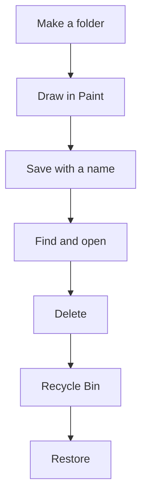

import Tabs from '@theme/Tabs';
import TabItem from '@theme/TabItem';

## Goal

By the end of this lesson, you can make a folder, save a file into it, find it again, delete it,
and get it back.

## Why It Matters

Think of a shop owner in Lahore. She keeps each bill in a cardboard folder, so she can find it
again. A school keeps every result card in a file for each student. A computer works the same
way. Your work is kept as a **file**, and you keep files in **folders**. Save in the right folder
and you can always find your work, such as a job application or a family budget.

If you delete a file by mistake, you can often get it back.

**Diagram in words:** Make a folder, draw in Paint, and save the drawing with a name in your
folder. Find it and open it. When you delete it, it goes to the Recycle Bin, and you can restore
it from there.

## Key Terms

| Term | Simple meaning |
|------|----------------|
| File | One piece of saved work, such as a drawing or a letter. Every file has a name. |
| Folder | A place on the computer that holds files, like a cardboard folder holds papers. |
| File Explorer | The Windows app you use to see and open your folders and files. |
| Paint | A Windows app for drawing pictures. |
| Save | Keep your work on the computer as a file, with a name, so you can open it later. |
| Delete | Remove a file from its folder. |
| Recycle Bin | The place where deleted files go first. You can get them back from here. |
| Restore | Bring a deleted file back from the Recycle Bin to its folder. |

## Step by Step

Follow these steps on your own computer. In this example, the folder is called **Sana Work**
and the drawing is called **My House**. You use the window buttons from
[Lesson 1.7](./operating-system-and-desktop.mdx).

**Make a folder**

A folder keeps your files together, like a cardboard folder keeps papers together.

1. Select the **File Explorer** icon on the taskbar. *You see File Explorer open.* File Explorer
   shows you the folders and files on your computer.
2. In the left pane, select **Documents**. Documents is a folder that is already on the
   computer. It is a good place to keep your work.
3. Make a new folder, so that your work has its own place.

<Tabs groupId="windows-version">
<TabItem value="win10" label="Windows 10">

Under **Home**, select **New folder**.

</TabItem>
<TabItem value="win11" label="Windows 11">

Select **New**, then **Folder**.

</TabItem>
</Tabs>

*You see a new folder appear.* Another way, on both versions: press **Ctrl+Shift+N** in
File Explorer.

4. Type **Sana Work** and press **Enter**. *You see the folder name.* A clear name tells you
   what is inside.
5. Minimize File Explorer. You come back to it later.

**Draw and save in Paint**

Paint gives you something to save. Saving keeps your work, so that it is not lost.

6. Open Paint.

<Tabs groupId="windows-version">
<TabItem value="win10" label="Windows 10">

In the search box next to **Start** on the taskbar, type **paint**. Then select **Paint** from
the list of results. *You see Paint open.*

</TabItem>
<TabItem value="win11" label="Windows 11">

Select **Start**. Type **Paint**, then press **Enter**. *You see Paint open.*

</TabItem>
</Tabs>

7. Select the **Pencil** tool. Drag on the white area to draw a simple house. It does not need
   to be neat.
8. Select **File**, then **Save as**. *You see a box for saving open.*
9. In the box, select **Documents**, then double-click **Sana Work**. Always check the folder
   before you save, so that you can find your file later.
10. In the **File name** box, type **My House**. Select **Save**. The name helps you know what
    is in the file.

:::tip[If your screen looks different]

Your Paint may not show **File** or **Save as** in the same way. Press **F12** in Paint
instead. F12 saves the picture as a new file.

:::

11. Select **Close** to close Paint. Your drawing is safe in the file.

**Find, open, delete and get it back**

12. Select File Explorer on the taskbar. Double-click **Sana Work**. *You see the **My House**
    file.* This is how you find your saved work again.
13. Double-click **My House**. *You see the drawing open.* Close it.

    :::tip[If your screen looks different]

    Your drawing may open in a different app. That is fine, as long as you see the drawing. To
    open it in Paint instead, open Paint and press **Ctrl+O**.

    :::

14. Select **My House** once. Press the **Delete** key. *You see the file disappear from the
    folder.* Windows normally does this without asking you first. The file is not gone. It went
    to the Recycle Bin.
15. Minimize File Explorer. Double-click the **Recycle Bin** icon on the desktop. *You see
    **My House** in the Recycle Bin.* The Recycle Bin is like the dustbin in your room. A paper
    stays there until someone empties it.
16. Right-click **My House**, then select **Restore**. *The file leaves the Recycle Bin.*
    Restore fixes a delete that you did by mistake.
17. Go back to File Explorer and look in **Sana Work**. *You see **My House** back in the
    folder.*

## Practice

A tailor near your home wants a simple sign for his shop. You make the sign in Paint and keep
it in its own folder. Use these names:

| What | Name to type |
|------|--------------|
| Your folder | **Tailor Shop** |
| Your drawing | **Shop Sign** |

1. Open File Explorer. Select **Documents**. Make a new folder and name it **Tailor Shop**.
2. Open Paint. Draw a simple shirt with the **Pencil**.
3. Save the drawing as **Shop Sign** in the **Tailor Shop** folder, as in steps 8 to 10 of Step
   by Step. Check the folder before you select **Save**.
4. Close Paint.
5. In File Explorer, open **Tailor Shop**. Double-click **Shop Sign** to open it. Then close it.
6. Select **Shop Sign** once and press **Delete**. This is a pretend mistake.
7. Open the Recycle Bin. Right-click **Shop Sign** and select **Restore**, so that you get it
   back.
8. Open **Tailor Shop** again and check that **Shop Sign** is back.
9. Check your work: in **Documents**, there is a folder called **Tailor Shop**. Inside it is
   the file **Shop Sign**, back after you restored it. **Shop Sign** is no longer in the
   Recycle Bin.

## Check Questions

1. Open the folder you made in Practice, and point to the file inside it.

   

   
Show answer

   **Answer:** In File Explorer, select **Documents**, then double-click **Tailor Shop**. The
   file **Shop Sign** is inside.

   

2. Where does a file go when you delete it?

   

   
Show answer

   **Answer:** It goes to the Recycle Bin first. You can restore it from there.

   

3. Why do you choose a folder before you select **Save**?

   

   
Show answer

   **Answer:** So you know where the file is, and you can find it again.

   

## Common Mistakes

- **Saving without choosing a folder, then not finding the file** → Before you select **Save**,
  check which folder is open in the saving box. Choose your own folder.
- **Forgetting the file name** → Use a short name that tells you what is in the file, such as
  **My House**.
- **Thinking a deleted file is gone forever** → Look in the Recycle Bin and restore it. A deleted file
  stays there until someone empties the Recycle Bin.
- **Double-clicking too slowly on a folder** → Click two times, very fast, as you practised in
  [Lesson 1.5](./using-the-mouse.mdx).

## Sources

*These official pages were checked when this lesson was written.*

- [Microsoft, "Draw, Create, and Edit with Paint"](https://www.microsoft.com/en-us/windows/paint): Paint is included in Windows; how to open Paint in Windows 11 (select Start, type Paint, press Enter); Paint has a Pencil tool "for freehand drawing"; you can save your work as a picture file.
- [Microsoft Support, "Help in Paint" (archived Microsoft page, March 2024)](https://web.archive.org/web/20240309013500/https://support.microsoft.com/en-us/windows/help-in-paint-d62e155a-1775-6da4-0862-62a3e9e5a511): Windows 11 and Windows 10 tabs; "In the search box next to Start on the taskbar, type paint and then select Paint from the list of results."
- [Microsoft Support, "Open Microsoft Paint" (archived Microsoft page, 2019)](https://web.archive.org/web/20191207122852/https://support.microsoft.com/en-us/help/4027410/windows-10-open-microsoft-paint): applies to Windows 10; type paint in the search box on the taskbar, then select Paint from the list of results.
- [Microsoft Support, "Keyboard shortcuts in apps" (archived Microsoft page, January 2025)](https://web.archive.org/web/20250112195904/https://support.microsoft.com/en-us/windows/keyboard-shortcuts-in-apps-139014e7-177b-d1f3-eb2e-7298b2599a34): applies to Windows 11 and Windows 10; in Paint, F12 saves the picture as a new file, Ctrl+S saves changes, and Ctrl+O opens an existing picture. Confirms the backup ways in the boxes.
- [Microsoft Support, "Fix a missing Camera Roll in Windows"](https://support.microsoft.com/en-us/windows/hardware/camera/fix-a-missing-camera-roll-in-windows): applies to Windows 10 and Windows 11; in File Explorer on Windows 11, select New, then Folder; on Windows 10, under Home, select New folder.
- [Microsoft Learn, "Available features on demand"](https://learn.microsoft.com/en-us/windows-hardware/manufacture/desktop/features-on-demand-non-language-fod): Paint is preinstalled on Windows 10, version 2004; on newer builds (which include Windows 11), Paint is a preinstalled app.
- [Microsoft Support, "Find your files and apps in Windows"](https://support.microsoft.com/en-us/windows/find-all-your-apps-and-programs-cadb9c4b-459d-dfcb-2964-14aac1d7d964): Windows 10 and Windows 11 tabs; select Search on the taskbar and type the name of the app.
- [Microsoft Support, "File Explorer in Windows"](https://support.microsoft.com/en-us/windows/experience/fileexplorer/file-explorer-in-windows): Windows 10 and Windows 11 tabs; open File Explorer from the taskbar; folders such as Documents are in the left pane.
- [Microsoft Support, "Create a new folder"](https://support.microsoft.com/en-us/office/create-a-new-folder-cbbfb6f5-59dd-4e5d-95f6-a12577952e17): applies to Windows 10 and Windows 11; in File Explorer select New, then Folder, type the name and press Enter; when saving, browse to the folder and select Save.
- [Microsoft Support, "Keyboard shortcuts in Windows"](https://support.microsoft.com/en-us/accessibility/windows/keyboard-shortcuts-in-windows): Windows 10 and Windows 11 tabs; the Delete key deletes the selected item and moves it to the Recycle Bin; Ctrl+Shift+N creates a new folder in File Explorer.
- [Microsoft Learn, "ADMX_WindowsExplorer Policy CSP"](https://learn.microsoft.com/en-us/windows/client-management/mdm/policy-csp-admx-windowsexplorer): the "Display confirmation dialog when deleting files" setting, for Windows 10 and Windows 11; if it is not turned on, "the default behavior of not displaying a confirmation dialog occurs."
- [Microsoft Support, "Customize the Desktop Icons in Windows"](https://support.microsoft.com/en-us/windows/experience/personalization/customize-the-desktop-icons-in-windows): applies to Windows 11 and Windows 10; the Recycle Bin icon is on the desktop by default.
- [Microsoft Support, "Find the Recycle Bin in Windows"](https://support.microsoft.com/en-us/windows/find-the-recycle-bin-in-windows-885cf298-0f98-a548-9427-a1248fce4315): applies to Windows 11 and Windows 10; how to show the Recycle Bin icon if it is missing from the desktop.
- [Microsoft Support, "Restore deleted files or folders in OneDrive"](https://support.microsoft.com/en-us/onedrive/restore-deleted-files-or-folders-in-onedrive): to restore a file in Windows, open the Recycle Bin, right-click the file and select Restore; it goes back to its original folder.
- [Microsoft Support, "Free up drive space in Windows"](https://support.microsoft.com/en-us/windows/empty-the-recycle-bin-in-windows-10-d4c8f8ef-a12e-8250-b0cf-2311960a31f9): Windows 10 and Windows 11 tabs; deleted files stay in the Recycle Bin until you empty it.
- [Microsoft Learn, "Windows 7 Mouse and Pointers"](https://learn.microsoft.com/en-us/windows/win32/uxguide/inter-mouse): you open folders and documents in the file window (now File Explorer), and shortcuts on the desktop, by double-clicking. (Written for Windows 7; the page says much of it still applies.)
