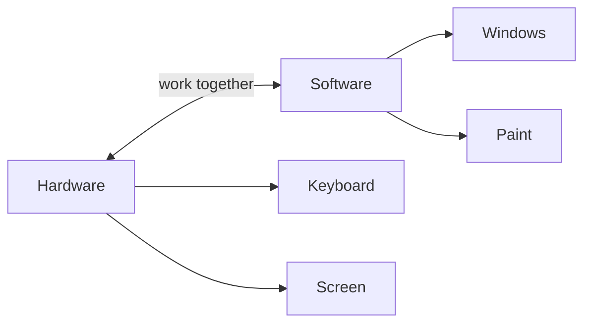

## Goal

By the end of this lesson, you can tell whether something is hardware or software.

## Why It Matters

A computer is made of two kinds of things. Some parts you can touch. Some things you cannot
touch, but they tell the computer what to do. When you know the difference, you can talk about
a computer clearly. You will also understand why a computer needs both.

Think of a piano and music. The piano is the thing you can touch. The music is what it plays.
A computer is the same. The hardware is like the piano. The software is like the music.

**Diagram in words:** Hardware and software work together. The keyboard and the screen are
hardware. Windows and Paint are software.

## Key Terms

| Term | Simple meaning | Urdu meaning |
|------|----------------|--------------|
| Hardware | The parts of a computer you can touch. | ہارڈ ویئر: کمپیوٹر کے وہ حصے جنہیں چھوا جا سکتا ہے |
| Software | Instructions that run on the computer and tell the hardware what to do. You cannot touch software. | سافٹ ویئر: ہدایات جو کمپیوٹر پر چلتی ہیں |
| Program | A list of steps, written so that a computer can follow them. | پروگرام: کمپیوٹر کے لیے مرحلہ وار ہدایات |
| App | A program that helps you do one kind of task. Paint is an app. | ایپ: کسی خاص کام کے لیے پروگرام |

## Teacher Demo

Use one lab computer that the whole class can see. Keep this page open on the screen.

1. Touch the keyboard, the mouse and the screen, one by one. Say: "These are **hardware**. You can
   touch them." *The class sees each part.*
2. Point to the printer and the speakers. Say: "These are hardware too."
3. Point to the screen. Say: "The computer is running **software** now. Software is a set of
   instructions. You cannot touch it."
4. Name three examples of software. Write them on the board:
   - **Windows**: the main software that makes the computer work.
   - **Paint**: an app for drawing pictures.
   - **Microsoft Edge**: an app for opening web pages. It is called a web browser.
5. Say: "This book is open in a web browser. The web browser is software."
6. Explain the piano and the music. The piano is like hardware. The music is like software.
7. Say: "Hardware follows the instructions in the software. They need each other."
8. Show the diagram above. Point to Hardware, then Software, then the arrow between them.

## Student Task

Work in pairs. You need one sheet of paper and a pen.

1. Draw two boxes on your paper. Write **Hardware** in one box and **Software** in the other.
2. Copy this list from the board: keyboard, mouse, Windows, screen, Paint, printer, Microsoft
   Edge, speakers.
3. Write each thing in the right box.
4. Go to your lab computer. Touch each piece of hardware on your list that you can find.
5. Show your teacher: your two boxes, and one piece of hardware on your computer.

## Check Questions

1. Is the mouse hardware or software? Why?
   **Answer:** Hardware, because you can touch it.
2. Point to two pieces of hardware on your lab computer.
   **Answer:** For example, the keyboard and the screen.
3. Name one example of software.
   **Answer:** Windows, Paint or Microsoft Edge.

## Common Mistakes

- **Thinking software is something you can hold** → Software is instructions. You cannot touch
  it.
- **Thinking hardware can work alone** → Hardware follows the instructions in the software. A
  computer needs both.
- **Calling every part "the computer"** → Each part has its own name. In the next lesson, you
  learn the names of the parts.

## Sources

*For the teacher: these sources were checked before this lesson was written.*

- [Stanford CS101, "Computer Hardware"](https://web.stanford.edu/class/cs101/hardware-1.html): hardware is the physical parts and software is the code that runs on the computer; the piano and music comparison; the processor follows the instructions in the code.
- [Stanford CS101, "Software-1 Running"](https://web.stanford.edu/class/cs101/software-1.html): software is code that runs on the hardware.
- [Code.org CS Discoveries vocabulary](https://curriculum.code.org/csd-18/vocab/): the meaning of a program.
- [Microsoft, "What Is an Operating System?"](https://www.microsoft.com/en-us/windows/learning-center/what-is-an-operating-system): Windows is an operating system, which is software.
- [Microsoft, "Paint"](https://www.microsoft.com/en-us/windows/paint): Paint is an app included in Windows.
- [Microsoft Support, "Apps and widgets that depend on Microsoft Edge"](https://support.microsoft.com/en-us/topic/apps-and-widgets-that-depend-on-microsoft-edge-f4be5fbd-bebf-4eeb-b988-93cb395f3204): Microsoft Edge is a web browser and part of Windows 10 and 11.
- [Code.org CS Discoveries, Lesson "Input and Output"](https://curriculum.code.org/csd-18/unit1/5/): keyboard, mouse, screen, printer and speakers as examples of computer parts.
