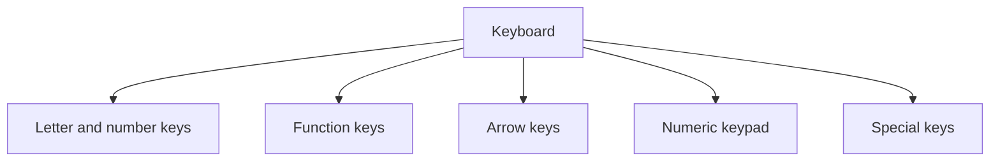

## Goal

By the end of this lesson, you can find the main groups of keys and use the most common keys.

## Why It Matters

The keyboard is the main way to type words into a computer. You will use it to write your name,
messages, letters and much more. When you know where the main keys are, typing becomes much
easier. In this lesson you learn where the keys are. You will practise real typing in Module 2.

**Diagram in words:** A keyboard has five main groups of keys. They are the letter and number
keys, the function keys, the arrow keys, the numeric keypad and the special keys.

## Key Terms

| Term | Simple meaning | Urdu meaning |
|------|----------------|--------------|
| Key | One button on the keyboard. | کی: کی بورڈ کا ایک بٹن |
| Spacebar | The key that puts a space between words. | اسپیس بار: الفاظ کے درمیان جگہ دینے والی کی |
| Backspace | The key that deletes the letter before the place where you are typing. | بیک اسپیس: پچھلا حرف مٹانے والی کی |
| Enter | The key that starts a new line, or says "yes, go ahead". | انٹر: نئی لائن شروع کرنے والی کی |
| Shift | A key you hold down to change what another key types. | شفٹ: دوسری کی کا کام بدلنے والی کی |
| Caps lock | A key that makes all letters capital until you press it again. | کیپس لاک: سب حروف بڑے لکھنے والی کی |
| Arrow keys | Four keys with arrows. They move the place where you type. | ایرو کیز: تیر کے نشان والی چار کیز |
| Function keys | The keys marked F1 to F12. | فنکشن کیز: F1 سے F12 تک کیز |

## Teacher Demo

Use one lab computer that the whole class can see.

1. Hold up the keyboard. Say: "The keyboard is the main way to type into the computer."
2. Point to the **letter keys**, then to the **number keys**.
3. Point to the **function keys**. Say: "These are F1 to F12."
4. Point to the four **arrow keys**.
5. Point to the **numeric keypad**, if the keyboard has one. Say: "This is another set of number
   keys."
6. Point to the special keys one by one: **Spacebar**, **Enter**, **Backspace**, **Shift** and
   **Caps lock**.
7. Open Notepad. Select **Start**, type **Notepad**, then select **Notepad** from the results.
   *The class sees Notepad open.* These steps are the same on Windows 10 and
   Windows 11.
8. Type your first name. Make a mistake on purpose, then press **Backspace** to delete it.
9. Use the arrow keys to move to the start of your name.

   :::warning[UNVERIFIED]

   Teacher: before class, test these on Windows 11 (laptop) and Windows 10 (lab computer), in
   Notepad. Hold **Shift** and press a letter: you should get a capital letter. Press
   **Caps lock**, type, then press it again: letters should be capital only while it is on.
   **Enter** should start a new line. **Spacebar** should put a space between words.

   :::

10. Show the class Shift, Caps lock, Enter and the Spacebar in Notepad, using what you tested.

## Student Task

Work at your own lab computer. Your teacher opens Notepad for you.

1. Find these keys and touch each one: Spacebar, Enter, Backspace, Shift, Caps lock, F1, and
   one arrow key.
2. Type your first name. Hold **Shift** for the first letter so that it is a capital.
3. Press the **Spacebar**, then type your family name.
4. Type one letter wrong on purpose. Press **Backspace** to delete it, then type the right letter.
5. Press **Enter** to start a new line. Type the name of your city.
6. Show your teacher: your name and your city on two lines, with capital first letters.

## Check Questions

1. Point to the Backspace key. What does it do?
   **Answer:** It deletes the letter before the place where you are typing.
2. Which key puts a space between two words?
   **Answer:** The Spacebar.
3. What are the keys F1 to F12 called?
   **Answer:** Function keys.

## Common Mistakes

- **Leaving Caps lock on** → If all your letters are capital, press Caps lock once to turn it
  off.
- **Pressing Shift after the letter** → Hold Shift down first, then press the letter.
- **Pressing Backspace too many times** → Backspace deletes one letter each time. Press it slowly
  and watch the screen.

## Sources

*For the teacher: these sources were checked before this lesson was written.*

- [Microsoft Style Guide, "Keys and keyboard shortcuts"](https://learn.microsoft.com/en-us/style-guide/a-z-word-list-term-collections/term-collections/keys-keyboard-shortcuts): the correct names of the keys.
- [Microsoft Learn, "Keyboard" design guide](https://learn.microsoft.com/en-us/windows/win32/uxguide/inter-keyboard): the keyboard is the main input device for typing; the groups of keys; Shift changes what another key does; Caps Lock puts the keyboard into a mode. (Written for Windows 7; the page says much of it still applies.)
- [Microsoft Support, "Edit cell contents"](https://support.microsoft.com/en-us/excel/edit-cell-contents): Backspace deletes characters; the arrow keys move the cursor.
- [Microsoft Support, "Help in Notepad"](https://support.microsoft.com/en-us/windows/apps/help-in-notepad): how to open Notepad, the same on Windows 10 and Windows 11.
