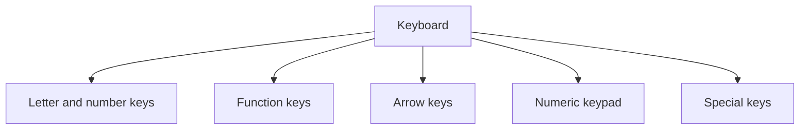

## Goal

By the end of this lesson, you can find the main groups of keys and use the most common keys.

## Why It Matters

The keyboard is the main way to type words into a computer. A shopkeeper types the customer's
name on a bill. A job seeker types an application letter. When you know where the main keys
are, your typing becomes faster. In this lesson you learn where the keys are. You practise real
typing in Module 2.

**Diagram in words:** A keyboard has five main groups of keys. They are the letter and number
keys, the function keys, the arrow keys, the numeric keypad and the special keys.

## Key Terms

| Term | Simple meaning | Urdu meaning |
|------|----------------|--------------|
| Key | One button on the keyboard. | کی: کی بورڈ کا ایک بٹن |
| Spacebar | The key that puts a space between words. | اسپیس بار: الفاظ کے درمیان جگہ دینے والی کی |
| Backspace | The key that deletes the letter before the place where you are typing. | بیک اسپیس: پچھلا حرف مٹانے والی کی |
| Enter | The key that starts a new line, or says "yes, go ahead". | انٹر: نئی لائن شروع کرنے والی کی |
| Shift | A key you hold down to change what another key types. | شفٹ: دوسری کی کا کام بدلنے والی کی |
| Caps lock | A key that makes all letters capital until you press it again. | کیپس لاک: سب حروف بڑے لکھنے والی کی |
| Arrow keys | Four keys with arrows. They move the place where you type. | ایرو کیز: تیر کے نشان والی چار کیز |
| Function keys | The keys marked F1 to F12. | فنکشن کیز: F1 سے F12 تک کیز |

## Step by Step

Follow these steps on your own computer. Look down at your keyboard as you read.

**Find the groups of keys**

Knowing the groups helps you find any key quickly, like knowing the shelves in a shop.

1. Find the **letter keys**, then the **number keys**. You use these to type words and numbers.
2. Find the **function keys**. They are marked F1 to F12.
3. Find the four **arrow keys**. You use them to move around in your typing.
4. Find the **numeric keypad**, if your keyboard has one. It is another set of number keys.
   It helps when you type many numbers, like the prices on a bill.
5. Find the special keys one by one: **Spacebar**, **Enter**, **Backspace**, **Shift** and
   **Caps lock**. You try each one below.

**Try the keys in Notepad**

Notepad is an app where you can type. It is a good place to practise.

6. Open Notepad. Select **Start**, type **Notepad**, then select **Notepad** from the results.
   *You see Notepad open.* These steps are the same on Windows 10 and Windows 11.
7. Type your first name. Make a mistake on purpose, then press **Backspace** to delete it.
   Backspace is like a rubber (eraser): it removes the letter before the place where you type.
8. Use the arrow keys to move to the start of your name. *You see the typing place move.* This
   lets you go back and fix a word.
9. Hold **Shift** and press a letter. *You see a capital letter.* Names start with a capital, so
   you need Shift often.
10. Press **Caps lock** once and type a word. *You see all capital letters.* Press **Caps lock**
    again to turn it off. Caps lock works like a light switch: one press on, one press off.
11. Type two words with one press of the **Spacebar** between them. *You see a space between the
    words.* Without spaces, words run together and are hard to read.
12. Press **Enter**. *You see a new line start.* Enter starts a new line, like the next line in
    your copy.

## Practice

A tuition centre keeps a fee record for each student. You type the top of one record. Use these
made-up details.

| Line | Type this |
|------|-----------|
| 1 | Ayesha Khan |
| 2 | Multan |
| 3 | FEE PAID |

1. Find these keys and touch each one: Spacebar, Enter, Backspace, Shift, Caps lock, F1, and
   one arrow key. This helps your fingers learn where they are.
2. Open Notepad, the same way as in step 6 of Step by Step.
3. Hold **Shift** and press **A**. Let go of Shift, then type **yesha**. A name starts
   with a capital letter.
4. Press the **Spacebar** once, so that the two names stay apart.
5. Type **Khan**. Hold **Shift** for the **K**.
6. Type one extra letter on purpose. Press **Backspace** once to delete it.
7. Press **Enter** to start a new line. Type **Multan**, with a capital **M**.
8. Press **Enter** again. Press **Caps lock** and type **FEE PAID**. Press **Caps lock** again
   to turn it off.
9. Check your work: Notepad shows three lines. They are **Ayesha Khan**, then **Multan**, then
   **FEE PAID**. There is one space between Ayesha and Khan, and no extra letters.

## Check Questions

1. Point to the Backspace key. What does it do?

   

   
Show answer

   **Answer:** It deletes the letter before the place where you are typing.

   

2. Which key puts a space between two words?

   

   
Show answer

   **Answer:** The Spacebar.

   

3. What are the keys F1 to F12 called?

   

   
Show answer

   **Answer:** Function keys.

   

## Common Mistakes

- **Leaving Caps lock on** → If all your letters are capital, press Caps lock once to turn it
  off.
- **Pressing Shift after the letter** → Hold Shift down first, then press the letter.
- **Pressing Backspace too many times** → Backspace deletes one letter each time. Press it slowly
  and watch the screen.

## Sources

*These official pages were checked when this lesson was written.*

- [Microsoft Style Guide, "Keys and keyboard shortcuts"](https://learn.microsoft.com/en-us/style-guide/a-z-word-list-term-collections/term-collections/keys-keyboard-shortcuts): the correct names of the keys.
- [Microsoft Learn, "Keyboard" design guide](https://learn.microsoft.com/en-us/windows/win32/uxguide/inter-keyboard): the keyboard is the main input device for typing; the groups of keys; Shift changes what another key does; Caps Lock puts the keyboard into a mode. (Written for Windows 7; the page says much of it still applies.)
- [Microsoft, "Using your keyboard" (archived Microsoft Windows help page, December 2015)](https://web.archive.org/web/20151223231731/http://windows.microsoft.com/en-us/windows/using-keyboard): "Press Shift in combination with a letter to type an uppercase letter"; "Press Caps Lock once to type all letters as uppercase. Press Caps Lock again to turn this function off"; Enter moves "to the beginning of the next line"; the Spacebar moves "one space forward". (Written for Windows 7.)
- [Microsoft Style Guide, "toggle"](https://learn.microsoft.com/en-us/style-guide/a-z-word-list-term-collections/t/toggle): "Use the Caps lock key to switch from typing capital letters to typing lowercase letters."
- [Microsoft Support, "Edit cell contents"](https://support.microsoft.com/en-us/excel/edit-cell-contents): Backspace deletes characters; the arrow keys move the cursor.
- [Microsoft Support, "Help in Notepad"](https://support.microsoft.com/en-us/windows/apps/help-in-notepad): how to open Notepad, the same on Windows 10 and Windows 11.
