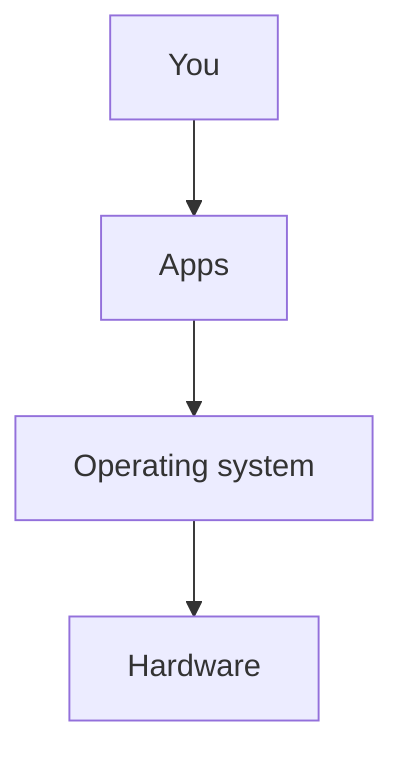
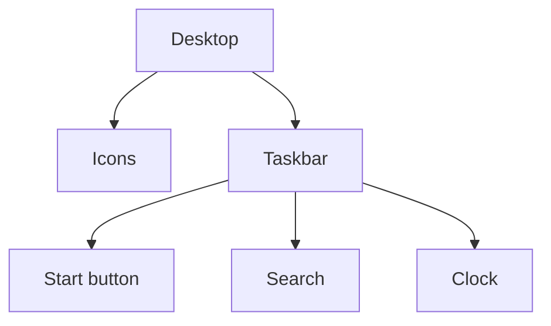

import Tabs from '@theme/Tabs';
import TabItem from '@theme/TabItem';

## Goal

By the end of this lesson, you can say what an operating system does, and use the desktop, the
Start menu, the taskbar and a window.

## Why It Matters

Every time you turn on a computer, you see the desktop first. You open every program from here.
When you know the parts of the desktop, you can find your way on any Windows computer. You can
use one at school, in an office, or at a shop in your city.

In [Lesson 1.2](./hardware-and-software.mdx), you learned that Windows is software. Windows is a
special kind of software called an **operating system**. It is the main software on the computer.
It runs your apps. It controls the hardware, and it looks after your files.

**Diagram in words:** You use apps, such as Notepad. The apps work through the operating system,
and the operating system controls the hardware.

## Key Terms

| Term | Simple meaning |
|------|----------------|
| Operating system | The main software on a computer. It runs apps and controls the hardware. Windows is an operating system. |
| Desktop | The main work area on the screen. You see it after Windows starts. |
| Icon | A small picture that stands for something you can open, such as an app or a folder. |
| Taskbar | The long bar at the edge of the screen, usually at the bottom. The Start button is on it. |
| Start menu | The list that opens when you select Start. It shows your apps. |
| Search | A place on the taskbar where you type the name of an app to find it. |
| Window | The box on the screen where an open program shows its work. The bar at its top is the **title bar**. |
| Window buttons | Three small buttons on a window: **Minimize** (take out of view), **Maximize** (make bigger) and **Close**. After Maximize, that button becomes **Restore**. |

**Diagram in words:** The desktop has icons and a taskbar. On the taskbar you find the Start
button, Search and the clock.

## Teacher Demo

Use one lab computer that the whole class can see. Start it up as in
[Lesson 1.4](./starting-up-and-shutting-down.mdx).

**The desktop**

1. Wait until Windows is ready. Say: "This is the **desktop**. It is our work area." *The class
   sees the desktop.*
2. Say: "Windows is the operating system. It runs every app we use."
3. Point to the icons on the desktop. Say: "Each small picture is an **icon**."
4. Point to the **Recycle Bin** icon. Say: "We will use this in
   [Lesson 1.8](./files-folders-saving-deleting.mdx)."

:::info[Screenshot to add]

The lab computer's desktop, with the icons, the Recycle Bin and the taskbar labelled.

:::

**The taskbar**

5. Point to the long bar at the bottom of the screen. Say: "This is the **taskbar**."
6. Point to the **Start** button, then to **Search** next to it.

<Tabs groupId="windows-version">
<TabItem value="win10" label="Windows 10">

The **Start** button is the first item on the taskbar, on the left side. **Search** is to the
right of the Start button.

</TabItem>
<TabItem value="win11" label="Windows 11">

The taskbar icons are in the middle of the taskbar. This is the usual setting. The **Start**
button is the first icon. **Search** is to the right of the Start button.

</TabItem>
</Tabs>

7. Point to the clock at the right end of the taskbar. *The class sees the time.*

**Opening and closing a program**

These steps are the same on Windows 10 and Windows 11.

8. Select **Start**. *The class sees the Start menu open.* Say: "One click is enough here."
9. Type **Notepad**, then select **Notepad** from the results. *The class sees Notepad open in a
   window.* Do not type anything in Notepad today.
10. Point to the bar at the top of the window. Say: "This is the title bar. It shows the name of
    the program."
11. Point to the three window buttons: **Minimize**, **Maximize** and **Close**. Say: "**Close**
    is always the last one."

    :::warning[UNVERIFIED]

    Teacher: before class, check on Windows 11 (laptop) and Windows 10 (lab computer) that the
    three buttons are at the top-right of the Notepad window, in this order: Minimize, Maximize,
    Close. Also check step 13: after Minimize, selecting the Notepad icon on the taskbar should
    bring the window back.

    :::

12. Select **Maximize**. *The class sees the window get bigger.* The Maximize button changes to a
    **Restore** button. Select **Restore**. *The window goes back to its size.*
13. Select **Minimize**. *The class sees the window go out of view.* Select the Notepad icon on
    the taskbar to bring it back.
14. Select **Close**. *Notepad closes. The class sees the desktop again.*

## Student Task

Work at your own lab computer. Your teacher shows you where the parts are on your version of
Windows.

1. Look at the desktop. Point to one icon and to the Recycle Bin.
2. Point to the taskbar, the **Start** button, **Search** and the clock.
3. Select **Start**. Type **Notepad**, then select **Notepad** from the results.
4. Point to the title bar. Read the name of the program.
5. Select **Maximize**, then select **Restore**.
6. Select **Minimize**. Bring the window back the way your teacher showed you.
7. Select **Close**.
8. Do steps 3 to 7 two more times, until you can do them without help.
9. Show your teacher: Notepad open in a window, then closed with the **Close** button.

## Check Questions

1. What does an operating system do?
   **Answer:** It is the main software on the computer. It runs the apps and controls the
   hardware.
2. Point to the taskbar and the Start button on your computer.
   **Answer:** The taskbar is the long bar, usually at the bottom of the screen. The Start button
   is the first item on it.
3. Which window button closes a program?
   **Answer:** The **Close** button. It is the last of the three window buttons.

## Common Mistakes

- **Double-clicking in the Start menu** → In the Start menu, one click opens an app.
- **Selecting Minimize when you want to close the program** → Minimize only takes the window out
  of view. Select **Close** to close the program.
- **Looking for the Start button on the left in Windows 11** → In Windows 11, the taskbar icons
  are usually in the middle. The Start button is the first one.

## Sources

*For the teacher: these sources were checked before this lesson was written.*

- [Microsoft, "What Is an Operating System?"](https://www.microsoft.com/en-us/windows/learning-center/what-is-an-operating-system): an operating system manages your apps, hardware and files, and runs applications; Windows is an operating system.
- [Microsoft Style Guide, "desktop"](https://learn.microsoft.com/en-us/style-guide/a-z-word-list-term-collections/d/desktop): the desktop is the work area on the Windows screen.
- [Microsoft Style Guide, "icon"](https://learn.microsoft.com/en-us/style-guide/a-z-word-list-term-collections/i/icon): an icon is a picture of something you can select and open, such as a folder, document or app.
- [Microsoft Support, "Customize the Desktop Icons in Windows"](https://support.microsoft.com/en-us/windows/experience/personalization/customize-the-desktop-icons-in-windows): applies to Windows 11 and Windows 10; the desktop is the first screen you see after you sign in; Windows puts the Recycle Bin icon on the desktop by default.
- [Microsoft Support, "Navigate and explore the Windows taskbar"](https://support.microsoft.com/en-us/accessibility/windows/navigate-and-explore-the-windows-taskbar): Windows 10 and Windows 11 tabs; the taskbar is usually at the bottom of the screen; Start is the first item; Search is to the right of Start; the Clock is at the right end of the taskbar.
- [Microsoft Support, "Customize the Taskbar in Windows"](https://support.microsoft.com/en-us/windows/experience/personalization/customize-the-taskbar-in-windows): by default, the taskbar is centred in Windows 11.
- [Microsoft Support, "Find your files and apps in Windows"](https://support.microsoft.com/en-us/windows/find-all-your-apps-and-programs-cadb9c4b-459d-dfcb-2964-14aac1d7d964): Windows 10 and Windows 11 tabs; Start shows your apps in a list; you can type the name of an app in Search.
- [Microsoft Support, "Help in Notepad"](https://support.microsoft.com/en-us/windows/help-in-notepad-4d68c388-2ff2-0e7f-b706-35fb2ab88a8c): applies to Windows 10 and Windows 11; open Notepad by selecting Start, typing Notepad, then selecting Notepad from the results.
- [Microsoft Learn, "Windows app title bar"](https://learn.microsoft.com/en-us/windows/apps/design/basics/titlebar-design): the title bar is at the top of an app; it shows the app's title and lets you minimize, maximize or close the app.
- [Microsoft Learn, "Title Bars: Design Guidelines"](https://learn.microsoft.com/en-us/previous-versions/windows/desktop/bb226827(v=vs.85)): the Close, Minimize, Maximize and Restore buttons; Close is always the rightmost button; Minimize comes before Maximize; Restore replaces Maximize after you maximize. (An older Microsoft guide; positions are in the UNVERIFIED box for testing.)
- [Microsoft Learn, "Windows 7 Mouse and Pointers"](https://learn.microsoft.com/en-us/windows/win32/uxguide/inter-mouse): opening programs in the Start menu needs a single click. (Written for Windows 7; the page says much of it still applies.)
