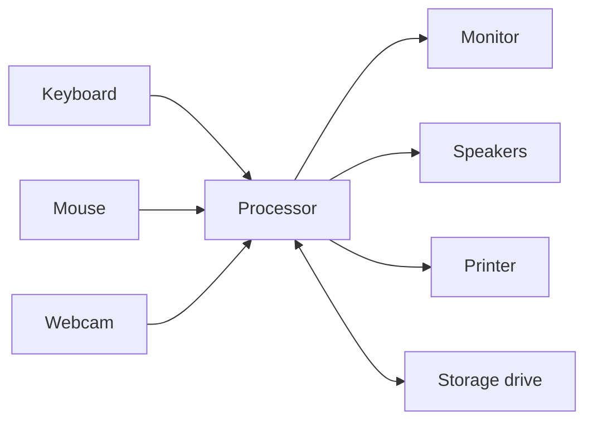

## Goal

By the end of this lesson, you can point to the main parts of a computer and say what each one
does.

## Why It Matters

Every part of a computer has a job. In [Lesson 1.1](./what-is-a-computer.mdx), you learned the
four jobs: input, processing, output and storage. Now you will see which part does which job.
At a shop, the printer gives the customer a paper bill. At a school, the monitor shows a
student's result card before it is printed. When you know the parts, you can follow the steps
in this book. You can also say clearly what is wrong if a part stops working.

**Diagram in words:** The keyboard, mouse and webcam give input. The processor does the
processing. The monitor, speakers and printer give output. The storage drive keeps information.

## Key Terms

| Term | Simple meaning | Urdu meaning |
|------|----------------|--------------|
| Monitor | The screen of a desktop computer. It shows output. | مانیٹر: کمپیوٹر کی اسکرین |
| Computer case | The box that holds the main parts of the computer inside it. | کمپیوٹر کیس: وہ ڈبہ جس کے اندر کمپیوٹر کے اہم حصے ہوتے ہیں |
| Processor (CPU) | A small chip inside the case. It works like the computer's brain. | پروسیسر: کمپیوٹر کا دماغ |
| Storage drive | The part inside the case that keeps software and information, even when the power is off. | اسٹوریج ڈرائیو: معلومات محفوظ رکھنے والا حصہ |
| Webcam | A small camera on the computer. It gives input. | ویب کیم: کمپیوٹر کا کیمرہ |
| Printer | A machine that puts output on paper. | پرنٹر: کاغذ پر چھاپنے والی مشین |

## Step by Step

Sit at your computer. You will find each part and say its job. **Do not unplug or move any
cable.** You only need to look and point.

1. Point to the keyboard and the mouse. These give **input**. You use them to give information
   to the computer.
2. Look for a webcam. It is a small camera. If your computer has one, point to it. It also
   gives **input**.
3. Point to the monitor. It shows **output**. A monitor is like a TV screen for the computer.
4. Look for speakers or headphones. If your computer has them, point to them. They give
   **output** as sound.
5. Look for a printer. If there is one near you, point to it. The printer gives **output** on
   paper, like the bill a shop gives you.
6. Point to the computer case. This box is the computer case. The main parts are inside it. Do
   not open it. You only need to know what is inside.
7. Think about the inside of the case. The **processor** is there. It is a small chip. It
   works like the computer's brain. It does the **processing**.
8. The **storage drive** is also inside the case. It keeps software and information, even when
   the power is off. This is **storage**. It is like a cupboard where your things stay safe
   until you need them.
9. Look at the diagram above. Find each part, then say its job. This helps you remember which
   part does which job.

## Practice

Ayesha works in a school office. Every term, she makes result cards on a computer. Find the
part that does each job in her work. You need one sheet of paper and a pen.

1. Make a table on your paper with two columns: **Part** and **Job**. A table keeps each part
   next to its job.
2. Write these parts in the Part column: keyboard, mouse, webcam, monitor, speakers or
   headphones, printer, computer case.
3. For each part, write its job: input, processing, output or storage. For the computer case,
   write the jobs of the parts inside it.
4. Now think about Ayesha's day. Write which part she uses for each task:
   - (a) typing a student's marks
   - (b) seeing the result card on the screen
   - (c) printing the result card on paper
   - (d) keeping the result cards for next year
5. Go to your computer. Point to each part from your table that you can find. Say its name and
   its job out loud.
6. Check your work: keyboard, mouse and webcam are **input**. Monitor, speakers or headphones,
   and printer are **output**. The computer case holds the processor (**processing**) and the
   storage drive (**storage**). For Ayesha: (a) keyboard, (b) monitor, (c) printer, (d)
   storage drive.

## Check Questions

1. Point to the monitor. What is its job?
   **Answer:** Output. It shows information on the screen.
2. Which part works like the computer's brain? Where is it?
   **Answer:** The processor (CPU). It is inside the computer case.
3. Is the printer an input part or an output part?
   **Answer:** Output. It puts information on paper.

## Common Mistakes

- **Calling the whole box "the CPU"** → The CPU is a small chip inside the box. The box is the
  computer case.
- **Thinking the monitor is the whole computer** → The monitor only shows output. The processor
  and the storage drive are inside the case.
- **Pulling cables to look at the parts** → Never pull or unplug a cable. Point to the parts
  only.

## Sources

*These official pages were checked when this lesson was written.*

- [Code.org CS Discoveries, Lesson "Input and Output"](https://curriculum.code.org/csd-18/unit1/5/): keyboard, mouse and camera as inputs; screen, speakers, printer and headphones as outputs.
- [Microsoft Style Guide, "Computer and device terms"](https://learn.microsoft.com/en-us/style-guide/a-z-word-list-term-collections/term-collections/computer-device-terms): a monitor is a standalone display for a desktop computer; a display is a visual output device.
- [Microsoft Support, "Common PC and device terms"](https://support.microsoft.com/en-us/windows/hardware/common-pc-and-device-terms): the processor (CPU) acts like the computer's brain.
- [Stanford CS101, "Computer Hardware"](https://web.stanford.edu/class/cs101/hardware-1.html): the CPU is a small chip; persistent storage keeps information when the power is off.
- [Dell Support, "A Basic Guide to Identifying the Major Components in a Desktop"](https://www.dell.com/support/kbdoc/en-us/000138912/a-basic-guide-to-identifying-the-major-components-in-a-desktop-system): the storage drive holds the software and data; the parts are fixed inside the case.
