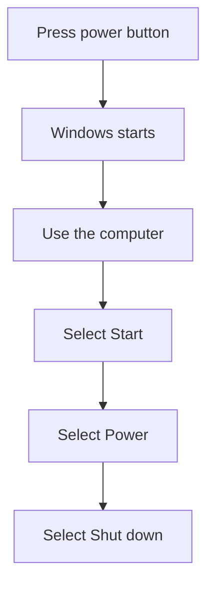

## Goal

By the end of this lesson, you can turn the computer on and shut it down the correct way.

## Why It Matters

You turn on a computer every time you want to use it. You shut it down when you finish. A
shopkeeper turns on the shop computer in the morning to make bills. A tuition centre computer
holds the fee record, so it must be shut down safely at night. If you turn a computer off the
wrong way, you can lose your work.

A computer keeps the work you are doing in its memory. When the power goes off, work you have
not saved is gone. This memory is like writing on a whiteboard. When the power goes, the board
is wiped clean. Shutting down the correct way keeps your work and the computer safe.

**Diagram in words:** Press the power button and wait for Windows to start. When you finish,
select Start, then Power, then Shut down.

## Key Terms

| Term | Simple meaning | Urdu meaning |
|------|----------------|--------------|
| Power button | The button you press to turn the computer on. | پاور بٹن: کمپیوٹر آن کرنے کا بٹن |
| Start up | Turning the computer on and waiting until it is ready to use. | اسٹارٹ اپ: کمپیوٹر آن کرنا |
| Shut down | Turning the computer off the correct way, from Windows. | شٹ ڈاؤن: کمپیوٹر کو صحیح طریقے سے بند کرنا |
| Start | The button on the screen where you begin. You use it to shut down. | اسٹارٹ: اسکرین پر وہ بٹن جہاں سے کام شروع ہوتا ہے |
| Select | To choose something on the screen, usually by clicking it with the mouse. | سلیکٹ: اسکرین پر کسی چیز کو چننا |

## Step by Step

Follow these steps on your own computer. The steps work the same way on **Windows 10** and
**Windows 11**.

You will learn the mouse properly in [Lesson 1.5](./using-the-mouse.mdx). If selecting
things on the screen is new for you, ask someone to help you today.

**Starting up**

1. Make sure the computer is off. You start from the beginning, so that you see every step.

   :::tip[If your computer looks different]

   The power button is in a different place on different computers. Look on the front of the
   computer case and on the monitor. Ask for help if you cannot find it.

   :::

2. Find the power button. Press it once. *You see the computer start.*
3. Wait. Do not press any keys. Windows is starting. *You see the screen change while Windows
   starts.* Give Windows time to get ready.
4. When Windows is ready, the computer is ready to use.

**Shutting down**

5. Save your work first, so that it is not lost. You will learn how to save in
   [Lesson 1.8](./files-folders-saving-deleting.mdx).
6. Select **Start**. *You see the Start menu open.*
7. Select **Power**.
8. Select **Shut down**. *You see the computer shut down.*
9. Always shut down from Windows. Never turn the computer off at the wall first. Work that is
   not saved is lost when the power goes off.

## Practice

Imagine you work at a tuition centre office. You open the office in the morning and you close
it in the evening. Practise the start and the end of your working day.

1. Find the power button on your computer.
2. Press the power button once. This is the start of your working day.
3. Wait without pressing any keys until Windows is ready. This gives Windows time to start.
4. Now it is the end of the day. Select **Start**, then **Power**, then **Shut down**. This
   turns the computer off the correct way before you leave.
5. Check your work: your computer turned on after one press of the power button, and Windows
   became ready to use. Then it shut down after you selected **Start**, **Power** and **Shut
   down**. You did not turn it off at the wall.

## Check Questions

1. Show how you start the computer.

   

   
Show answer

   **Answer:** Press the power button once, then wait for Windows to start.

   

2. What three things do you select to shut down the computer?

   

   
Show answer

   **Answer:** Start, then Power, then Shut down.

   

3. Why should you shut down from Windows, not at the wall?

   

   
Show answer

   **Answer:** Work that is not saved is lost when the power goes off.

   

## Common Mistakes

- **Turning the computer off at the wall without shutting down** → Always select Start, then
  Power, then Shut down first.
- **Pressing keys again and again while the computer starts** → Press the power button once, then
  wait.
- **Leaving without shutting down at the end of the day** → Shut down the computer every time
  before you leave.

## Sources

*These official pages were checked when this lesson was written.*

- [Microsoft Support, "Shut down, sleep, or hibernate your PC"](https://support.microsoft.com/en-us/windows/experience/power-battery/shut-down-sleep-or-hibernate-your-pc): the shut-down steps (Start, then Power, then Shut down), the same on Windows 10 and Windows 11; the power button is used to start working.
- [Stanford CS101, "Software-1 Running"](https://web.stanford.edu/class/cs101/software-1.html): the operating system runs when the computer first starts up.
- [Stanford CS101, "Computer Hardware"](https://web.stanford.edu/class/cs101/hardware-1.html): the computer's working memory is not kept when the power is turned off.
- [Microsoft, "What Is an Operating System?"](https://www.microsoft.com/en-us/windows/learning-center/what-is-an-operating-system): Windows is an operating system.
