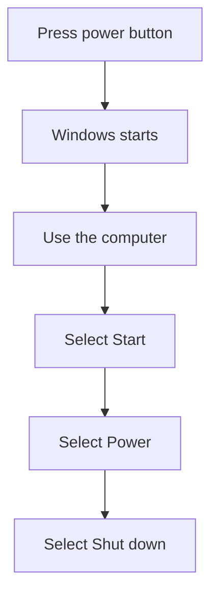

## Goal

By the end of this lesson, you can turn the computer on and shut it down the correct way.

## Why It Matters

You start every class by turning on a computer. You end every class by shutting it down. If
you turn it off the wrong way, you can lose your work. A computer keeps the work you are doing
in its memory. When the power goes off, work you have not saved is gone. Shutting down the
correct way keeps your work and the computer safe.

**Diagram in words:** Press the power button and wait for Windows to start. When you finish,
select Start, then Power, then Shut down.

## Key Terms

| Term | Simple meaning | Urdu meaning |
|------|----------------|--------------|
| Power button | The button you press to turn the computer on. | پاور بٹن: کمپیوٹر آن کرنے کا بٹن |
| Start up | Turning the computer on and waiting until it is ready to use. | اسٹارٹ اپ: کمپیوٹر آن کرنا |
| Shut down | Turning the computer off the correct way, from Windows. | شٹ ڈاؤن: کمپیوٹر کو صحیح طریقے سے بند کرنا |
| Start | The button on the screen where you begin. You use it to shut down. | اسٹارٹ: اسکرین پر وہ بٹن جہاں سے کام شروع ہوتا ہے |
| Select | To choose something on the screen, usually by clicking it with the mouse. | سلیکٹ: اسکرین پر کسی چیز کو چننا |

## Teacher Demo

Use one lab computer that the whole class can see. The steps work the same way on **Windows 10**
and **Windows 11**.

**Starting up**

1. Make sure the computer is off. Say: "Now we will start up the computer."

   :::warning[UNVERIFIED]

   Where the power button is depends on the computer model. Teacher: before class, find the power
   button on the lab computer case and on the monitor, and check that pressing it once starts the
   computer.

   :::

2. Point to the power button. Press it once. *The class watches the computer start.*
3. Say: "Now we wait. Do not press any keys. Windows is starting." *The class sees the screen
   change while Windows starts.*
4. When Windows is ready, say: "The computer is ready to use."

**Shutting down**

5. Say: "Before we shut down, we save our work." (You will learn how to save in Lesson 1.8.)
6. Select **Start**. *The class sees the Start menu open.*
7. Select **Power**.
8. Select **Shut down**. *The class watches the computer shut down.*
9. Say: "Always shut down from Windows. Never turn the computer off at the wall first."

## Student Task

Work at your own lab computer. You will learn the mouse properly in Lesson 1.5. Today, your
teacher helps you click.

1. Find the power button on your computer. Your teacher shows you where it is.
2. Press the power button once.
3. Wait without pressing any keys until Windows is ready.
4. With your teacher's help, select **Start**, then **Power**, then **Shut down**.
5. Show your teacher: your computer turning on, and your computer shutting down the correct way.

## Check Questions

1. Show how you start the computer.
   **Answer:** Press the power button once, then wait for Windows to start.
2. What three things do you select to shut down the computer?
   **Answer:** Start, then Power, then Shut down.
3. Why should you shut down from Windows, not at the wall?
   **Answer:** Work that is not saved is lost when the power goes off.

## Common Mistakes

- **Turning the computer off at the wall without shutting down** → Always select Start, then
  Power, then Shut down first.
- **Pressing keys again and again while the computer starts** → Press the power button once, then
  wait.
- **Leaving without shutting down at the end of class** → The lab rule is to shut down every
  computer before you leave.

## Sources

*For the teacher: these sources were checked before this lesson was written.*

- [Microsoft Support, "Shut down, sleep, or hibernate your PC"](https://support.microsoft.com/en-us/windows/experience/power-battery/shut-down-sleep-or-hibernate-your-pc): the shut-down steps (Start, then Power, then Shut down), the same on Windows 10 and Windows 11; the power button is used to start working.
- [Stanford CS101, "Software-1 Running"](https://web.stanford.edu/class/cs101/software-1.html): the operating system runs when the computer first starts up.
- [Stanford CS101, "Computer Hardware"](https://web.stanford.edu/class/cs101/hardware-1.html): the computer's working memory is not kept when the power is turned off.
- [Microsoft, "What Is an Operating System?"](https://www.microsoft.com/en-us/windows/learning-center/what-is-an-operating-system): Windows is an operating system.
