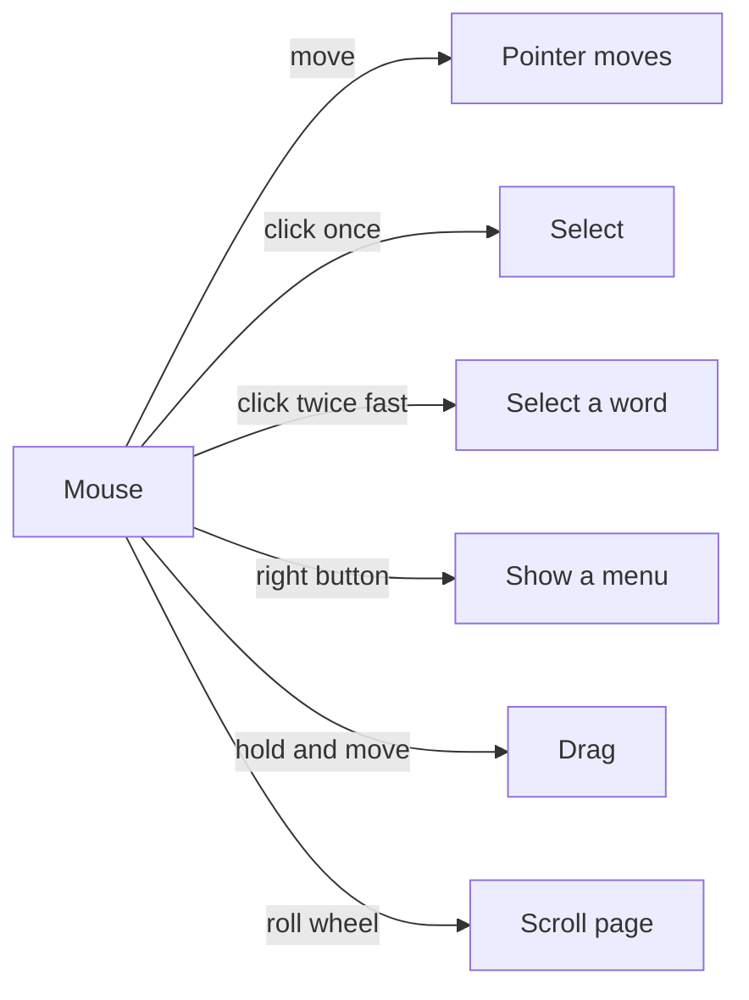

## Goal

By the end of this lesson, you can point, click, double-click, right-click and drag with the
mouse.

## Why It Matters

You use the mouse in almost every computer lesson. With the mouse, you choose things on the
screen, open them and move them. Good mouse skills make every later lesson easier and faster.

When you move the mouse on the table, an arrow on the screen moves too. This arrow is called
the **pointer**. A mouse has a **left button**, a **right button** and a **wheel** between them.

**Diagram in words:** Move the mouse to move the pointer. Click once to select. Click twice fast
to double-click. Press the right button to see a menu. Hold the button and move to drag. Roll
the wheel to scroll.

## Key Terms

| Term | Simple meaning | Urdu meaning |
|------|----------------|--------------|
| Pointer | The arrow on the screen that moves when you move the mouse. | پوائنٹر: اسکرین پر تیر کا نشان جو ماؤس کے ساتھ چلتا ہے |
| Click | Press and let go of the left button once. | کلک: بائیں بٹن کو ایک بار دبانا |
| Double-click | Click the left button two times, very fast. | ڈبل کلک: بائیں بٹن کو دو بار تیزی سے دبانا |
| Right-click | Press the right button once. It shows a menu. | رائٹ کلک: دائیں بٹن کو ایک بار دبانا |
| Drag | Hold the left button down, move the mouse, then let go. | ڈریگ: بٹن دبا کر ماؤس کو کھینچنا |
| Scroll | Roll the wheel to move the page up or down. | اسکرول: پہیہ گھما کر صفحہ اوپر نیچے کرنا |

## Teacher Demo

Use one lab computer that the whole class can see. Keep this page open on the screen.

1. Hold up the mouse. Show the left button, the right button and the wheel.
2. **Point:** Move the mouse slowly on the table. Move the pointer onto a lesson name in the
   sidebar, but do not click. *The class sees the pointer change to a small hand.*
3. **Click:** Keep the mouse still. Press and let go of the left button once. *The class sees
   that lesson open.* Then click "1.5 Using the Mouse" in the sidebar to come back.
4. **Double-click:** Point to one word on this page. Click two times, very fast. *The class sees
   the word become highlighted (selected).*
5. **Right-click:** Point to an empty part of this page. Press the right button once. *The class
   sees a small menu appear.*

   :::warning[UNVERIFIED]

   To close the menu, click once on an empty part of the page. Teacher: check this on the lab
   computer before class.

   :::

6. **Drag:** Point to the start of a sentence. Hold the left button down. Move the mouse to the
   end of the sentence. Let go. *The class sees the sentence become highlighted.*
7. **Scroll:** Roll the wheel towards you, then away from you. *The class sees the page move
   down, then up.*
8. Click once on an empty part of the page to remove the highlight.

## Student Task

Work at your own lab computer. Open this lesson in the book.

1. **Point:** Move the pointer onto a lesson name in the sidebar. Watch it change to a hand.
2. **Click:** Click "1.1 What Is a Computer?" in the sidebar. Then click "1.5 Using the Mouse" to
   come back.
3. **Double-click:** Double-click the word "mouse" in the Goal section.
4. **Right-click:** Right-click an empty part of the page. Look at the menu. Close it the way
   your teacher showed you.
5. **Drag:** Drag across the first sentence of the Goal section to highlight it.
6. **Scroll:** Scroll down to the Check Questions, then scroll back up.
7. Show your teacher: a double-click on one word, and a drag across one sentence.

## Check Questions

1. Show your teacher how to double-click a word on this page.
   **Answer:** Point to the word and click the left button two times, very fast.
2. Which mouse button shows a menu?
   **Answer:** The right button.
3. What is the arrow on the screen called?
   **Answer:** The pointer.

## Common Mistakes

- **Moving the mouse while clicking** → Keep the mouse still while you press and let go of the
  button.
- **Double-clicking too slowly** → Two slow clicks count as two single clicks. Click two times,
  very fast.
- **Using the right button for a normal click** → Most clicks use the left button. Use the right
  button only to see a menu.

## Sources

*For the teacher: these sources were checked before this lesson was written.*

- [Microsoft Style Guide, "Mouse and mouse interaction terms"](https://learn.microsoft.com/en-us/style-guide/a-z-word-list-term-collections/term-collections/mouse-mouse-interaction-terms): the meanings of pointer, point to, click, double-click, right-click, drag and scroll.
- [Microsoft Learn, "Mouse and Pointers" design guide](https://learn.microsoft.com/en-us/windows/win32/uxguide/inter-mouse): moving the mouse moves the pointer; the left button, right button and wheel; right-clicking shows a menu; the wheel scrolls; double-clicking or dragging over text selects it; links show a hand pointer; users often move the mouse slightly while clicking. (Written for Windows 7; the page says much of it still applies.)
