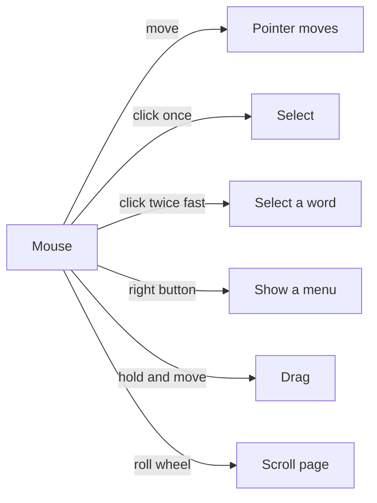

## Goal

By the end of this lesson, you can point, click, double-click, right-click and drag with the
mouse.

## Why It Matters

You use the mouse in almost every computer lesson, to choose, open and move things. A mobile
shop owner clicks to open his stock list every morning. A
student scrolls down a long result page to find her roll number. Good mouse skills make every
later lesson faster.

When you move the mouse on the table, an arrow on the screen moves too. This arrow is called
the **pointer**. Think of it as your finger on the screen. A mouse has a **left button**, a
**right button** and a **wheel** between them.

**Diagram in words:** Move the mouse to move the pointer. Click once to select. Click twice fast
to double-click. Press the right button to see a menu. Hold the button and move to drag. Roll
the wheel to scroll.

## Key Terms

| Term | Simple meaning | Urdu meaning |
|------|----------------|--------------|
| Pointer | The arrow on the screen that moves when you move the mouse. | پوائنٹر: اسکرین پر تیر کا نشان جو ماؤس کے ساتھ چلتا ہے |
| Click | Press and let go of the left button once. | کلک: بائیں بٹن کو ایک بار دبانا |
| Double-click | Click the left button two times, very fast. | ڈبل کلک: بائیں بٹن کو دو بار تیزی سے دبانا |
| Right-click | Press the right button once. It shows a menu. | رائٹ کلک: دائیں بٹن کو ایک بار دبانا |
| Drag | Hold the left button down, move the mouse, then let go. | ڈریگ: بٹن دبا کر ماؤس کو کھینچنا |
| Scroll | Roll the wheel to move the page up or down. | اسکرول: پہیہ گھما کر صفحہ اوپر نیچے کرنا |

## Step by Step

Follow these steps on your own computer. Keep this page open on the screen.

1. Look at your mouse. Find the left button, the right button and the wheel. You need all
   three in this lesson.
2. **Point:** Move the mouse slowly on the table. Move the pointer onto a lesson name in the
   sidebar, but do not click. *You see the pointer change to a small hand.* The hand tells you
   that this is a link you can open.
3. **Click:** Keep the mouse still. Press and let go of the left button once. *You see that
   lesson open.* Then click "1.5 Using the Mouse" in the sidebar, so that you come back here.
4. **Double-click:** Point to one word on this page. Click two times, very fast. *You see the
   word become highlighted (selected).* Selecting is how you choose a word before you change it.
5. **Right-click:** Point to an empty part of this page. Press the right button once. *You see a
   small menu appear.* This menu shows things you can do here. To close the menu, click once on
   an empty part of the page.

   :::tip[If your screen looks different]

   The menu may stay open when you click the empty part. Press the **Esc** key instead. Esc
   closes a menu.

   :::

6. **Drag:** Point to the start of a sentence. Hold the left button down. Move the mouse to the
   end of the sentence. Let go. *You see the whole sentence become highlighted.* Dragging is like
   moving a highlighter pen across a line in your school book.
7. **Scroll:** Roll the wheel towards you, then away from you. *You see the page move down, then
   up.* Scrolling lets you read a long page without losing your place.
8. Click once on an empty part of the page. *The highlight goes away.* Now the page is clean
   again.

## Practice

You are reading a long notice and want to mark one useful line, like with a highlighter pen.
Use this book as your notice. Keep the mouse still each time you click.

1. **Point:** Move the pointer onto "1.6 Keyboard Basics" in the sidebar. Watch it change to a
   hand.
2. **Click:** Click "1.6 Keyboard Basics" to open it. Then click "1.5 Using the Mouse" to come
   back.
3. **Scroll:** Roll the wheel to scroll down to the **Common Mistakes** section of this lesson.
4. **Double-click:** Double-click the word "still" in the first mistake.
5. **Drag:** Drag across the first sentence of the first mistake, so that it is highlighted.
6. **Right-click:** Right-click an empty part of the page. Look at the menu. Close it the same
   way as in step 5 of Step by Step.
7. Click an empty part of the page to remove the highlight. Then scroll back up to the Goal.
8. Check your work: lesson 1.6 opened, and you came back to lesson 1.5. The word "still" was
   highlighted after your double-click. The whole sentence was highlighted after your drag. The
   menu opened and closed, and the page is back at the Goal.

## Check Questions

1. On this page, double-click the word "Pointer" in the Key Terms table. What do you see?

   

   
Show answer

   **Answer:** The word becomes highlighted (selected). You point to the word and click the left
   button two times, very fast.

   

2. Which mouse button shows a menu?

   

   
Show answer

   **Answer:** The right button.

   

3. What is the arrow on the screen called?

   

   
Show answer

   **Answer:** The pointer.

   

## Common Mistakes

- **Moving the mouse while clicking** → Keep the mouse still while you press and let go of the
  button.
- **Double-clicking too slowly** → Two slow clicks count as two single clicks. Click two times,
  very fast.
- **Using the right button for a normal click** → Most clicks use the left button. Use the right
  button only to see a menu.

## Sources

*These official pages were checked when this lesson was written.*

- [Microsoft Style Guide, "Mouse and mouse interaction terms"](https://learn.microsoft.com/en-us/style-guide/a-z-word-list-term-collections/term-collections/mouse-mouse-interaction-terms): the meanings of pointer, point to, click, double-click, right-click, drag and scroll.
- [Microsoft Learn, "Mouse and Pointers" design guide](https://learn.microsoft.com/en-us/windows/win32/uxguide/inter-mouse): moving the mouse moves the pointer; the left button, right button and wheel; right-clicking shows a menu; the wheel scrolls; double-clicking or dragging over text selects it; links show a hand pointer; users often move the mouse slightly while clicking. (Written for Windows 7; the page says much of it still applies.)
- [Microsoft Support, "Keyboard shortcuts in Windows"](https://support.microsoft.com/en-us/accessibility/windows/keyboard-shortcuts-in-windows): applies to Windows 11 and Windows 10; Esc: "Stop or leave the current task." Confirms the backup way in the box.
- [Microsoft Learn, "About Menus"](https://learn.microsoft.com/en-us/windows/win32/menurc/about-menus): a shortcut menu (context menu) usually opens when you right-click; in the standard keyboard controls for menus, "ESC: Exits menu mode."
- [Microsoft, "Using menus, buttons, bars, and boxes" (archived Microsoft Windows help page, January 2016)](https://web.archive.org/web/20160114140556/http://windows.microsoft.com/en-us/windows/using-menus-buttons-bars-boxes): "To close a menu without selecting any commands, click the menu bar or any other part of the window." (Written for Windows 7, so step 5 also gives a backup way in the box.)
