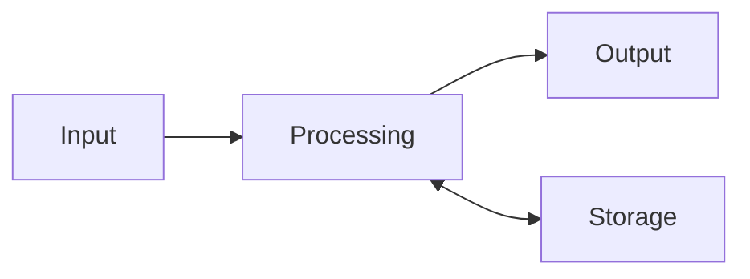

## Goal

By the end of this lesson, you can explain the four jobs of a computer and give an example of
each.

## Why It Matters

A computer is a machine that works with information. It helps people with thinking work. A
shopkeeper uses a computer to make a bill for a customer. A school office uses one to make
result cards. If you know the four jobs of a computer, every new computer skill is easier to
learn.

Every computer does four jobs with information. It takes information in. It works on it. It
gives a result. It keeps information for later.

**Diagram in words:** Information goes in (input). The computer works on it (processing). The
computer gives a result (output). The computer can keep information for later and use it again
(storage).

## Key Terms

| Term | Simple meaning | Urdu meaning |
|------|----------------|--------------|
| Computer | A machine that works with information to help people. | کمپیوٹر: ایک مشین جو معلومات پر کام کرتی ہے |
| Information | Words, numbers, pictures or sounds. | معلومات |
| Input | Information the computer gets. For example, from the keyboard or the mouse. | اِن پُٹ: کمپیوٹر کو دی جانے والی معلومات |
| Processing | The work the computer does to turn input into output. | پروسیسنگ: معلومات پر کام کرنا |
| Output | Information the computer gives. For example, on the screen or from the speakers. | آؤٹ پُٹ: کمپیوٹر سے ملنے والا نتیجہ |
| Storage | Keeping information on the computer for later. | اسٹوریج: معلومات کو بعد کے لیے محفوظ رکھنا |

## Step by Step

Sit at your computer. Keep this page open. You will find each of the four jobs on your own
computer.

1. Look at your computer. Remember: a computer is a machine that works with information.
2. Find the keyboard and the mouse. These give information to the computer. This is
   **input**. Input is like your ears: it is how information comes in.
3. Move the mouse slowly on the table. *You see the arrow on the screen move.* Your hand gave
   input, so the computer moved the arrow.
4. Look at the screen. The screen gives information to you. This is **output**. Output is like
   your mouth when you give an answer.
5. Now think about the inside of the computer. A part inside works on the input. This is
   **processing**. That part is like the computer's brain.
6. Think about saving your work. When you save, the computer keeps your work for later. This
   is **storage**. Storage is like writing in a notebook so that you can read it again later.
7. Look at the diagram above. Read each box in order: Input, Processing, Output, Storage. This
   helps you remember the order of the four jobs.
8. Now try the four jobs yourself, without a computer. Ask yourself: "What is 2 + 3?"
   - You **read** the numbers. This is like input.
   - You **think** about them. This is like processing.
   - You **say** "5". This is like output.
   - You **remember** it next time. This is like storage.
9. Think of one more example: typing a job application letter. The keys you press are input.
   The computer works on them (processing). The letters show on the screen (output). Saving
   the letter is storage, so that you can print it again tomorrow.

## Practice

Bilal has a mobile shop. He makes a bill for every customer on his computer. Find the four jobs
in his work. You need one sheet of paper and a pen.

1. Draw four boxes on your paper. Write one word in each box: **Input**, **Processing**,
   **Output**, **Storage**. Each box holds one job, so that you can sort the list.
2. Read this list of things from Bilal's shop: keyboard, mouse, camera, microphone, screen,
   speakers, printer, headphones, the computer working out the total of the bill, saving the
   bill for later.
3. Write each thing from the list in the right box. Ask yourself: does it bring information
   in, work on it, give it out, or keep it?
4. Go to your computer. Point to one thing that gives input and one thing that shows output.
   This links your paper answers to a real computer.
5. Check your work: **Input** has keyboard, mouse, camera and microphone. **Processing** has
   the computer working out the total of the bill. **Output** has screen, speakers, printer
   and headphones. **Storage** has saving the bill for later. On your computer, you pointed to
   the keyboard or the mouse (input) and the screen (output).

## Check Questions

1. Which job is each one?
   - (a) typing on the keyboard
   - (b) the computer working out a sum
   - (c) a picture on the screen
   - (d) saving a photo for later

   

   
Show answer

   **Answer:** (a) input, (b) processing, (c) output, (d) storage.

   

2. Point to one thing on your computer that gives input, and one thing that shows output.

   

   
Show answer

   **Answer:** Input: the keyboard or the mouse. Output: the screen.

   

3. What does storage mean?

   

   
Show answer

   **Answer:** Keeping information on the computer for later.

   

## Common Mistakes

- **Mixing up input and output** → Input goes **into** the computer. Output comes **out** to
  you.
- **Thinking output and storage are the same** → Output shows a result now. Storage keeps
  information for later.
- **Thinking the screen is the whole computer** → The screen only shows output. The processing
  happens inside the computer.

## Sources

*These official pages were checked when this lesson was written.*

- [Code.org CS Discoveries, Lesson "What is a Computer?"](https://curriculum.code.org/csd-18/unit1/4/): a computer as a machine that inputs, outputs, stores and processes information, and that helps with thinking work.
- [Code.org CS Discoveries, Lesson "Input and Output"](https://curriculum.code.org/csd-18/unit1/5/): the meanings of input and output, and the examples of each.
- [Code.org CS Discoveries, Lesson "Processing"](https://curriculum.code.org/csd-1718/unit1/6/): processing is the work done to turn an input into an output.
- [Code.org CS Discoveries, Lesson "Apps and Storage"](https://curriculum.code.org/csd-18/unit1/7/): storing information on a device for later.
- [Microsoft Support, "Common PC and device terms"](https://support.microsoft.com/en-us/windows/hardware/common-pc-and-device-terms): the processor acts like the computer's brain.
