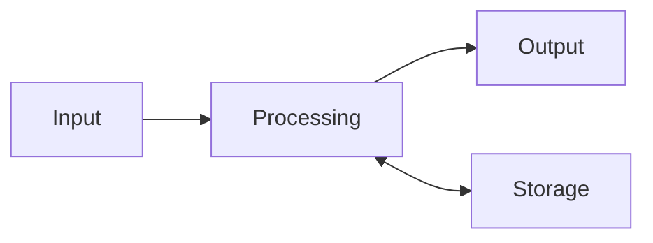

## Goal

By the end of this lesson, you can explain the four jobs of a computer and give an example of
each.

## Why It Matters

A computer is a machine that works with information. It helps people with thinking work. People
use computers at home, at school, in shops and in offices. If you know the four jobs of a
computer, every new computer skill will be easier to learn.

Every computer does four jobs with information. It takes information in. It works on it. It
gives a result. It keeps information for later.

**Diagram in words:** Information goes in (input). The computer works on it (processing). The
computer gives a result (output). The computer can keep information for later and use it again
(storage).

## Key Terms

| Term | Simple meaning | Urdu meaning |
|------|----------------|--------------|
| Computer | A machine that works with information to help people. | کمپیوٹر: ایک مشین جو معلومات پر کام کرتی ہے |
| Information | Words, numbers, pictures or sounds. | معلومات |
| Input | Information the computer gets. For example, from the keyboard or the mouse. | اِن پُٹ: کمپیوٹر کو دی جانے والی معلومات |
| Processing | The work the computer does to turn input into output. | پروسیسنگ: معلومات پر کام کرنا |
| Output | Information the computer gives. For example, on the screen or from the speakers. | آؤٹ پُٹ: کمپیوٹر سے ملنے والا نتیجہ |
| Storage | Keeping information on the computer for later. | اسٹوریج: معلومات کو بعد کے لیے محفوظ رکھنا |

## Teacher Demo

Use one lab computer that the whole class can see. Keep this page open on the screen.

1. Stand next to the computer. Say: "A computer is a machine that works with information."
   *The class sees the computer.*
2. Hold up the keyboard, then the mouse. Say: "These give information to the computer. This is
   **input**." *The class sees the keyboard and the mouse.*
3. Move the mouse slowly on the table. *The class sees the arrow on the screen move.*
4. Point to the screen. Say: "The screen gives information to us. This is **output**."
5. Say: "Inside the computer, a part works on the input. This is **processing**. That part is like
   the computer's brain."
6. Say: "When we save our work, the computer keeps it for later. This is **storage**."
7. Show the diagram above. Point to each box in order: Input, Processing, Output, Storage.
8. Ask one student: "What is 2 + 3?" When the student answers, explain:
   - The student **heard** the numbers. This is like input.
   - The student **thought** about them. This is like processing.
   - The student **said** the answer. This is like output.
   - The student will **remember** it. This is like storage.
9. Give one more example: typing a letter. The keys you press are input. The computer works on
   them (processing). The letters show on the screen (output). Saving the letter is storage.

## Student Task

Work in pairs. You need one sheet of paper and a pen.

1. Draw four boxes on your paper. Write one word in each box: **Input**, **Processing**,
   **Output**, **Storage**.
2. Copy this list from the board: keyboard, mouse, camera, microphone, screen, speakers,
   printer, headphones, the computer working out a sum, saving a photo for later.
3. Write each thing from the list in the right box.
4. Go to your lab computer. Point to one thing that gives input and one thing that shows output.
5. Show your teacher: your four boxes, and the input and output things on your computer.

## Check Questions

1. Which job is each one?
   - (a) typing on the keyboard
   - (b) the computer working out a sum
   - (c) a picture on the screen
   - (d) saving a photo for later

   **Answer:** (a) input, (b) processing, (c) output, (d) storage.
2. Point to one thing on the lab computer that gives input, and one thing that shows output.
   **Answer:** Input: the keyboard or the mouse. Output: the screen.
3. What does storage mean?
   **Answer:** Keeping information on the computer for later.

## Common Mistakes

- **Mixing up input and output** → Input goes **into** the computer. Output comes **out** to
  you.
- **Thinking output and storage are the same** → Output shows a result now. Storage keeps
  information for later.
- **Thinking the screen is the whole computer** → The screen only shows output. The processing
  happens inside the computer.

## Sources

*For the teacher: these sources were checked before this lesson was written.*

- [Code.org CS Discoveries, Lesson "What is a Computer?"](https://curriculum.code.org/csd-18/unit1/4/): a computer as a machine that inputs, outputs, stores and processes information, and that helps with thinking work.
- [Code.org CS Discoveries, Lesson "Input and Output"](https://curriculum.code.org/csd-18/unit1/5/): the meanings of input and output, and the examples of each.
- [Code.org CS Discoveries, Lesson "Processing"](https://curriculum.code.org/csd-1718/unit1/6/): processing is the work done to turn an input into an output.
- [Code.org CS Discoveries, Lesson "Apps and Storage"](https://curriculum.code.org/csd-18/unit1/7/): storing information on a device for later.
- [Microsoft Support, "Common PC and device terms"](https://support.microsoft.com/en-us/windows/hardware/common-pc-and-device-terms): the processor acts like the computer's brain.
