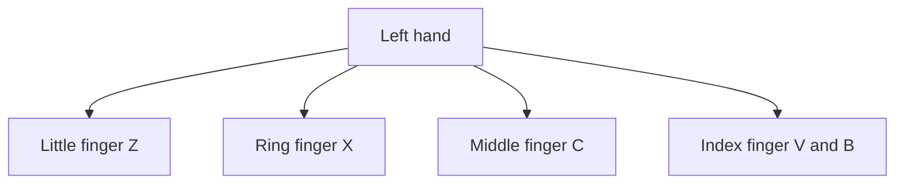
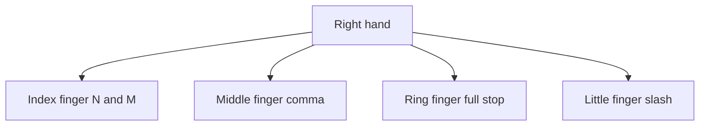

## Goal

By the end of this lesson, you can type the bottom row keys with the correct fingers. These are
Z X C V B N M, the comma, the full stop and the slash. You also come back to the home row after
each one.

## Why It Matters

Many everyday words need the bottom row. A shopkeeper types "cash", "bill" and "naan" on a
receipt. A family writes "bus", "van" and "bank" in a shopping or travel list. Most sentences
end with a full stop, and the full stop is on the bottom row. After this lesson, you can
type every small letter on the keyboard.



**Diagram in words:** On the bottom row, your left little finger presses Z, the ring finger X and
the middle finger C. The left index finger presses two keys, V and B.



**Diagram in words:** On the bottom row, your right index finger presses two keys, N and M. The
middle finger presses the comma, the ring finger the full stop and the little finger the slash.

## Key Terms

| Term | Simple meaning |
|------|----------------|
| Bottom row | The row of keys below the home row: Z X C V B N M, then comma, full stop and slash. |
| Reach down | Moving one finger down from its home key to press a bottom row key. |
| Comma | A small mark that separates words in a list, as in "naan, dal, chai". |
| Full stop | The dot that ends a sentence. It is also called a period. |
| Slash | A sloping line: /. You often see it in dates, such as 14/08/2026. |
| Look-away line | A line you type while you look only at the screen. You met it in [Lesson 2.3](./top-row.mdx). |

## Step by Step

Open Notepad as you learned in
[Lesson 1.6: Keyboard Basics](../module-01-computer-basics/keyboard-basics.mdx), step 6. Put
your hands on the home row, as in [Lesson 2.1](./sitting-right-and-home-row.mdx).

Each bottom row key belongs to the same finger as the key above it. In
[Lesson 2.3](./top-row.mdx), your fingers reached up. Now they reach down, press the key, and
come home. It is like going down the stairs to open the door, then going back up.

**Middle fingers: C and comma**

1. Reach your left middle finger down from **D** to **C**. Press **C**, then go back to **D**.
   Type **dcd dcd**. *You see* dcd dcd *in Notepad.*
2. Reach your right middle finger down from **K** to the **comma** key. Press it, then go back
   to **K**. Type the line below. Start with the middle fingers, then move out to the other fingers.

   ```text
   k,k k,k
   ```

**Index fingers: V, B, M and N**

Each index finger has two bottom row keys. One is below the home key. The other is one key
further towards the middle of the keyboard.

3. Reach your left index finger down from **F** to **V**. Type **fvf fvf**.
4. Reach your left index finger down and towards the middle to **B**. Type **fbf fbf**. B belongs
   to the left hand, so do not use your right hand for it.
5. Reach your right index finger down from **J** to **M**. Type **jmj jmj**.
6. Reach your right index finger down and towards the middle to **N**. Type **jnj jnj**. N
   belongs to the right hand, so do not use your left hand for it.

**Ring fingers: X and full stop**

7. Reach your left ring finger down from **S** to **X**. Type **sxs sxs**.
8. Reach your right ring finger down from **L** to the **full stop** key. Type the line below.
   Ring fingers need extra practice, so go slowly and press firmly.

   ```text
   l.l l.l
   ```

**Little fingers: Z and slash**

9. Reach your left little finger down from **A** to **Z**. Type **aza aza**.
10. Reach your right little finger down from the **;** key to the **slash** key. Type the line
    below. Little fingers need the most practice, so repeat this line if it feels hard.

    ```text
    ;/; ;/;
    ```

**Keep your hands close to home**

11. When one finger reaches down, keep the other fingers near their home keys. Do not move your
    whole hand. Small movements are faster, and they tire your hands less.
12. After each bottom row key, feel for the bumps on **F** and **J**. *You feel your index
    fingers back on the bumps.* Now you are ready for the next key without looking.

**Type words with a comma and a full stop**

13. Type the line below. Copy it exactly, with one space after each comma. You learn capital
    letters in [Lesson 2.5](./capitals-and-punctuation.mdx), so use small letters for now.

    ```text
    naan, sabzi, milk.
    ```

    *You see the words, two commas and a full stop at the end.* Lists like this are on every
    shopping slip.

**Practise with TypingMaster**

14. Open TypingMaster and log in with your name, as in
    [Lesson 2.1](./sitting-right-and-home-row.mdx). Select **Courses** in the menu on the right
    side. *You see the lesson you studied last.*
15. Finish the exercises of that lesson in order. Then go on to the next lesson in the Touch
    Typing Course. This course teaches all the letter keys and common punctuation.
16. In a key drill, wait for the key to turn **green**. Look at the **green dot** on the hands to
    find the finger, as in [Lesson 2.2](./home-row-keys.mdx).

    :::tip[If your screen looks different]

    If you cannot find the next lesson, or your screen does not match these steps, use the
    Notepad drills on this page. They train the same fingers.

    :::

If TypingMaster lets you open only the first lessons, use the Notepad drills on each page.

{/* Screenshot to add: a TypingMaster key drill where a bottom row key is green and a green dot shows the finger. */}

## Practice

Type these drills in Notepad. Press **Enter** at the end of each line. Type names and places in
small letters for now.

Key pairs:

```text
dcd k,k fvf fbf jmj jnj
sxs l.l aza ;/; dcd k,k
```

Words:

```text
bus van cab box zoo
naan bank cash bill
sabzi biryani namak
chawal, sabzi, naan.
```

Phrases:

```text
a van, a bus, a cab.
buy naan, milk and sabzi.
the bank is in the bazaar.
```

Look-away line:

```text
a man in a van has cash.
```

1. Sit right and put your hands on the home row without looking. Feel the bumps on F and J.
   This starts every drill in the right place.
2. Open Notepad. Type each line of key pairs two times. Use the correct finger for each key.
   Go back to the home row after each reach down.
3. Type each line of words two times. Keep a steady rhythm, even when it feels slow. Correct
   letters come first, and speed comes later.
4. Type each phrase two times. Use one space after each comma, as in the drill.
5. Read the look-away line once. Then look only at the screen and type it five times, on five
   lines. Do not look at your hands. This shows whether your fingers know the bottom row.
6. Count the wrong letters and marks in your five look-away lines.
7. If you have TypingMaster, do the next exercises of the Touch Typing Course too.
8. Check your work: every line in Notepad matches the drills above, with commas and full stops
   in the same places. Your five look-away lines have no more than 2 mistakes in total.

## Check Questions

1. Put your hands on the home row. Type **fvf fbf** without looking. Which finger pressed V and B?

   <details>
   <summary>Show answer</summary>

   **Answer:** Your left index finger pressed both V and B. After each one, it went back to F.

   </details>

2. Which finger presses the full stop, and which finger presses the comma?

   <details>
   <summary>Show answer</summary>

   **Answer:** Your right ring finger presses the full stop. Your right middle finger presses the
   comma.

   </details>

3. Point to the Z key. Which finger presses it, and where does that finger go after?

   <details>
   <summary>Show answer</summary>

   **Answer:** Your left little finger presses Z. Then it goes back to its home key, A.

   </details>

## Common Mistakes

- **Pressing N with the left hand** → N belongs to the right index finger. B belongs to the left
  index finger. Type **fbf jnj** slowly until it feels natural.
- **Moving the whole hand down** → Move only the finger that presses the key. Keep the other
  fingers near the home row.
- **Forgetting to come back home** → After each bottom row key, put the finger back on its home
  key. Feel the bumps on F and J.
- **Mixing up the comma and the full stop** → The comma is below K, for the middle finger. The
  full stop is below L, for the ring finger.
- **Looking down at the keys** → Look at the screen. If you get lost, feel for the bumps on F
  and J instead of looking.

## Sources

*These official pages were checked when this lesson was written.*

- [BCcampus, *Key Concepts of Computer Studies*, Unit 2 Topic B, "The base position" (archived copy, January 2026)](https://web.archive.org/web/20260117103740/https://opentextbc.ca/computerstudies/chapter/the-base-position/): the left little finger presses keys including "letters Q, A, and Z"; the left ring finger "letters W, S, and X"; the left middle finger "letters E, D, and C"; the left index finger "letters R, T, F, G, V, and B"; the right index finger "the letters Y, U, H, J, N, and M"; the right middle finger "the letters I and K, and the comma"; the right ring finger "the letters O and L, and the period"; the right little finger presses keys including "the forward slash"; "Keyboards usually have small bumps on the F and J keys"; "Always try to return your fingers to the base position when you are not typing"; "Learn to be accurate first, then improve speed."
- [BCcampus, *Key Concepts of Computer Studies*, Unit 2 Topic A, "Keyboarding skills" (archived copy, December 2025)](https://web.archive.org/web/20251205174836/https://opentextbc.ca/computerstudies/chapter/keyboarding-skills/): "Press each key with the proper finger"; "Each key has to pressed by the same finger all the time"; "keep eyes on the screen rather than the keyboard or hands."
- [University of Waterloo, ECE 150, "Touch typing"](https://ece.uwaterloo.ca/~ece150/Touch_typing/): "The letter z is pressed with the left pinky"; "The letter x is pressed with the left ring finger"; "The letter c is pressed with the left middle finger"; "The letter b is pressed with the left index finger"; "The letter v is also … pressed with the left index finger"; "The letter m is also pressed with the right index finger"; "the right index finger to type the letter n"; "The period . is pressed by the right ring finger"; "The slash / is pressed by the right pinky"; "try to avoid looking at the keyboard."
- [University of Wollongong, "Touch typing"](https://www.uow.edu.au/student/support-services/academic-skills/online-resources/technology-and-software/typing/): "your index, middle and ring fingers move either up or down from their home position"; "you should always use the right fingers for the right keys, and return them to the home position when you have finished"; keeping your fingers "close to the base position" will "improve speed" and "reduce stress on the hands"; "Typing in a rhythm will aid you"; "Pay greater attention to the ring and pinky fingers when training"; if you get stuck, "slide your fingers around until they find the elevated 'tabs' on the F and J keys."
- [TypingMaster 11 User Manual (archived copy)](https://web.archive.org/web/2023/https://www.typingmaster.com/typing-tutor/support/user-manual.html): Touch Typing Course: "you will learn the positions of the letter keys and common punctuation by heart"; the **Courses** menu item: "If you are already studying a course, TypingMaster will go directly to the lesson you have last studied"; "The program will automatically advance from one exercise to the next and from one lesson to the next"; key drill: "the key to be pressed is colored green after a 2 second delay", "A green dot indicates the finger you should use"; in the trial version "Only the first two lessons are accessible."
- [Microsoft Support, "Help in Notepad"](https://support.microsoft.com/en-us/windows/apps/help-in-notepad): how to open Notepad, the same on Windows 10 and Windows 11.
