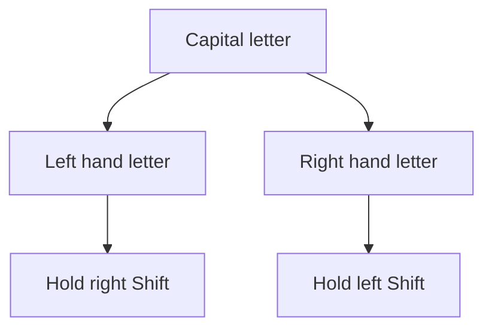
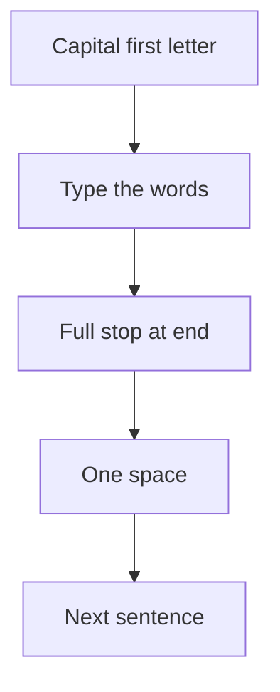

## Goal

By the end of this lesson, you can type capital letters with the correct Shift key. You can also
type the full stop, the comma and the question mark in short sentences.

## Why It Matters

Names always start with a capital letter. A school form needs "Sana Khan", not "sana khan". A
shopkeeper writes "Lahore" or "Multan" on a delivery slip. A job letter is full of sentences, and
each one needs a capital letter and a full stop. Correct capitals and punctuation make your
writing look neat and careful.



**Diagram in words:** Use the Shift key on the other side. If your left hand types the letter,
hold the right Shift. If your right hand types the letter, hold the left Shift.



**Diagram in words:** A sentence starts with a capital letter and ends with a full stop. Then you
press the Spacebar once and start the next sentence.

## Key Terms

| Term | Simple meaning |
|------|----------------|
| Capital letter | A big letter, such as A instead of a. Names and sentences start with one. |
| Small letter | An ordinary letter, such as a. |
| Shift | A key you hold down to change what another key types. You met it in [Lesson 1.6](../module-01-computer-basics/keyboard-basics.mdx). |
| Opposite hand | The hand that does not type the letter. Its little finger holds Shift. |
| Punctuation | Marks such as the full stop, the comma and the question mark. They help people read your sentences. |
| Question mark | The mark ? at the end of a question. |

## Step by Step

Open Notepad as you learned in
[Lesson 1.6: Keyboard Basics](../module-01-computer-basics/keyboard-basics.mdx), step 6. Put
your hands on the home row, as in [Lesson 2.1](./sitting-right-and-home-row.mdx).

**Find the two Shift keys**

1. Look at your keyboard once. Find the **Shift** key on the left side. Then find the **Shift**
   key on the right side. Each hand has its own Shift key.
2. Your left little finger presses the left Shift. Your right little finger presses the right
   Shift. Each little finger reaches out from its home key, **A** or **;**, and then comes back.

**Use the opposite hand for Shift**

Typing a capital is a job for two hands. It is like carrying a big box through a door: one
person holds the door, and the other carries the box.

3. Learn the rule. If your left hand types the letter, hold the **right** Shift. If your right
   hand types the letter, hold the **left** Shift. One hand holds Shift while the other hand
   presses the letter.
4. Type **Ali**. A is a left hand key, so hold the right Shift with your right little finger.
   Press **A**, then let go of both keys. Type **li**. *You see* Ali *in Notepad.*
5. Press the **Spacebar**. Type **Hina**. H is a right hand key, so hold the left Shift with
   your left little finger. Press **H**, let go, then type **ina**. *You see* Ali Hina.
6. Let go of Shift as soon as the capital letter appears. If you hold it too long, the next
   letter is a capital too.
7. Type these names, one on each line. The table shows which Shift to hold. Thinking about the
   hand first trains you to choose the right Shift without looking.

   | Name | First letter is typed by | Hold this Shift |
   |------|--------------------------|-----------------|
   | Sana | left hand | right Shift |
   | Kamran | right hand | left Shift |
   | Faisal | left hand | right Shift |
   | Usman | right hand | left Shift |

8. Do not use **Caps lock** for one capital letter. Caps lock makes every letter capital until
   you press it again ([Lesson 1.6](../module-01-computer-basics/keyboard-basics.mdx)).

**End a sentence with a full stop**

9. Start a new line. Type the sentence below. It starts with a capital letter. Press the full
   stop with your right ring finger, as in [Lesson 2.4](./bottom-row.mdx).

   ```text
   Ali drinks chai.
   ```

10. Press the **Spacebar** once, then type the next sentence. Use one space after a full stop,
    not two. *You see* Ali drinks chai. Sana eats roti.

    ```text
    Ali drinks chai. Sana eats roti.
    ```

**Use a comma in a list**

11. Start a new line. Type the sentence below. Press the comma with your right middle finger.
    Copy the line exactly, with one space after the comma. Commas keep the items of a list
    apart, like the lines on a shopping slip.

    ```text
    Buy naan, dal and milk.
    ```

**End a question with a question mark**

12. Find the key with **?** on it. The **?** is on the upper part of the key. Any mark on the
    upper part of a key needs **Shift**.
13. Press the **?** key with your right little finger. That finger is busy, so hold the **left**
    Shift with your left little finger. Type the question below. *You see the question mark at
    the end.*

    ```text
    Where is Sana?
    ```

**Practise with TypingMaster**

14. Open TypingMaster and log in with your name, as in
    [Lesson 2.1](./sitting-right-and-home-row.mdx). Select **Courses** in the menu on the right
    side. *You see the lesson you studied last.*
15. Finish the exercises in order, then go on to the next lesson in the Touch Typing Course. This
    course teaches the letter keys and common punctuation.
16. In a key drill, look at the **green dot** on the hands to find the finger, as in
    [Lesson 2.2](./home-row-keys.mdx).

    :::tip[If your screen looks different]

    If you cannot find the next lesson, or your screen does not match these steps, use the
    Notepad drills on this page. They train the same fingers.

    :::

If TypingMaster lets you open only the first lessons, use the Notepad drills on each page.

{/* Screenshot to add: a TypingMaster key drill for a capital letter, with green dots on the hands. */}

## Practice

Type these drills in Notepad. Press **Enter** at the end of each line.

Names:

```text
Ali Sana Hina Kamran
Faisal Zara Bilal Usman
```

Places:

```text
Lahore Karachi Multan Quetta
Peshawar Sialkot Hyderabad
```

Sentences:

```text
Ali drinks chai. Sana eats roti.
Buy naan, dal and milk.
Where is the bus to Multan?
Is the shop open today?
```

Look-away line:

```text
Sana and Ali live in Lahore.
```

1. Sit right and put your hands on the home row without looking. Feel the bumps on F and J.
   This starts every drill in the right place.
2. Open Notepad. Type each line of names two times. Before each capital, think: which hand
   types this letter? Then hold the Shift on the other side.
3. Type each line of places two times. Let go of Shift as soon as each capital appears.
4. Type each sentence two times. Copy the spaces exactly: one space after each full stop and
   each comma. Copy every capital letter and every mark too.
5. Read the look-away line once. Then look only at the screen and type it five times, on five
   lines. Do not look at your hands. This shows whether your fingers know the keys.
6. Count your mistakes in the five look-away lines. A wrong capital, a missing full stop or an
   extra space each count as one mistake.
7. If you have TypingMaster, do the next exercises of the Touch Typing Course too.
8. Check your work: every line in Notepad matches the drills above, with capitals, commas, full
   stops and question marks in the same places. Your five look-away lines have no more than 2
   mistakes in total.

## Check Questions

1. Type the name **Faisal** in Notepad. Which Shift key did you hold, and why?

   <details>
   <summary>Show answer</summary>

   **Answer:** The right Shift. Your left hand types F, so the right little finger holds Shift.

   </details>

2. How many spaces do you type after a full stop, before the next sentence?

   <details>
   <summary>Show answer</summary>

   **Answer:** One space. Press the Spacebar once.

   </details>

3. You want to type a question mark. Which finger presses the key, and which Shift do you hold?

   <details>
   <summary>Show answer</summary>

   **Answer:** Your right little finger presses the key. Hold the left Shift with your left little
   finger.

   </details>

## Common Mistakes

- **Using Caps lock for one capital** → Use Shift for one capital letter. If all your letters
  are capital, press Caps lock once to turn it off.
- **Holding Shift with the same hand that types the letter** → Use the Shift on the other side.
  Left hand letter, right Shift. Right hand letter, left Shift.
- **Holding Shift too long, as in "SAna"** → Let go of Shift as soon as the capital appears.
- **Two spaces after a full stop** → Press the Spacebar once after a full stop.
- **A space before a comma or full stop** → Look at the drill. The mark comes straight after
  the word, with no space before it.

## Sources

*These official pages were checked when this lesson was written.*

- [University of Waterloo, ECE 150, "Touch typing"](https://ece.uwaterloo.ca/~ece150/Touch_typing/): "If you want to type a capital letter, if the letter you wish to capitalize is being typed by the left hand, use the right-hand pinky to hold down the Shift key; otherwise, use the left-hand pinky to hold down the other Shift key"; "The period . is pressed by the right ring finger"; "The question mark ? and the colon : are also pressed by the right pinky."
- [BCcampus, *Key Concepts of Computer Studies*, Unit 2 Topic B, "The base position" (archived copy, January 2026)](https://web.archive.org/web/20260117103740/https://opentextbc.ca/computerstudies/chapter/the-base-position/): the left little finger presses keys including "Shift"; the right little finger presses keys including "the shift key"; the right middle finger presses "the comma"; the right ring finger presses "the period"; "Keyboards usually have small bumps on the F and J keys."
- [Microsoft, "Using your keyboard" (archived Microsoft Windows help page, December 2015)](https://web.archive.org/web/20151223231731/http://windows.microsoft.com/en-us/windows/using-keyboard): "Press Shift in combination with a letter to type an uppercase letter. Press Shift in combination with another key to type the symbol shown on the upper part of that key"; "Press Caps Lock once to type all letters as uppercase. Press Caps Lock again to turn this function off." (Written for Windows 7.)
- [Microsoft Style Guide, "Periods"](https://learn.microsoft.com/en-us/style-guide/punctuation/periods): "End all sentences with a period"; "Put one space, not two, after a period."
- [Microsoft Style Guide, "Capitalization"](https://learn.microsoft.com/en-us/style-guide/capitalization): "Always capitalize the first word of a new sentence"; "Capitalize proper nouns" (names of people and places).
- [TypingMaster 11 User Manual (archived copy)](https://web.archive.org/web/2023/https://www.typingmaster.com/typing-tutor/support/user-manual.html): Touch Typing Course: "you will learn the positions of the letter keys and common punctuation by heart"; the **Courses** menu item goes "directly to the lesson you have last studied"; key drill: "A green dot indicates the finger you should use"; in the trial version "Only the first two lessons are accessible."
- [Microsoft Support, "Help in Notepad"](https://support.microsoft.com/en-us/windows/apps/help-in-notepad): how to open Notepad, the same on Windows 10 and Windows 11.
