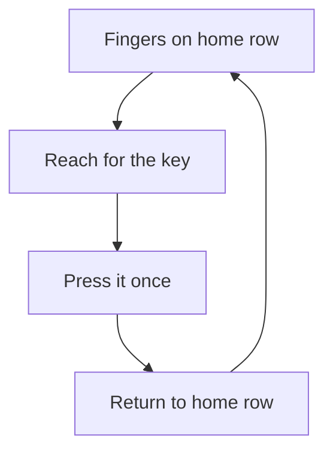
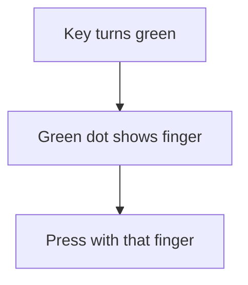

## Goal

By the end of this lesson, you can type home row letters and words with the correct fingers,
without looking at the keys.

## Why It Matters

The home row keys are the first keys every touch typist learns. Many common words use them,
such as "dal", "salad" and "glass". A student who types an assignment without looking finishes
it sooner. A shop assistant who types an order without looking can keep eyes on the customer's
list. Each new row in this module builds on the home row.



**Diagram in words:** Every key press is a small circle. Start on the home row, reach for the
key, press it once, then go back to the home row.

## Key Terms

| Term | Simple meaning |
|------|----------------|
| Home key | The home row key where one finger rests. For example, F is the home key of the left index finger. |
| Reach | Moving one finger from its home key to press another key. |
| Drill | A short line of letters or words that you type again and again to train your fingers. |
| Key drill | A TypingMaster exercise that teaches new keys. It shows a keyboard and two hands. |
| Word drill | A TypingMaster exercise where you copy words made from the keys you have learned. |
| Accuracy | How many of your words are correct, as a percentage. 100% means every word is correct. |
| Rhythm | Pressing keys at a steady speed, like the tick of a clock. |

## Step by Step

Follow these steps in Notepad. Open Notepad as you learned in
[Lesson 1.6: Keyboard Basics](../module-01-computer-basics/keyboard-basics.mdx), step 6.

**Type each home key with its own finger**

1. Put your hands on the home row, as in
   [Lesson 2.1](./sitting-right-and-home-row.mdx). Feel for the bumps on F and J first.
   Every drill starts from here.
2. Type **fff**, press the **Spacebar** with a thumb, then type **jjj**. Use only your index
   fingers. *You see* fff jjj *in Notepad.*
3. Type **ddd kkk** with your middle fingers. Then type **sss lll** with your ring fingers.
   Then type **aaa ;;;** with your little fingers. Each finger has its own key, so no finger
   does another finger's job.
4. Press **Enter** with your right little finger. It reaches right from the **;** key. Then put
   it back on **;**. *You see a new line start.* Now your hands are ready for the next line.

**Reach to G and H, then come back**

The G and H keys sit between your two hands. Your index fingers reach sideways to press them.

5. Move your left index finger one key to the right, from **F** to **G**. Press **G**. Move the
   finger back to **F**. Type **fgf fgf** this way.
6. Move your right index finger one key to the left, from **J** to **H**. Press **H**. Move the
   finger back to **J**. Type **jhj jhj** this way.
7. After each reach, feel the bump on F or J again. Going home after each key keeps your
   fingers in the right place. Then you do not need to look.

**Type your first words**

8. Type these words, with one space after each: **sad dad lad ask has**. Real words train
   your fingers to move from key to key.
9. Type **dal saag salad**. These are foods you know. Familiar words are good practice.
10. Type slowly, at a steady rhythm. Correct letters matter more than speed now. Speed comes
    later, with practice.

**Practise with TypingMaster**

TypingMaster shows you which key to press and which finger to use.

11. Open TypingMaster and log in with your name, as in Lesson 2.1. Select **Courses** in the
    menu on the right side. *You see the lesson you studied last, with its list of exercises.*
12. Select the highlighted exercise. It is the next one you should do. Do the exercises in
    order, from the top, because the course was made to be taken that way.
13. In a key drill, the keys to press are shown at the top. A keyboard and two hands are shown
    below them. Wait a moment, and the key to press turns **green**.

    :::tip[If your screen looks different]

    If you do not see a green key or the two hands, practise with the Notepad drills on this
    page instead. They train the same fingers.

    :::

14. Look at the two hands under the keyboard. A **green dot** shows the finger to use. Press
    the key with that finger. This helps you remember where each key is.
15. In a word drill, copy the words at the top of the screen. You correct a word with
    **Backspace** only before you press the **Spacebar**. After the Spacebar, the word is
    final.
16. At the end of each exercise, read your results. Look at your **Accuracy**. Then select the
    next exercise.
17. Finish an exercise before you close TypingMaster. Only finished exercises are saved.

If TypingMaster lets you open only the first lessons, use the Notepad drills on each page.



**Diagram in words:** In a TypingMaster key drill, the key to press turns green. A green dot on
the hands shows the finger. You press the key with that finger.

{/* Screenshot to add: a TypingMaster key drill with a green key and the green dot on one finger of the hands. */}

## Practice

Type these drills in Notepad. Press **Enter** at the end of each line.

Lines:

```text
fff jjj ddd kkk sss lll aaa ;;;
fgf jhj fgf jhj fgf jhj
asdf jkl; asdf jkl;
```

Words:

```text
sad dad lad ask has had
all fall hall half
gas glass flask
dal saag salad
```

Sentences:

```text
a lad has a flask
dad had half a salad
dad asks a lad
```

Look-away line:

```text
a lad had half a glass
```

1. Sit right and put your hands on the home row without looking. Feel the bumps on F and J.
   This starts every drill in the right place.
2. Open Notepad. Type the three lines of letters. Use the correct finger for each key. Return
   to the home row after each reach to G or H.
3. Type each line of words two times. Keep a steady rhythm, even when it feels slow.
4. Type each sentence two times. Use a thumb for each space.
5. Read the look-away line once. Then look only at the screen and type it five times, on five
   lines. Do not look at your hands.
6. Count the wrong letters in your five look-away lines.
7. If you have TypingMaster, do the next exercises of the Touch Typing Course too.
8. Check your work: every line in Notepad matches the drills above. Your five look-away lines
   have no more than 2 mistakes in total.

## Check Questions

1. Put your hands on the home row. Type **fgf jhj** without looking. Which fingers press G and
   H?

   <details>
   <summary>Show answer</summary>

   **Answer:** Your left index finger presses G. Your right index finger presses H. After each
   one, the finger goes back to F or J.

   </details>

2. Which finger presses the Enter key?

   <details>
   <summary>Show answer</summary>

   **Answer:** Your right little finger. It reaches right from the semicolon key, then goes back.

   </details>

3. In a TypingMaster key drill, how do you know which finger to use?

   <details>
   <summary>Show answer</summary>

   **Answer:** Look at the two hands under the keyboard. A green dot shows the finger to use.

   </details>

## Common Mistakes

- **Using one finger for many keys** → Each key has its own finger. Press each home key with
  the finger that rests on it.
- **Not going back to the home row** → After you press G, H or Enter, move the finger back to
  its home key at once.
- **Typing fast and making many mistakes** → Slow down. Correct letters come first, speed comes
  later.
- **Little fingers and ring fingers feel weak** → This is normal. Give the A, S, L and ; keys
  extra practice.

## Sources

*These official pages were checked when this lesson was written.*

- [BCcampus, *Key Concepts of Computer Studies*, Unit 2 Topic B, "The base position" (archived copy, January 2026)](https://web.archive.org/web/20260117103740/https://opentextbc.ca/computerstudies/chapter/the-base-position/): the home row fingers ("Little finger: A key … Index finger: F key"; "Index finger: J key … Little finger: Semi-colon key"); the left index finger presses "letters R, T, F, G, V, and B"; the right index finger presses "the letters Y, U, H, J, N, and M"; the right little finger presses keys including "the semicolon … the enter key"; "Always try to return your fingers to the base position when you are not typing"; "Learn to be accurate first, then improve speed."
- [BCcampus, *Key Concepts of Computer Studies*, Unit 2 Topic A, "Keyboarding skills" (archived copy, December 2025)](https://web.archive.org/web/20251205174836/https://opentextbc.ca/computerstudies/chapter/keyboarding-skills/): "Press each key with the proper finger"; "Each key has to pressed by the same finger all the time."
- [University of Wollongong, "Touch typing"](https://www.uow.edu.au/student/support-services/academic-skills/online-resources/technology-and-software/typing/): "you should always use the right fingers for the right keys, and return them to the home position when you have finished"; "Typing in a rhythm will aid you when touch typing"; "Pay greater attention to the ring and pinky fingers when training"; "Take your time when you are learning to touch type."
- [TypingMaster 11 User Manual (archived copy)](https://web.archive.org/web/2023/https://www.typingmaster.com/typing-tutor/support/user-manual.html): the **Courses** menu item: "If you are already studying a course, TypingMaster will go directly to the lesson you have last studied"; "The highlighted one is the next exercise in order you should take"; "We strongly recommend starting from the top and working down through the list"; key drill: "the sequence of keys to be pressed is shown", "the key to be pressed is colored green after a 2 second delay", "two hands are shown. A green dot indicates the finger you should use"; word drill: "you will copy words that are made up of the keys already learned"; "If you notice and error when typing a word, you can go back and correct it just as long as you don't press Space"; after an exercise it shows "Duration, Gross Speed, Accuracy and Net Speed"; "With an accuracy of 100% all words were typed correctly"; "only completed exercises are saved"; in the trial version "Only the first two lessons are accessible."
- [Microsoft Support, "Help in Notepad"](https://support.microsoft.com/en-us/windows/apps/help-in-notepad): how to open Notepad, the same on Windows 10 and Windows 11.
