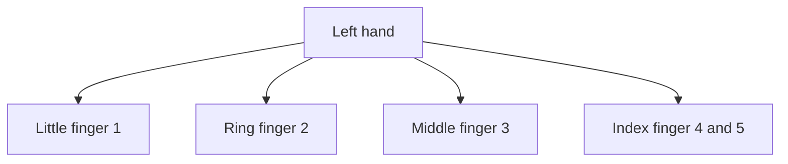
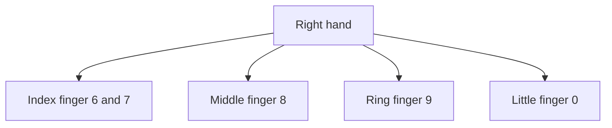

## Goal

By the end of this lesson, you can type the numbers 1 to 0 on the number row with the correct
fingers. You can also type prices, dates and phone-style numbers.

## Why It Matters

Numbers are everywhere in daily life. A shopkeeper types prices, such as "250 rupees", on a
bill. A school office types roll numbers, marks and dates. A job form asks for your phone number
and your date of birth. When your fingers know the numbers, you type these quickly and without
mistakes.



**Diagram in words:** On the number row, your left little finger presses 1, the ring finger 2 and
the middle finger 3. The left index finger presses two keys, 4 and 5.



**Diagram in words:** On the number row, your right index finger presses two keys, 6 and 7. The
middle finger presses 8, the ring finger 9 and the little finger 0.

## Key Terms

| Term | Simple meaning |
|------|----------------|
| Number row | The row of number keys above the top row of letters. It has the numbers 1 to 9, then 0. |
| Digit | One number sign from 0 to 9. The price 250 has three digits. |
| Reach up | Moving one finger up from its home key. You met it in [Lesson 2.3](./top-row.mdx). |
| Symbol | A sign that is not a letter or a number. Many number keys show one on their upper part. |
| Numeric keypad | A separate block of number keys, set out like a calculator. Not every keyboard has one. This module does not teach it. |

## Step by Step

Open Notepad as you learned in
[Lesson 1.6: Keyboard Basics](../module-01-computer-basics/keyboard-basics.mdx), step 6. Put
your hands on the home row, as in [Lesson 2.1](./sitting-right-and-home-row.mdx).

**Find the number row**

1. Look at your keyboard once. Find the row of numbers above the top row of letters. *You see the
   numbers 1 to 9, then 0.* This is the number row.
2. Each number key belongs to the same finger as the top row key below it. For example, 1 is for
   the finger that presses Q and A. The number row is two rows above the home row. So this reach
   is longer than the top row reach. It is like reaching for the top shelf in a shop: stretch,
   take it, and come back.

**Left hand: 1 to 5**

3. Reach your left little finger up from **A** to **1**. Press **1**, then go back to **A**.
   Type **a1a a1a**. *You see* a1a a1a *in Notepad.*
4. Reach your left ring finger up from **S** to **2**. Type **s2s s2s**.
5. Reach your left middle finger up from **D** to **3**. Type **d3d d3d**.
6. Reach your left index finger up from **F** to **4**. Type **f4f f4f**.
7. Reach your left index finger up and towards the middle to **5**. Type **f5f f5f**. 5 belongs
   to the left hand, so do not use your right hand for it.

**Right hand: 6 to 0**

8. Reach your right index finger up and towards the middle from **J** to **6**. Type **j6j j6j**.
   6 belongs to the right hand, so do not use your left hand for it.
9. Reach your right index finger up from **J** to **7**. Type **j7j j7j**.
10. Reach your right middle finger up from **K** to **8**. Type **k8k k8k**.
11. Reach your right ring finger up from **L** to **9**. Type **l9l l9l**.
12. Reach your right little finger up from the **;** key to **0**. Type the line below. Little
    and ring fingers need the most practice, so repeat it if it feels hard.

    ```text
    ;0; ;0;
    ```

**Keep your hands close to home**

13. Move only the finger that presses the key. Keep the other fingers near the home row. Small
    movements are faster, and they tire your hands less.
14. After each number, feel for the bumps on **F** and **J**. *You feel your index fingers back
    on the bumps.* The number row is far away, so coming home matters even more here.

**Type numbers without Shift**

15. Do not hold **Shift** when you type a number. Shift with a number key types the symbol on
    the upper part of that key, not the number.

**About the numeric keypad**

16. Look to the right side of your keyboard. Some keyboards have a **numeric keypad** there. It
    is set out like a calculator. You can learn it later. In this module, you use only the
    number row. It is part of the main typing keys, close to your home row.

**Type real numbers**

17. Type a price: **250 rupees**. Prices are on every bill and receipt.
18. Type a date with slashes: **14/08/2026**. Press the slash with your right little finger, as
    in [Lesson 2.4](./bottom-row.mdx). Dates go on forms, letters and receipts.
19. Type a made-up phone-style number with a space in it: **0300 1234567**. The space splits the
    number into two parts, so it is easier to read and check.

**Practise with TypingMaster**

TypingMaster has a separate **Numbers Course**. It has two lessons on the number row.

20. Open TypingMaster and log in with your name, as in
    [Lesson 2.1](./sitting-right-and-home-row.mdx). Select **Courses** in the menu on the right
    side.
21. Select **Change course** at the top of the screen. *You see the list of courses.*
22. Select **Numbers Course**. Then select **Start Course**, or **Continue Course** if you
    started it before. Do the exercises in order, from the top.
23. In a key drill, wait for the key to turn **green**. Look at the **green dot** on the hands to
    find the finger, as in [Lesson 2.2](./home-row-keys.mdx).

    :::tip[If your screen looks different]

    If the Numbers Course does not open, or your screen does not match these steps, use the
    Notepad drills on this page. They train the same fingers.

    :::

The trial version of TypingMaster only lets you preview the Numbers Course. In that case, use
the Notepad drills on this page. TypingMaster also has a **Numeric Keypad Course**, for later.

{/* Screenshot to add: the TypingMaster course list with the Numbers Course and its Start Course button. */}

## Practice

Type these drills in Notepad. Press **Enter** at the end of each line. The phone-style numbers
are made up, for practice only.

Key pairs:

```text
a1a s2s d3d f4f f5f
j6j j7j k8k l9l ;0;
```

Numbers:

```text
10 20 30 40 50
12 34 56 78 90
100 250 500 1000
```

Prices, dates and phone-style numbers:

```text
naan 30 rupees
milk 220 rupees
school fee 2500 rupees
14/08/2026 23/03/2027
0300 1234567 0321 7654321
```

Sentences:

```text
Sana has 3 books and 12 pens.
The bus to Multan leaves at 7.
```

Look-away line:

```text
Ali paid 450 rupees on 12/05/2026.
```

1. Sit right and put your hands on the home row without looking. Feel the bumps on F and J.
   This starts every drill in the right place.
2. Open Notepad. Type each line of key pairs two times. Use the correct finger for each number.
   Go back to the home row after each reach.
3. Type each line of numbers two times. Keep a steady rhythm. Correct numbers come first, and
   speed comes later.
4. Type each price, date and phone-style line two times. Check each number on the screen after
   you type it. One wrong digit makes a wrong price or a wrong phone number.
5. Type each sentence two times. Use capitals and full stops, as in
   [Lesson 2.5](./capitals-and-punctuation.mdx).
6. Read the look-away line once. Then look only at the screen and type it five times, on five
   lines. Do not look at your hands. This shows whether your fingers know the number row.
7. Count your mistakes in the five look-away lines. Each wrong digit counts as one mistake.
8. If you have the full TypingMaster, do the Numbers Course exercises too.
9. Check your work: every line in Notepad matches the drills above, digit for digit. Your five
   look-away lines have no more than 2 mistakes in total.

## Check Questions

1. Put your hands on the home row. Type **f5f j6j** without looking. Which fingers pressed 5
   and 6?

   <details>
   <summary>Show answer</summary>

   **Answer:** Your left index finger pressed 5. Your right index finger pressed 6. After each
   one, the finger went back to F or J.

   </details>

2. What happens if you hold Shift and press a number key?

   <details>
   <summary>Show answer</summary>

   **Answer:** You get the symbol on the upper part of that key, not the number. Type numbers
   without Shift.

   </details>

3. Which finger presses 1, and which finger presses 0?

   <details>
   <summary>Show answer</summary>

   **Answer:** Your left little finger presses 1. Your right little finger presses 0.

   </details>

## Common Mistakes

- **Typing the letter O instead of the number 0** → The number 0 is on the number row, for your
  right little finger. The letter O is on the top row.
- **Typing a small letter l instead of the number 1** → The number 1 is on the number row, for
  your left little finger.
- **Holding Shift while typing a number** → Let go of Shift. Shift with a number key types a
  symbol instead.
- **Moving the whole hand up to the numbers** → Move only the finger that presses the key. Then
  bring it back home and feel for the bumps on F and J.
- **Looking down for every number** → Look at the screen. Type the key pairs again until your
  fingers find the numbers by themselves.

## Sources

*These official pages were checked when this lesson was written.*

- [BCcampus, *Key Concepts of Computer Studies*, Unit 2 Topic B, "The base position" (archived copy, January 2026)](https://web.archive.org/web/20260117103740/https://opentextbc.ca/computerstudies/chapter/the-base-position/): the left little finger presses keys including "the number 1, letters Q, A, and Z"; the left ring finger "the number 2 and letters W, S, and X"; the left middle finger "the number 3 and and letters E, D, and C"; the left index finger "numbers 4 and 5, and letters R, T, F, G, V, and B"; the right index finger "numbers 6 and 7, and the letters Y, U, H, J, N, and M"; the right middle finger "the number 8 and the letters I and K"; the right ring finger "the number 9 and the letters O and L"; the right little finger presses keys including "the number 0"; "Always try to return your fingers to the base position when you are not typing."
- [University of Wollongong, "Touch typing"](https://www.uow.edu.au/student/support-services/academic-skills/online-resources/technology-and-software/typing/): "your index, middle and ring fingers move either up or down from their home position"; keeping your fingers "close to the base position" will "improve speed" and "reduce stress on the hands"; "Typing in a rhythm will aid you"; "Pay greater attention to the ring and pinky fingers when training."
- [Microsoft, "Using your keyboard" (archived Microsoft Windows help page, December 2015)](https://web.archive.org/web/20151223231731/http://windows.microsoft.com/en-us/windows/using-keyboard): "Press Shift in combination with another key to type the symbol shown on the upper part of that key"; "The numeric keypad is handy for entering numbers quickly. The keys are grouped together in a block like a conventional calculator"; "If your keyboard has a numeric keypad." (Written for Windows 7.)
- [TypingMaster 11 User Manual (archived copy)](https://web.archive.org/web/2023/https://www.typingmaster.com/typing-tutor/support/user-manual.html): Numbers Course: "This two lesson course teaches how to type numbers on the number row"; Numeric Keypad Course: "Learn to use the 10-key pad with touch typing technique"; to change a course, "select the 'Change course' option at the top of the screen"; "To start a course click on the 'Start Course' button. If you have started a course earlier, the button will say 'Continue Course'"; key drill: "the key to be pressed is colored green after a 2 second delay", "A green dot indicates the finger you should use"; in the trial version, advanced courses "covering numbers, special marks, numeric keypad and speed building" "can only be previewed."
- [Microsoft Support, "Help in Notepad"](https://support.microsoft.com/en-us/windows/apps/help-in-notepad): how to open Notepad, the same on Windows 10 and Windows 11.
