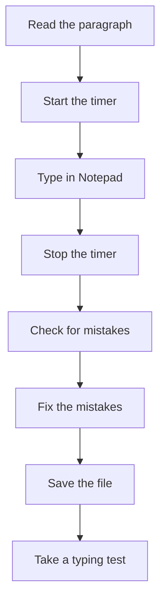

## Goal

By the end of this lesson, you can type a short job letter paragraph within a time goal and
check it for mistakes.

## Why It Matters

When you apply for a job, you often write a letter. A mobile shop may need a sales helper. A
clinic may need a receptionist. In [Lesson 4.12](../module-04-ms-word/project-application-letter.mdx)
you make a full application letter in Word. In this project you type one paragraph of such a
letter, using every skill from this module.



**Diagram in words:** Read the paragraph and start the timer. Type it in Notepad, then stop the
timer. Check and fix the mistakes, save the file, and then take a typing test.

## Key Terms

| Term | Simple meaning |
|------|----------------|
| Paragraph | A group of sentences about one idea. |
| Application letter | A letter you write to ask for a job. |
| Time goal | The time you try to finish in, such as 4 minutes. |
| Proofread | Read your typing slowly, next to the original, to find mistakes. |
| Words per minute | Your words divided by your minutes. It shows your speed. |
| Net speed | Your speed after errors in the TypingMaster Typing Test. You met it in [Lesson 2.8](./speed-and-accuracy.mdx). |

## Step by Step

All names, shops and places in this lesson are made up. Follow these steps to type the example
paragraph.

```text
I am writing to apply for the job of Shop Assistant at City
Mobile Centre in Multan. I saw your notice on the shop door. I
am learning computers in the AICT course. I can type letters and
bills without looking at the keys. I am honest, polite and always
on time. Thank you for reading my letter.
```

This paragraph has 58 words.

**Get ready**

1. Open Notepad, as in [Lesson 1.6](../module-01-computer-basics/keyboard-basics.mdx). *You
   see an empty Notepad window.*
2. Read the whole paragraph once, slowly. Look for the capital letters and the full stops.
   When you know the words, your fingers do not stop to guess.
3. Sit right and put your fingers on the home row, as in
   [Lesson 2.1](./sitting-right-and-home-row.mdx). This puts every finger in the right place.

**Type against the clock**

A time goal is like a bus timetable. It gives you a time to aim for.

4. Get a timer, such as the stopwatch on a mobile phone or a clock with a seconds hand. Your
   time goal is **4 minutes or less**.
5. Start the timer. Type the paragraph. Keep your eyes on the words, not on your hands.
6. Press **Enter** at the end of each line, as shown. Each line then matches this page, so you
   can check it line by line.
7. If you see a mistake while you type, press **Backspace** and fix it. Do not stop for long.
   You check the whole paragraph again later.
8. Stop the timer when you type the last full stop. Write down your time.
   *You see the whole paragraph in Notepad, on six lines.*

**Check and fix your mistakes**

9. Proofread one line at a time. Put your finger under the line on this page. Compare it with
   the same line on the screen. Checking one line at a time stops you from missing a mistake.
10. Count the words that have a mistake. Write the number next to your time.
11. Fix each mistake. Use the arrow keys to move the cursor to it, as in
    [Lesson 1.6](../module-01-computer-basics/keyboard-basics.mdx). Press **Backspace**, then type
    the correct letters.

**Work out your speed**

12. Divide the number of words by your minutes. For example, 58 words in 4 minutes is about
    15 words per minute. 58 words in 3 minutes is about 19 words per minute.
13. This is a simple count that you do yourself. It is **not** TypingMaster's Net speed. It
    still shows you if you are near 20.

**Save your paragraph**

14. Select **File**, then **Save As**. *You see a box for saving.* Choose a folder, as in
    [Lesson 1.8](../module-01-computer-basics/files-folders-saving-deleting.mdx). Then you can
    find your file later.
15. In the **File name** box, type **My Paragraph**. Select **Save**. *You see the name My Paragraph
    at the top of Notepad.*

**Compare with the goal**

16. Take a Typing Test in TypingMaster, as in [Lesson 2.8](./speed-and-accuracy.mdx). If you
    do not have TypingMaster, take the one-minute Notepad test from that lesson.
17. Write the result in your progress table. Compare your Net speed with the goal of 20 WPM.
    This shows how ready you are for real typing work.

{/* Screenshot to add: Notepad showing the example paragraph on six lines, saved as My Paragraph. */}

## Practice

Now type a new paragraph on your own. Sana wants a job at a clinic.

```text
I am writing to apply for the job of Receptionist at Green
Clinic in Karachi. My cousin told me about this job. I have
finished my matric, and I am learning computers in the AICT
course. I can type quickly and check my work for mistakes. I
like to help people. Thank you for reading my letter.
```

This paragraph has 57 words.

Look-away line:

```text
Thank you for reading my letter.
```

1. Open Notepad. Read the paragraph once, slowly, so that you know the words.
2. Put your fingers on the home row. Start your timer.
3. Type the paragraph. Press **Enter** at the end of each line.
4. Stop the timer at the last full stop. Write down your time.
5. Proofread one line at a time. Count the words with a mistake, then fix them.
6. Divide 57 by your minutes. This gives your simple words per minute.
7. Save the file as **Clinic Paragraph**, in the same folder as before.
8. Press **Enter** two times. Read the look-away line once. Then type it with your eyes on the
   words only. Count the words with a mistake. You do not need to save this line.
9. Take a Typing Test, or the one-minute Notepad test. Write the result in your progress
   table.
10. Check your work: you typed the paragraph in 4 minutes or less. It had no more than 3 words
    with a mistake before you fixed them, and none after. The file **Clinic Paragraph** is
    saved. Your look-away line has no mistakes. Your progress table has a new row.

## Check Questions

1. Why should you proofread one line at a time?

   <details>
   <summary>Show answer</summary>

   **Answer:** You compare a small part with the original. Then you do not miss a mistake.

   </details>

2. Type **I am honest, polite and always on time.** in Notepad. Time yourself. How long did it
   take, and how many words had a mistake?

   <details>
   <summary>Show answer</summary>

   **Answer:** The sentence has 8 words. Aim for under 30 seconds with no mistakes. If you made
   mistakes, type it again more slowly.

   </details>

3. You typed 60 words in 3 minutes. What is your simple words per minute? Is it TypingMaster's
   Net speed?

   <details>
   <summary>Show answer</summary>

   **Answer:** 60 divided by 3 is 20 words per minute. It is not TypingMaster's Net speed. It is
   a simple count you work out yourself.

   </details>

## Common Mistakes

- **Starting to type before reading the paragraph** → Read it once first. Then your fingers do
  not stop to guess the words.
- **Looking at your hands to go faster** → Keep your eyes on the words. Looking down makes you
  lose your place.
- **Forgetting to stop the timer** → Stop it as soon as you type the last full stop.
- **Checking the whole paragraph in one look** → Proofread one line at a time, with your finger
  under the line.
- **Closing Notepad without saving** → Select **File**, then **Save As**, before you close it.

## Sources

*These official pages were checked when this lesson was written.*

- [Microsoft Support, "Help in Notepad"](https://support.microsoft.com/en-us/windows/apps/help-in-notepad): applies to Windows 10 and Windows 11; "To open Notepad, select the Start button, type Notepad, then select Notepad from the results"; "On the File menu, select Save As, type a descriptive name for your file in the File name box."
- [Microsoft Support, "Create a new folder"](https://support.microsoft.com/en-us/office/create-a-new-folder-cbbfb6f5-59dd-4e5d-95f6-a12577952e17): applies to Windows 10 and Windows 11; to save into a folder, "select File > Save As, and then browse to the new folder, and select Save."
- [Microsoft, "Using your keyboard" (archived Microsoft Windows help page, December 2015)](https://web.archive.org/web/20151223231731/http://windows.microsoft.com/en-us/windows/using-keyboard): "Press Backspace to delete the character before the cursor"; the arrow keys "Move the cursor or selection one space or line in the direction of the arrow"; "Press Enter to move the cursor to the beginning of the next line." (Written for Windows 7.)
- [BBC Bitesize, "Dance Mat Typing"](https://www.bbc.co.uk/bitesize/articles/z3c6tfr): "It's important not to look at your hands when you are learning to type"; "there's no need to rush!"
- [TypingMaster 11 User Manual (archived)](https://web.archive.org/web/2023/https://www.typingmaster.com/typing-tutor/support/user-manual.html): the Typing Test shows "Gross speed, Accuracy and Net speed"; "Net speed shows your final speed after errors."
