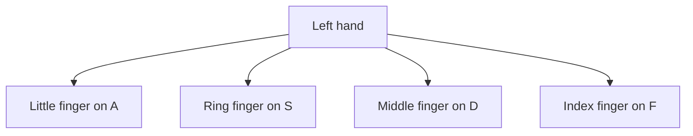
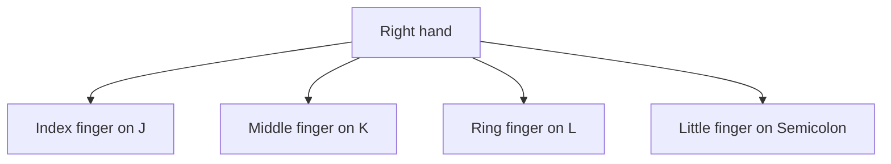

## Goal

By the end of this lesson, you can sit correctly at the keyboard and put both hands on the home
row without looking.

## Why It Matters

Good typists do not look at their hands. They look at the screen or at the paper they copy. A
computer operator in a shop types bills all day. A clerk in an office types letters from a
handwritten page. Both work faster and make fewer mistakes when their fingers know the keys.
Everything starts from one place on the keyboard: the home row.



**Diagram in words:** Your left hand rests on four keys. The little finger is on A, the ring
finger on S, the middle finger on D and the index finger on F.



**Diagram in words:** Your right hand rests on four keys. The index finger is on J and the middle
finger on K. The ring finger is on L, and the little finger is on the semicolon key (**;**).

## Key Terms

| Term | Simple meaning |
|------|----------------|
| Touch typing | Typing with all ten fingers, without looking at the keyboard. |
| Home row | The middle row of letter keys. Your fingers rest on A S D F and J K L ; here. |
| Home row position | Your eight fingers resting on the home row keys, ready to type. |
| Finger names | Thumb, index finger, middle finger, ring finger and little finger. The index finger is next to the thumb. |
| TypingMaster | A program that teaches touch typing, one lesson at a time. |
| Touch Typing Course | The TypingMaster course that teaches the letter keys and common punctuation. |
| Course Selection screen | The TypingMaster screen that lists its courses. You choose a course here. |

## Step by Step

Follow these steps at your computer. You do not type any words yet. Today your body and hands
learn where to be.

**Sit right for typing**

You learned how to sit at a computer in
[Lesson 1.9: Caring for Your Computer](../module-01-computer-basics/caring-for-your-computer.mdx).
Typing adds a few things for your arms and hands.

1. Sit the way you learned in Lesson 1.9. Your back is straight and your feet are flat on the
   floor. This stops your back and neck from hurting during long typing work.
2. Move your chair so your body is in the middle, in front of the keyboard. Then both hands reach
   the keys equally.
3. Let your arms relax. Bend your elbows to about a right angle, like the corner of a book.
   Keep your elbows close to your body. *You see your forearms point straight at the keyboard.*
4. Keep your wrists straight, not bent up, down or to the side. Do not rest your palms on the
   keyboard. Do not lean your weight on your wrists. This protects your wrists and hands.
5. Look at the screen, not at your hands. Touch typists keep their eyes on the screen.

**Find the home row**

The home row is like your home. Your fingers go out to other keys, and then they always come
back to it.

6. Look at the keyboard once. Find the middle row of letters. Find **A S D F** on the left and
   **J K L ;** on the right. *You see eight keys, four for each hand.*
7. Touch the **F** key and the **J** key. Most keyboards have a small raised bump on each of
   them. The bumps let you find F and J without looking.
8. Put your left index finger on **F**. Put your right index finger on **J**. These two fingers
   are your guides, so always place them first.
9. Put your other left fingers down: middle finger on **D**, ring finger on **S**, little finger
   on **A**.
10. Put your other right fingers down: middle finger on **K**, ring finger on **L**, little
    finger on **;** (the semicolon key).
11. Let your fingers rest over the keys. Do not press them down, or letters will type.
    *You see your eight fingers on the home row, with no finger left over.*
12. Rest your thumbs over the **Spacebar**. Either thumb can press it. Your thumbs do this one
    job, so they stay near the Spacebar.
13. Lift both hands off the keyboard. Now put them back without looking: feel for the bumps on
    F and J first, then put down the other fingers. Do this five times. This is the most
    important skill in touch typing, because every other key is found from here.

**Open TypingMaster and find the Touch Typing Course**

TypingMaster gives you typing exercises and shows which finger to use. If your computer does not
have it, the Notepad drills in this lesson work too.

14. Double-click the **TypingMaster** icon on the desktop. *You see TypingMaster open.*

    :::tip[If your screen looks different]

    If you cannot find TypingMaster, or it looks different from these steps, use the Notepad
    drills in the Practice part of this lesson instead.

    :::

15. The first time you open TypingMaster, it shows the **New User** screen. Create a user with
    your first and last name. TypingMaster saves your work under this name, so you can continue
    later from where you stopped.
16. Next time, TypingMaster shows the login screen. Type your name in the **User name** box, or
    choose it from the list. Then select **Enter**. Other people may use the same computer, so
    always choose your own name.
17. The first time you log in, you see the **Course Selection** screen. Find the
    **Touch Typing Course** in the list. This course teaches the letter keys, so it is the one
    for this module.
18. Select the **Start Course** button next to the Touch Typing Course. *You see the lessons of
    the course.* Select **Start Course** again. *You see the first lesson, with a list of
    exercises.*
19. Stop here for today. Close TypingMaster with the **Close** button in the top right corner.
    Start the exercises in Lesson 2.2.

If TypingMaster lets you open only the first lessons, use the Notepad drills on each page.

{/* Screenshot to add: TypingMaster Course Selection screen with the Touch Typing Course and its Start Course button. */}

## Practice

Practise the home row position, then type your first home row keys. Open Notepad as you learned
in [Lesson 1.6: Keyboard Basics](../module-01-computer-basics/keyboard-basics.mdx), step 6.

Lines to type (press the Spacebar with a thumb between each group):

```text
fff jjj fff jjj
ddd kkk ddd kkk
sss lll sss lll
aaa ;;; aaa ;;;
```

Look-away line:

```text
asdf jkl; asdf jkl;
```

1. Sit right: back straight, feet flat, body in the middle of the keyboard, elbows close to
   your body. This keeps you comfortable for the whole drill.
2. Put your hands on the home row without looking. Lift them and put them back five times.
   Each time, feel for the bumps on F and J first.
3. Open Notepad. Type each of the four lines above. Use only the finger that rests on each key.
   Press **Enter** at the end of each line to start a new line.
4. Type the look-away line three times, on three new lines. Look only at the screen, never at
   your hands. If you lose your place, feel for the bumps on F and J again.
5. Now look at your work. Count the letters that are wrong.
6. Check your work: you put your hands on the home row five times without looking. Notepad
   shows seven lines, and you made no more than 2 mistakes in the three look-away lines.

## Check Questions

1. Close your eyes. Put all eight fingers on the home row. Which keys are under your fingers?

   <details>
   <summary>Show answer</summary>

   **Answer:** Your left fingers are on A, S, D and F. Your right fingers are on J, K, L and
   the semicolon key (;).

   </details>

2. How can you find the F and J keys without looking?

   <details>
   <summary>Show answer</summary>

   **Answer:** Feel for the small raised bumps on the F and J keys. Put your index fingers on
   them first.

   </details>

3. Which fingers press the Spacebar?

   <details>
   <summary>Show answer</summary>

   **Answer:** Your thumbs. Either thumb can press it.

   </details>

## Common Mistakes

- **Looking down at the keys** → Keep your eyes on the screen. If you get lost, feel for the
  bumps on F and J.
- **Hands one key too far left or right** → Check that your index fingers are on the keys with
  the bumps, F and J.
- **Resting palms or wrists on the keyboard** → Keep your wrists straight and your palms off the
  keyboard. Do not lean on your wrists.
- **Pressing the Spacebar with a finger** → Use a thumb, so your fingers stay on the home row.

## Sources

*These official pages were checked when this lesson was written.*

- [University of Wollongong, "Touch typing"](https://www.uow.edu.au/student/support-services/academic-skills/online-resources/technology-and-software/typing/): "Touch typing is typing without looking at the keyboard"; "Locate the elevated 'tabs', without looking down, on the F and J keys. Place your left index finger on the F key, and your right index finger on the J key. Then place the fingers on your left hand on the A, S, D and F keys and the fingers on your right hand on the J, K, L and ; keys"; "your thumb covers the space bar"; "Never shift your body weight to your wrists by resting on them."
- [BCcampus, *Key Concepts of Computer Studies*, Unit 2 Topic B, "The base position" (archived copy, January 2026)](https://web.archive.org/web/20260117103740/https://opentextbc.ca/computerstudies/chapter/the-base-position/): "The home row keys on the keyboard are A, S, D, and F on the left and J, K, L, and the semicolon (;) on the right"; "Keyboards usually have small bumps on the F and J keys. They help the users locate the base position without having to look"; left hand "Little finger: A key, Ring finger: S key, Middle finger: D key, Index finger: F key"; right hand "Index finger: J key, Middle finger: K key, Ring finger: L key, Little finger: Semi-colon key"; "The space bar can be pressed by a thumb on either hand."
- [BCcampus, *Key Concepts of Computer Studies*, Unit 2 Topic A, "Keyboarding skills" (archived copy, December 2025)](https://web.archive.org/web/20251205174836/https://opentextbc.ca/computerstudies/chapter/keyboarding-skills/): touch typing is "a method of typing (with all the available fingers) without looking at the keyboard"; "centre body in front of keyboard and sit up straight"; "arms relaxed and bent to about 90 degrees; elbows naturally close to body"; "palms of hands not resting on the keyboard"; "keep eyes on the screen rather than the keyboard or hands."
- [Microsoft, "A Guide to Healthy Computing" (PDF)](https://download.microsoft.com/download/1/3/4/1340dfe4-a8c1-485f-be3b-4e8991323df3/Healthy_Computing_Guide.pdf): "Keep wrists in line with their forearms and not bent upwards, downwards or to one side or the other."
- [TypingMaster 11 User Manual (archived copy)](https://web.archive.org/web/2023/https://www.typingmaster.com/typing-tutor/support/user-manual.html): "double click on the TypingMaster icon on your Desktop"; "The first time you start TypingMaster 11 you will be taken to the New User screen to create a user"; the login screen has a "'User name' field" and you start "by selecting 'Enter'"; "When you login for the first time you will be presented with the Course Selection screen"; Touch Typing Course: "you will learn the positions of the letter keys and common punctuation by heart"; "Select a course by clicking on the 'Start Course' button … Click the 'Start Course' button again to continue"; exit with "the 'Close' button located in top right corner"; in the trial version "Only the first two lessons are accessible."
