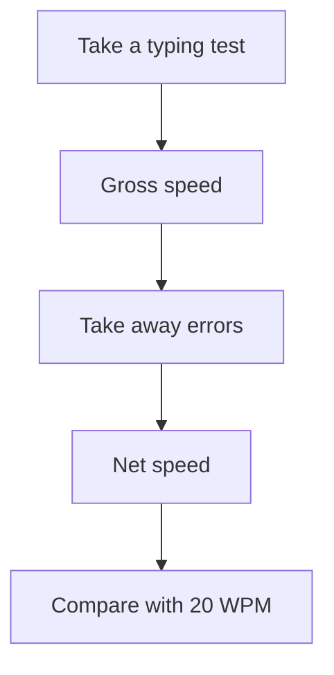

## Goal

By the end of this lesson, you can take a typing test, read your speed and accuracy, and write
them in a progress table.

## Why It Matters

A shop owner wants the bill typed while the customer waits. A school office types many result
letters in one day. Both need typing that is fast and correct. A typing test gives you numbers,
so you can see if you are getting better week by week. Your goal for this module is a **Net
speed of 20 WPM**.



**Diagram in words:** You take a typing test and get your Gross speed. Your errors are taken
away, which gives your Net speed. Then you compare your Net speed with the goal of 20 WPM.

## Key Terms

| Term | Simple meaning |
|------|----------------|
| Typing Test | The part of TypingMaster where you copy a text and it measures your typing. |
| Duration | How long the test lasts, in minutes. |
| WPM | Words per minute. How many words you type in one minute. |
| KPM | Keystrokes per minute. How many keys you press in one minute. |
| Gross speed | The speed at which you typed during the test, before errors are counted. |
| Accuracy | How many of your words were correct, out of 100. 100% means every word was correct. |
| Net speed | Your final speed after errors. This is the number for your goal. |
| Progress table | A small table where you write your results after each test. |

## Step by Step

A typing test is like weighing yourself on a scale. One number alone tells you little. Many
numbers over the weeks show if you are improving.

**Take the Typing Test in TypingMaster**

1. Open TypingMaster and log in with your user name, as in
   [Lesson 2.1](./sitting-right-and-home-row.mdx). Your results are saved under your own name.
2. In the **Menu** on the right side of the screen, select **Typing Test**. *You see the Typing
   Test screen.*
3. In part 1 of the screen, choose a test text from the list. This is the text you copy.
4. In part 2, choose the **Duration**. A full typing test is usually at least 5 minutes long.
   If you cannot change the Duration, your copy may be the trial version. Its tests last
   2 minutes, and that is fine for this lesson.
5. Put your fingers on the home row. Then select **Start Test**. *You see the test text.* Copy
   it with your eyes on the text, not on your hands.

:::tip[If your screen looks different]

Your TypingMaster may look different from these steps, for example in version 10. If you
cannot find **Typing Test** or **Start Test**, do the one-minute Notepad test below instead.

:::

6. Fix a mistake only while you are still typing that word. After you press the **Spacebar**,
   the word is final. Keep going, so that your typing stays smooth.
7. If you skip a word, TypingMaster moves you to the right place in the text. A skipped word
   still counts as an error, so read carefully.
8. When the test ends, read your results. *You see the Duration, your Gross speed, your
   Accuracy and your Net speed.*

{/* Screenshot to add: TypingMaster Typing Test results showing Duration, Gross speed, Accuracy and Net speed. */}

**Read your results**

9. Look at the unit after each speed. It is **WPM** or **KPM**. Your goal is in WPM.
10. If you see **KPM**, select **Settings** in the Menu. Under **Speed Unit**, choose **WPM**.
    Then your results match the goal of this module.

:::tip[If your screen looks different]

If you cannot find **Speed Unit**, write your result in your table with its unit, KPM. Then
also take the one-minute Notepad test below. It counts words, not keys.

:::

11. Read your **Gross speed**. This is how fast you typed, mistakes and all.
12. Read your **Accuracy**. 100% means you typed every word correctly. Aim for 100%, because
    many mistakes spoil your work, however fast you type.
13. Read your **Net speed**. This is your speed after errors. Compare it with the goal of
    **20 WPM**.

**Write your results in a progress table**

TypingMaster keeps your results under your name. A table of your own lets you see them at a
glance, like the marks in a school report card.

14. Copy this table into your notebook, or type it in Notepad. Use one row for each test. The
    first row is a made-up example.

    | Date | Where | Gross speed | Accuracy | Net speed |
    |------|-------|-------------|----------|-----------|
    | 14 October | TypingMaster, 2 minutes | 18 WPM | 90% | 15 WPM |
    | | | | | |
    | | | | | |

15. After each test, fill in one row. Over the weeks, your Net speed should move towards
    20 WPM.

**Backup: the one-minute test in Notepad**

Use this when TypingMaster is not on your computer. It also works at home.

16. Open Notepad, as in [Lesson 1.6](../module-01-computer-basics/keyboard-basics.mdx). Put your
    fingers on the home row.
17. Get a timer, such as the stopwatch on a mobile phone or a clock with a seconds hand. The
    timer tells you when one minute is over.
18. Start the timer. Type the text below. Press **Enter** at the end of each line.

    ```text
    Sana works in a shop in Lahore. She types the bills for the
    customers. Each morning she opens the shop and drinks a cup of
    chai. Then she checks the stock and types a list of things to
    buy. Her brother Ali takes the list to the market by bus. In the
    evening they count the money and close the shop.
    ```

19. Stop typing when one minute is over, even in the middle of a word.
20. Count the words you typed. That number is your words in one minute.
21. Count the words that have a mistake. Take this away from your words in one minute. The
    answer is your correct words in one minute.
22. Write both numbers in your progress table. Write **Notepad, 1 minute** under "Where".

This Notepad test is a simple count that you do yourself. It is **not** TypingMaster's
measure, so the two numbers may not match. Compare Notepad results only with other Notepad
results.

## Practice

Warm-up line (type it before each test):

```text
Bilal buys bread and eggs from the shop.
```

Look-away line:

```text
Sana drinks chai with her friends.
```

1. Copy the progress table from step 14 into your notebook, or type it in Notepad. Then you
   are ready to record your results.
2. Open Notepad. Type the warm-up line three times. This gets your fingers moving before the
   test.
3. Read the look-away line once. Type it three times with your eyes on the words only. Count
   the words with a mistake. This shows if you are ready to type without looking.
4. Take one Typing Test in TypingMaster. If you do not have TypingMaster, take the one-minute
   Notepad test from steps 16 to 22.
5. Write your results in the first empty row of your table.
6. Rest for two minutes. Shake your hands and arms gently.
7. Take a second test the same way. This time, aim for higher accuracy, not a higher speed.
8. Write the second results in the next row. Compare the two rows.
9. Check your work: your table has two new rows, each with a date and where you tested. Each
   row shows Gross speed, Accuracy and Net speed, or your words in one minute and correct words
   for Notepad. You can say how far your Net speed is from 20 WPM. Your look-away lines have
   no more than 2 words with a mistake.

## Check Questions

1. What does your Net speed show?

   <details>
   <summary>Show answer</summary>

   **Answer:** Your final typing speed after errors. It is also called adjusted speed. It is
   the number you compare with the goal of 20 WPM.

   </details>

2. Take one typing test, in TypingMaster or in Notepad. Point to your result in your progress
   table. Is it 20 WPM or more?

   <details>
   <summary>Show answer</summary>

   **Answer:** Your own number is in your table. If it is below 20, keep practising every day.
   Aim for correct words first. Your speed grows with practice.

   </details>

3. Your TypingMaster results show KPM. What do you change to see WPM?

   <details>
   <summary>Show answer</summary>

   **Answer:** Select **Settings** in the Menu. Under **Speed Unit**, choose **WPM**.

   </details>

## Common Mistakes

- **Looking only at Gross speed** → Your goal is the Net speed. It counts your errors.
- **Rushing and making many mistakes** → Slow down a little. Aim for 100% accuracy. Mistakes
  lower your Net speed.
- **Comparing a Notepad count with a TypingMaster result** → They are measured in different
  ways. Compare Notepad with Notepad, and TypingMaster with TypingMaster.
- **Going back to fix a word after pressing the Spacebar** → In the Typing Test, that word is
  final. Keep typing the next word.
- **Not writing your results down** → Fill in one row of your progress table after every test.

## Sources

*These official pages were checked when this lesson was written.*

- [TypingMaster 11 User Manual (archived)](https://web.archive.org/web/2023/https://www.typingmaster.com/typing-tutor/support/user-manual.html): "The Menu at the right side of the program screen is used for navigating"; "Typing Test: Clicking on this item takes you to TypingMaster's typing tests"; "On the Typing Test screen, under section 1, is an extensive range of test texts … Next, in section 2, select the Duration, a typical typing test is at least 5 minutes long. Lastly click on the 'Start Test' button to begin"; "during the test you can make corrections to the word you are currently typing but after the space bar is pressed, the word is considered final"; "Although missing a word is considered to be an error"; "The results will be displayed in WPM (Words Per Minute) or KPM (Keystrokes Per Minute) depending on your selections in Settings. The duration of the test will be displayed along with information on Gross speed, Accuracy and Net speed"; "Gross speed is the speed at which you typed during the test. The accuracy percentage counts the amount of words that were correct. With an accuracy of 100% all words were typed correctly. Net speed shows your final speed after errors and can also be called adjusted speed or adjusted words-per-minute"; "The Net Speed is the Gross Speed minus the errors you made"; Settings, "Speed Unit": "If WPM is selected your speed will be counted in Words per Minute. With KPM selected Keystrokes per Minute will be used"; accuracy: "It is very important that you aim for a hundred percent"; trial version: "Duration locked to 2 minutes."
- [BBC Bitesize, "Dance Mat Typing"](https://www.bbc.co.uk/bitesize/articles/z3c6tfr): "It's important not to look at your hands when you are learning to type"; "You should take a rest, and shake your hands and arms to relax your muscles if you get tired."
- [Microsoft Support, "Help in Notepad"](https://support.microsoft.com/en-us/windows/apps/help-in-notepad): applies to Windows 10 and Windows 11; "To open Notepad, select the Start button, type Notepad, then select Notepad from the results."
- [Microsoft, "Using your keyboard" (archived Microsoft Windows help page, December 2015)](https://web.archive.org/web/20151223231731/http://windows.microsoft.com/en-us/windows/using-keyboard): "Press Enter to move the cursor to the beginning of the next line." (Written for Windows 7.)
