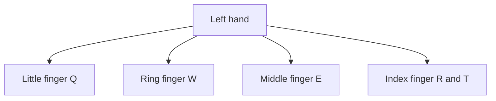
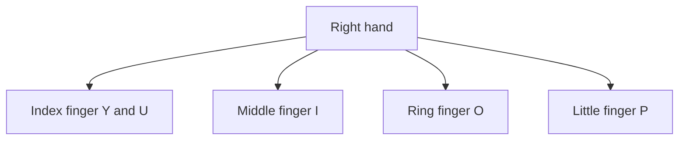

## Goal

By the end of this lesson, you can type the top row letters with the correct fingers. You
also come back to the home row after each one.

## Why It Matters

With the home row alone, you can type only a few words. The top row adds many letters you need
every day. Words like "tea", "roti", "rupees" and "Lahore" all use top row keys. A shop
assistant types "rupees" on many bills. A student types city names in a school form. After this
lesson, you can type many more real words.



**Diagram in words:** On the top row, your left little finger presses Q, the ring finger W and
the middle finger E. The left index finger presses two keys, R and T.



**Diagram in words:** On the top row, your right index finger presses two keys, Y and U. The
middle finger presses I, the ring finger O and the little finger P.

## Key Terms

| Term | Simple meaning |
|------|----------------|
| Top row | The row of letter keys above the home row: Q W E R T Y U I O P. |
| Home key | The home row key where one finger rests. You met it in [Lesson 2.2](./home-row-keys.mdx). |
| Reach up | Moving one finger up from its home key to press a top row key. |
| Key pair | A home key and a top row key pressed by the same finger, such as D and E. |
| Look-away line | A line you type while you look only at the screen. It shows if your fingers know the keys. |

## Step by Step

Open Notepad as you learned in
[Lesson 1.6: Keyboard Basics](../module-01-computer-basics/keyboard-basics.mdx), step 6. Put
your hands on the home row, as in [Lesson 2.1](./sitting-right-and-home-row.mdx).

Each top row key belongs to the finger below it on the home row. The finger reaches up, presses
the key, and comes home. It is like stepping out of your door to the shop next door, then going
back inside.

**Middle fingers: E and I**

1. Reach your left middle finger up from **D** to **E**. Press **E**, then go back to **D**.
   Type **ded ded**. *You see* ded ded *in Notepad.*
2. Reach your right middle finger up from **K** to **I**. Press **I**, then go back to **K**.
   Type **kik kik**. Start with these two pairs, then move out to the other fingers.

**Index fingers: R, T, U and Y**

Each index finger has two top row keys. One is straight up. The other is one key further towards
the middle of the keyboard.

3. Reach your left index finger up from **F** to **R**. Type **frf frf**.
4. Reach your left index finger up and towards the middle to **T**. Type **ftf ftf**. T belongs
   to the left hand, so do not use your right hand for it.
5. Reach your right index finger up from **J** to **U**. Type **juj juj**.
6. Reach your right index finger up and towards the middle to **Y**. Type **jyj jyj**. Y belongs
   to the right hand, so do not use your left hand for it.

**Ring fingers: W and O**

7. Reach your left ring finger up from **S** to **W**. Type **sws sws**.
8. Reach your right ring finger up from **L** to **O**. Type **lol lol**. Ring fingers need
   extra practice, so go slowly and press firmly.

**Little fingers: Q and P**

9. Reach your left little finger up from **A** to **Q**. Type **aqa aqa**.
10. Reach your right little finger up from **;** to **P**. Type **;p; ;p;**. Little fingers need
    the most practice, so repeat this line if it feels hard.

**Keep your hands close to home**

11. When one finger reaches up, keep the other fingers near their home keys. Do not lift your
    whole hand. Small movements are faster, and they tire your hands less.
12. After each top row key, feel for the bumps on **F** and **J**. *You feel your index fingers
    back on the bumps.* Now you are ready for the next key without looking.

**Practise with TypingMaster**

13. Open TypingMaster and log in with your name. Select **Courses** in the menu on the right
    side. *You see the lesson you studied last.*
14. Finish the exercises of that lesson in order. TypingMaster moves you to the next exercise,
    and then to the next lesson, by itself.
15. To move to the next lesson in the Touch Typing Course yourself, select the **>>** button.
    Use the green key and the green dot, as in [Lesson 2.2](./home-row-keys.mdx), to find the
    right finger.

    :::tip[If your screen looks different]

    If you do not see the **>>** button, finish the exercises in order. TypingMaster moves you
    to the next lesson by itself. You can also use the Notepad drills on this page.

    :::

If TypingMaster lets you open only the first lessons, use the Notepad drills on each page.

{/* Screenshot to add: TypingMaster lesson view with the list of exercises and the >> button. */}

## Practice

Type these drills in Notepad. Press **Enter** at the end of each line. You learn capital letters
in Lesson 2.5, so type names in small letters for now.

Key pairs:

```text
ded kik frf juj ftf jyj
sws lol aqa ;p; ded kik
```

Words:

```text
tea roti aloo pulao
kheer ghee atta dahi
paratha sugar rupees shop
quetta peshawar lahore sialkot
```

Sentences:

```text
ali ate roti at the shop
sara put sugar for the tea
dad paid three rupees for the paratha
```

Look-away line:

```text
the shop is at peshawar road
```

1. Sit right and put your hands on the home row without looking. Every drill starts from the
   home row.
2. Type each line of key pairs two times. This trains each finger to know
   its own pair of keys.
3. Type each line of words two times. After each top row key, come back to the home row.
4. Type each sentence two times. Keep a steady rhythm, and use a thumb for each space.
5. Read the look-away line once. Then look only at the screen and type it five times, on five
   lines. Do not look at your hands.
6. Count the wrong letters in your five look-away lines.
7. If you have TypingMaster, continue with the next lesson in the Touch Typing Course.
8. Check your work: every line in Notepad matches the drills above. Your five look-away lines
   have no more than 2 mistakes in total.

## Check Questions

1. Put your hands on the home row. Without looking, type **ded kik**. Which fingers press E
   and I?

   <details>
   <summary>Show answer</summary>

   **Answer:** Your left middle finger presses E. Your right middle finger presses I. Each one
   reaches up from D or K, then goes back.

   </details>

2. Which finger presses T, and which finger presses Y?

   <details>
   <summary>Show answer</summary>

   **Answer:** Your left index finger presses T. Your right index finger presses Y.

   </details>

3. Which finger presses P, and which home key does it come back to?

   <details>
   <summary>Show answer</summary>

   **Answer:** Your right little finger presses P. It comes back to the semicolon key (;).

   </details>

## Common Mistakes

- **Pressing T or Y with the wrong hand** → T is for the left index finger. Y is for the right
  index finger.
- **Lifting the whole hand to reach a key** → Move only the finger that types. Keep the other
  fingers near their home keys.
- **Staying on the top row after a key** → Go back to the home row after every top row key.
  Feel for the bumps on F and J.
- **Looking down to find Q or P** → Reach up from A or from the semicolon key. Practise the
  pairs **aqa** and **;p;** until your little fingers find them.

## Sources

*These official pages were checked when this lesson was written.*

- [BCcampus, *Key Concepts of Computer Studies*, Unit 2 Topic B, "The base position" (archived copy, January 2026)](https://web.archive.org/web/20260117103740/https://opentextbc.ca/computerstudies/chapter/the-base-position/): which finger presses each key: left little finger "letters Q, A, and Z"; left ring finger "letters W, S, and X"; left middle finger "letters E, D, and C"; left index finger "letters R, T, F, G, V, and B"; right index finger "the letters Y, U, H, J, N, and M"; right middle finger "the letters I and K"; right ring finger "the letters O and L"; right little finger "the letter P … the semicolon"; "Always try to return your fingers to the base position when you are not typing."
- [University of Wollongong, "Touch typing"](https://www.uow.edu.au/student/support-services/academic-skills/online-resources/technology-and-software/typing/): "your index, middle and ring fingers move either up or down from their home position"; "always use the right fingers for the right keys, and return them to the home position when you have finished"; "Limit your hand and finger movement only to what is necessary to press a specific key by keeping your hands and fingers close to the base position. This will not only improve speed it will also reduce stress on the hands"; "Pay greater attention to the ring and pinky fingers when training."
- [TypingMaster 11 User Manual (archived copy)](https://web.archive.org/web/2023/https://www.typingmaster.com/typing-tutor/support/user-manual.html): the **Courses** menu item goes "directly to the lesson you have last studied"; "The program will automatically advance from one exercise to the next and from one lesson to the next"; "To advance lessons click on the >> button to go to the next lesson"; in the trial version "Only the first two lessons are accessible."
- [Microsoft Support, "Help in Notepad"](https://support.microsoft.com/en-us/windows/apps/help-in-notepad): how to open Notepad, the same on Windows 10 and Windows 11.
