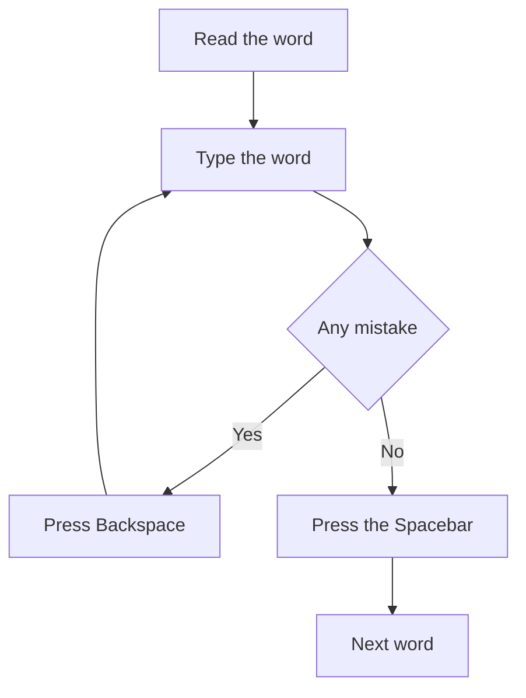

## Goal

By the end of this lesson, you can type words and sentences without looking at the keys, and
fix mistakes with Backspace.

## Why It Matters

You now know every letter key. Real typing is not single letters, though. It is words and
sentences. A shopkeeper types a customer's name and the things bought on a bill. A student types
a short message to a school office. When your eyes stay on the words, you lose your place less
often and you finish sooner.



**Diagram in words:** Read a word, then type it. If you see a mistake, press Backspace and type
it again. If there is no mistake, press the Spacebar and go on to the next word.

## Key Terms

| Term | Simple meaning |
|------|----------------|
| Touch typing | Typing with all ten fingers, without looking down at the keys. |
| Word drill | A line of words that you type to practise. |
| Sentence | A group of words that says one full idea. It starts with a capital letter and ends with a full stop. |
| Cursor | The blinking line in your typing. It shows where the next letter will appear. |
| Backspace | The key that deletes the letter before the cursor. You met it in [Lesson 1.6](../module-01-computer-basics/keyboard-basics.mdx). |
| Accuracy | How many of your words you type with no mistakes. |
| Look-away line | A line you type with your eyes on the words, never on the keys. |

## Step by Step

You type in Notepad. Notepad always works, with or without TypingMaster.

**Get ready**

1. Open Notepad. Select **Start**, type **Notepad**, then select **Notepad** from the results.
   You did this in [Lesson 1.6](../module-01-computer-basics/keyboard-basics.mdx). *You see an
   empty Notepad window with a blinking cursor.*
2. Sit right and put your fingers on the home row, as in
   [Lesson 2.1](./sitting-right-and-home-row.mdx). Feel for the small bumps on **F** and **J**.
   Every finger now starts from its own key.
3. Keep this page where you can read it. Your eyes look at the words here and at the screen.
   They never look at your hands.

**Type whole words**

A good reader reads a whole word, not one letter at a time. Typing works the same way.

4. Read the first word below: **shop**. Say it in your head. Then type all four letters.
   *You see the word "shop" in Notepad.* Thinking of the whole word helps your fingers move
   one after another.
5. Press the **Spacebar** once. *The cursor moves one space forward.* One space keeps the words
   apart, like the gap between words in your copy.
6. Type the rest of this line in the same way. Do not look down.

   ```text
   shop bus chai roti school
   ```

7. Press **Enter** at the end of the line. *The cursor moves to the start of the next line.*
   Each drill then sits on its own line, so you can check it quickly.

**Fix a mistake with Backspace**

Backspace is like a rubber (eraser). It removes the letter before the cursor.

8. Type **chia** by mistake. Press **Backspace** two times. *You see "ch" left.* Each press
   deletes one letter.
9. Type **ai** to finish the word **chai**. *You see "chai".* Now the word is correct. Press
   **Enter** to start a new line.
10. Fix a mistake as soon as you see it, before you type the next word. TypingMaster works the
    same way. In its Typing Test and longer drills, a word is final once you press the
    Spacebar.

**Type full sentences**

11. Hold **Shift** and press **A** for the capital A in **Ali**. Capital letters start every
    sentence and every name, as in [Lesson 2.5](./capitals-and-punctuation.mdx).
12. Type the rest of this sentence. End it with a full stop, then press **Enter**.

    ```text
    Ali goes to school by bus.
    ```

    *You see the whole sentence on one line.*
13. Type at a calm speed. There is no need to rush. Correct words matter more than fast words,
    because every mistake costs you time to fix.
14. Look at your line and at the sentence above. Count the words that have a mistake. This
    count shows your accuracy.

**Rest your hands**

15. After 15 to 20 minutes of typing, take a short break. Shake your hands and arms gently to
    relax them. Tired hands make more mistakes.

**Extra practice in TypingMaster**

16. If TypingMaster is on your computer, open the **Touch Typing Course** and do the next lesson.
    Its lessons include word drills and sentence drills, which practise the same skill. In a sentence drill, press
    **Enter** at the end of each sentence to see the next one.

:::tip[If your screen looks different]

TypingMaster may not open the next lesson, or the lesson may be locked. Do the Notepad drills
in Practice below instead. They train the same skill.

:::

{/* Screenshot to add: Notepad with the line "Ali goes to school by bus." typed, cursor at the end. */}

## Practice

Type these drills in Notepad. Press **Enter** at the end of each line.

Words:

```text
the and for you are was
shop bus chai roti milk
school book pen bag desk
Lahore Karachi Multan Quetta
```

Short groups of words:

```text
a cup of chai
a bus to Lahore
rice and roti
a pen and a book
```

Sentences:

```text
Ali goes to school by bus.
Sana buys milk from the shop.
My mother makes roti for us.
We drink chai in the evening.
The bus to Karachi leaves at night.
```

Look-away line:

```text
Ahmed sells fruit in the market.
```

1. Open Notepad and put your fingers on the home row. This starts every drill in the right
   place.
2. Type each line of words two times. Read each word whole, then type it.
3. Type each short group of words two times. Press the **Spacebar** once between words.
4. Type each sentence once. Use **Shift** for the capital letters. End with a full stop.
5. Fix each mistake with **Backspace** as soon as you see it. This builds the habit of correct
   typing.
6. Read the look-away line once. Then look only at the words and type it three times, on three
   lines. Do not look at your hands. Do not fix mistakes in these three lines, so that you can
   count them.
7. Count the words with a mistake in your three look-away lines.
8. If you have TypingMaster, do the next exercises of the Touch Typing Course too.
9. Check your work: your five sentences match the drills, with no mistakes left. Your three
   look-away lines have no more than 2 words with a mistake in total.

## Check Questions

1. Which key deletes the letter before the cursor?

   <details>
   <summary>Show answer</summary>

   **Answer:** Backspace. Each press deletes one letter.

   </details>

2. Open Notepad. Without looking at the keys, type **Sana buys milk from the shop.** How many
   words have a mistake?

   <details>
   <summary>Show answer</summary>

   **Answer:** Aim for none. If two or more words have a mistake, type the sentence again,
   more slowly.

   </details>

3. In TypingMaster's Typing Test, why should you fix a mistake before you press the Spacebar?

   <details>
   <summary>Show answer</summary>

   **Answer:** Once you press the Spacebar, the word is final. You cannot correct it after
   that.

   </details>

## Common Mistakes

- **Looking down at the keys after every word** → Keep your eyes on the words. If you lose your
  place, feel for the bumps on F and J.
- **Typing fast with many mistakes** → Slow down. Aim for no mistakes first. Speed comes with
  practice.
- **Pressing Backspace too many times** → Backspace deletes one letter each time. Press it once,
  then look at the screen.
- **Pressing the Spacebar two times between words** → Press it once. One space is enough.
- **Typing for a long time without a break** → Rest every 15 to 20 minutes. Shake your hands
  and arms gently.

## Sources

*These official pages were checked when this lesson was written.*

- [BBC Teach, "Dance Mat Typing: touch typing practice for 7-11 year olds"](https://www.bbc.co.uk/teach/articles/ztj9h4j): touch typing "is the skill of being able to type without looking down at the keyboard"; F and J "will sometimes have small bumps on them so that they can be found easily"; keeping the home row hand position helps you "find the right keys without looking at their hands."
- [BBC Bitesize, "Dance Mat Typing"](https://www.bbc.co.uk/bitesize/articles/z3c6tfr): "use the correct fingers"; "there's no need to rush!"; "You should take a rest, and shake your hands and arms to relax your muscles if you get tired"; "It's important not to look at your hands when you are learning to type."
- [Microsoft, "Using your keyboard" (archived Microsoft Windows help page, December 2015)](https://web.archive.org/web/20151223231731/http://windows.microsoft.com/en-us/windows/using-keyboard): the cursor is a "blinking vertical line" that "shows where the text that you type will begin"; "Press Backspace to delete the character before the cursor"; "Press Enter to move the cursor to the beginning of the next line"; "Press the Spacebar to move the cursor one space forward"; "Press Shift in combination with a letter to type an uppercase letter"; "Take short breaks from computer use every 15 to 20 minutes." (Written for Windows 7.)
- [Microsoft Support, "Help in Notepad"](https://support.microsoft.com/en-us/windows/apps/help-in-notepad): applies to Windows 10 and Windows 11; "To open Notepad, select the Start button, type Notepad, then select Notepad from the results."
- [TypingMaster 11 User Manual (archived)](https://web.archive.org/web/2023/https://www.typingmaster.com/typing-tutor/support/user-manual.html): the courses have word drills ("you copy words") and sentence drills ("You need to press Enter at the end of the sentence for a new sentence to appear"); "When you copy a word and press the Space bar, TypingMaster considers the word final and no corrections can be made to it"; accuracy: "It is very important that you aim for a hundred percent, since your overall performance will suffer considerably if you make many mistakes, no matter how good your typing speed is"; trial mode: "Only the first two lessons are accessible."
