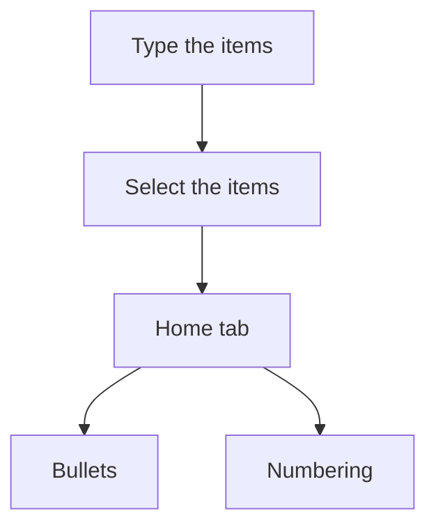

## Goal

By the end of this lesson, you can make a bulleted list and a numbered list in Word, and end
the list when you finish.

## Why It Matters

You make lists every day: a shopping list for the bazaar, or the steps to make tea. A family
may keep a wedding guest list. A mobile shop may keep a list of phones in stock. In Word, a list
makes these items clear and neat. A CV and many office documents use lists too.

## Key Terms

| Term | Simple meaning |
|------|----------------|
| List | Short items written one under the other. |
| Item | One thing in a list. Each item is its own paragraph. |
| Bullet | A small mark at the start of each item in a list. |
| Bulleted list | A list with a bullet before each item. Use it when the order does not matter. |
| Numbered list | A list with a number before each item. Use it when the order matters, like steps. |
| Bullets | The button on the **Home** tab that makes a bulleted list. |
| Numbering | The button on the **Home** tab that makes a numbered list. |

**Diagram in words:** Type your items and select them. Then, on the Home tab, select Bullets
for a bulleted list or Numbering for a numbered list.

## Step by Step

Start a blank document. You will make a grocery list and the steps to make tea. There are three
ways to make a list. Try all three, then use the one you like.

**Way 1: type first, then make the list**

1. Type these four items. Press **Enter** after each one: **Rice**, **Sugar**, **Tea**,
   **Cooking oil**. *You see four short lines.*
2. Select all four items (see [Lesson 4.4](./copy-cut-paste.mdx)), so that Word knows which
   lines to change.
3. Select the **Home** tab, then select **Bullets**. *A bullet appears before each item.* Now
   each item is clear on its own, like ticks on a shopping slip.
4. Click at the end of the last item. Press **Enter** until the bullet switches off. *The list
   has ended.* This lets you type normal text again.

**Way 2: start the list, then type**

5. Type **Steps to make tea** and press **Enter**.
6. Select **Numbering**. *The number 1 appears.* Use numbers here because the order of the
   steps matters.
7. Type these steps. Press **Enter** after each one: **Boil the water**, **Add tea leaves**,
   **Add milk and sugar**, **Pour into cups**. *Word adds the next number each time.* You do
   not need to type the numbers yourself.
8. After the last step, press **Enter** until the numbering switches off. *The next line has
   no number.*

**Way 3: let Word start the list**

This way is quick when you are already typing.

9. Type **1.** and a space, then type **Wash the cups**. Press **Enter**. *Word makes a
   numbered list by itself.*
10. Press **Enter** again to end the list.
11. Type `*` and a space, then type **Milk**. Press **Enter**. *Word makes a bulleted list by
    itself.*
12. Press **Enter** again to end the list.

{/* Screenshot to add: The **Home** tab with the **Bullets** and **Numbering** buttons circled, and a short bulleted list in the document. */}

## Practice

Make two lists for your family: a grocery list for the bazaar and a morning routine for a
younger brother or sister. Type each heading first, then the list under it.

| Heading | Items | List type |
|---------|-------|-----------|
| Things to buy | Flour, Lentils, Eggs, Soap, Matches | Bulleted |
| Morning routine | Wake up, Wash your face, Eat breakfast, Go to school | Numbered |

1. Start a blank document.
2. Type **Things to buy** and press **Enter**.
3. Type the five items from the table. Press **Enter** after each one.
4. Select the five items. On the **Home** tab, select **Bullets**. Bullets fit here, because
   the order of shopping does not matter.
5. Click at the end of **Matches**. Press **Enter** until the bullet switches off, so that the
   next heading is not part of the list.
6. Type **Morning routine** and press **Enter**.
7. Select **Numbering**. Type the four steps. Press **Enter** after each one. Numbers fit here,
   because the steps happen in order.
8. After the last step, press **Enter** until the numbering switches off.
9. Save your work with the name **My Lists** (see [Lesson 4.3](./saving-closing-opening.mdx)),
   so that you can use it again.
10. Check your work: **Things to buy** has five items with a bullet before each one. **Morning
    routine** has four steps numbered 1 to 4. The headings have no bullet or number. The title
    bar shows **My Lists**.

## Check Questions

1. Point to the **Bullets** button and the **Numbering** button.

   

   
Show answer

   **Answer:** Both are on the Home tab.

   

2. You are writing the steps to cook rice. Should you use a bulleted list or a numbered list?

   

   
Show answer

   **Answer:** A numbered list, because the order of the steps matters.

   

3. How do you end a list when you finish the last item?

   

   
Show answer

   **Answer:** Press Enter until the bullets or numbers switch off.

   

## Common Mistakes

- **Typing your own numbers in a numbered list** → Word adds the numbers for you. Delete your
  typed numbers and let Word number the items.
- **Not knowing how to stop the list** → Press **Enter** until the bullet or number switches
  off.
- **Selecting only some of the items** → Select every item first, then select **Bullets** or
  **Numbering**.
- **Changing the wrong text into a list** → Press **Ctrl+Z** to undo (see
  [Lesson 4.2](./typing-and-correcting-text.mdx)).

## Sources

*These official pages were checked when this lesson was written.*

- [Microsoft Support, "Create a bulleted or numbered list"](https://support.microsoft.com/en-us/word/training/create-a-bulleted-or-numbered-list) (applies to Word 2016 and Word 2019): select text, then **Home** > **Bullets** or **Home** > **Numbering**; type **1.**, a space and text to start a numbered list; type `*` and a space to start a bulleted list; press **Enter** until the bullets or numbering switch off to complete a list.
- [Microsoft Support, "Use a screen reader to create bulleted or numbered lists with Word"](https://support.microsoft.com/en-us/office/use-a-screen-reader-to-create-bulleted-or-numbered-lists-with-word-4e88102c-9507-4edb-ab2a-8d7026ee2964) (applies to Word 2016 and Word 2019): you can turn on a list first and then type; press **Enter** after each item, and press **Enter** again to stop the list.
- [Microsoft Support, "Keyboard shortcuts in Word"](https://support.microsoft.com/en-us/accessibility/word/keyboard-shortcuts-in-word) (applies to Word 2016 and Word 2019): **Ctrl+Z** undo.
