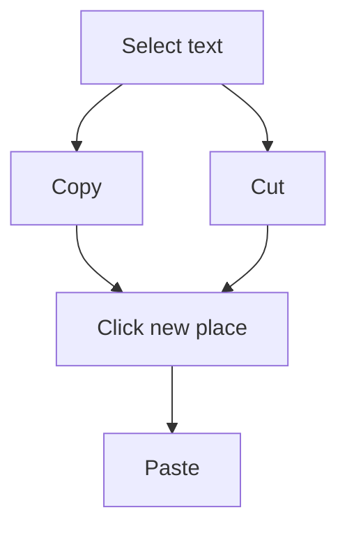

## Goal

By the end of this lesson, you can select text with the mouse, and copy, cut and paste it.

## Why It Matters

Sometimes you need the same words two times, for example a shop name at the top and bottom of a
bill. Sometimes a name is in the wrong place, for example on a wedding guest list. Copy and paste
saves you from typing the same words again. Cut and paste moves words to a new place without
typing them again.

**Diagram in words:** First select the text, then choose Copy or Cut. Click the new place and
paste. Copy keeps the text in its old place too. Cut takes it away from the old place.

## Key Terms

| Term | Simple meaning |
|------|----------------|
| Select | Mark text so Word knows which words you want to work with. |
| Selected text | Text you have marked. It has a coloured background. |
| Copy | Keep a copy of the selected text, ready to paste. The text stays where it is. |
| Cut | Take the selected text away, ready to paste somewhere else. |
| Paste | Put the copied or cut text where the cursor is. |
| Clipboard | The place where Word keeps the text you copy or cut, until you paste it. |

You learned to click, double-click and drag in
[Lesson 1.5](../module-01-computer-basics/using-the-mouse.mdx). You learned **Undo** in
[Lesson 4.2](./typing-and-correcting-text.mdx).

## Step by Step

Follow these steps on your own computer. Open Word, start a blank document, and type these four
lines. Press **Enter** after each line.

**Please buy these things for the shop on Sunday.** / **Milk** / **Bread** / **Eggs**

**Selecting text**

Selecting is like pointing at something in a shop and saying "this one". Word must know which
words you mean before it can do anything with them.

1. Point right before the word **buy**. Hold down the left mouse button and drag to the end of
   the word. Let go. *You see a coloured background on the word. It is selected.*
2. Double-click the word **Sunday**. *You see the whole word selected.* This is a fast way to
   select one word.
3. Point to the left of the line **Bread** and click once. *You see the whole line selected.*

   :::tip[If your screen looks different]

   If clicking to the left does not select the line, click right before **B** in **Bread**.
   Then press **Shift+Down arrow**.

   :::

4. Point right before the first letter of line 1. Drag to the full stop at the end. *You see
   the whole paragraph selected.* Use this when you want to work with a whole sentence.

**Copy and paste**

Copy is like a photocopy. The first paper stays where it is, and you get one more.

5. Select the word **Milk**. Press **Ctrl+C**. Word keeps a copy on the Clipboard, ready to
   paste.
6. Click at the end of the word **Eggs**. Press **Enter**. This makes a new line for the copy.
7. Press **Ctrl+V**. *You see **Milk** appear again. The first **Milk** is still there.*
   A small **Paste Options** button may appear. You can ignore this button for now.

**Cut and paste**

Cut is like picking a box up from one shelf. You then put it down on another shelf.

8. Select the word **Bread**. Press **Ctrl+X**. *You see **Bread** go away.*
9. Click at the end of the last line. Press **Enter**, so that there is a new line for
   **Bread**.
10. Press **Ctrl+V**. *You see **Bread** at the bottom of the list.* You moved it without
    typing it again.
11. Remember: Copy keeps the old text. Cut takes it away. If you make a mistake, press
    **Ctrl+Z**.

**Another way: the buttons**

12. Select the **Home** tab and find the **Clipboard** group. Find **Cut**, **Copy** and
    **Paste**. These buttons do the same jobs as the keys. They help when you forget the keys.

    :::tip[If your screen looks different]

    If you cannot find the **Cut** and **Copy** buttons, use the keys instead: **Ctrl+X** to
    cut, **Ctrl+C** to copy and **Ctrl+V** to paste.

    :::

{/* Screenshot to add: The **Home** tab in Word, with the **Clipboard** group and the **Cut**, **Copy** and **Paste** buttons labelled. */}

## Practice

Your family runs a small shop. Your mother writes a shopping list for Sunday. She needs **Milk**
two times, and she wants **Bread** at the end. Fix the list without typing the words again.
Type these four lines first. Press **Enter** after each line.

| Line | Type this |
|------|-----------|
| 1 | Please buy these things for the shop on Sunday. |
| 2 | Milk |
| 3 | Bread |
| 4 | Eggs |

1. Open Word, select **Blank document** and type the four lines.
2. Drag across the word **shop** to select it.
3. Double-click the word **Sunday** to select it.
4. Click to the left of the line **Bread** to select the whole line. If this does not work, use
   the backup way from step 3 of Step by Step.
5. Drag from the first letter of line 1 to its full stop to select the whole paragraph.
6. Select **Milk** and press **Ctrl+C**. Click at the end of **Eggs**, press **Enter**, then press
   **Ctrl+V**. Now **Milk** is on the list two times.
7. Select **Bread** and press **Ctrl+X**. Click at the end of the last line, press **Enter**, then
   press **Ctrl+V**. This moves **Bread** to the end.
8. If an empty line is left where **Bread** was, click in it and press **Backspace**, so that the
   list has no gaps.
9. If something goes wrong, press **Ctrl+Z** and try again.
10. Check your work: your list has five lines in this order. **Please buy these things for the
    shop on Sunday.**, then **Milk**, **Eggs**, **Milk** and **Bread**. There is no empty line.

## Check Questions

1. Show how you select one word by dragging.
   **Answer:** Point right before the word. Hold down the left mouse button, drag to the end of
   the word, and let go.
2. What is the difference between Copy and Cut?
   **Answer:** Copy keeps the text in its old place. Cut takes it away from the old place.
3. Which keys do you press to copy, to cut and to paste?
   **Answer:** **Ctrl+C** to copy, **Ctrl+X** to cut and **Ctrl+V** to paste.

## Common Mistakes

- **Pressing Ctrl+C before selecting any text** → Select the text first. You can see it has a
  coloured background. Then copy.
- **Pasting before clicking the new place** → Click where you want the text first, then paste.
- **Using Cut when you wanted Copy** → Press **Ctrl+Z** to undo, then use **Ctrl+C**.
- **Missing the first or last letter when dragging** → Start right before the first letter and drag
  slowly to right after the last letter.

## Sources

*These official pages were checked when this lesson was written.*

- [Microsoft Support, "Word for new users"](https://support.microsoft.com/en-us/word/word-for-new-users) (applies to Word 2016 and Word 2019): to select text, place the cursor at the beginning, hold down the left mouse button and drag; a background colour shows the selected text.
- [Microsoft Support, "Keyboard shortcuts in Word"](https://support.microsoft.com/en-us/accessibility/word/keyboard-shortcuts-in-word) (applies to Word 2016 and Word 2019): **Ctrl+X** cuts and **Ctrl+C** copies the selected content to the Clipboard; **Ctrl+V** pastes the contents of the Clipboard; **Ctrl+Z** undoes.
- [Microsoft Support, "Control the formatting when you paste text"](https://support.microsoft.com/en-us/word/control-the-formatting-when-you-paste-text) (applies to Word 2016 and Word 2019): you can paste with **Ctrl+V** or the **Paste** button; after **Ctrl+V** a **Paste Options** button appears, and it is on by default.
- [Microsoft Support, "Use the Office Clipboard"](https://support.microsoft.com/en-us/office/use-the-office-clipboard-028903c7-66ea-4eb0-b0a1-bacdb952e3a1) (applies to Word 2016 and Word 2019): the **Clipboard** group is on the **Home** tab; the Clipboard stores text you copy or cut.
- [Microsoft Support, "Use the Spike to cut and paste multiple items in Word"](https://support.microsoft.com/en-us/word/use-the-spike-to-cut-and-paste-multiple-items-in-word) (applies to Word 2016 and Word 2019): cut text is taken out of the original document; the Windows clipboard pastes one copied item at a time.
- [Microsoft Support, "Select text" (archived Microsoft page, December 2019)](https://web.archive.org/web/20191214043222/https://support.office.com/en-us/article/select-text-5ae24034-1c93-4805-bc2d-00aaf6235c97) (applies to Word 2019 and Word 2016; the **Newer versions** tab is for Office 2013, 2016 and 2019): "To select a single word, quickly double-click that word"; to select a line, place the cursor at the start of the line and press **Shift+Down arrow** (confirms the backup way in the box). On this page, clicking to the left of a line is only in the **Office 2010** tab.
- [Microsoft Support, "Select text"](https://support.microsoft.com/en-us/office/select-text-5ae24034-1c93-4805-bc2d-00aaf6235c97) and ["Add and edit text"](https://support.microsoft.com/en-us/office/add-and-edit-text-ed1e3147-a846-41ca-8087-49e324cb50bd) (apply to Word 2021, Word 2024 and Microsoft 365 only): click to the left of a line to select it.
- [Microsoft Support, "Copy and paste using the Office Clipboard" (archived Microsoft page, August 2018)](https://web.archive.org/web/20180813050657/https://support.office.com/en-us/article/copy-and-paste-using-the-office-clipboard-714a72af-1ad4-450f-8708-c2931e73ec8a?ui=en-US&rs=en-US&ad=US) (applies to Word 2016): you can cut, copy and paste "by using the buttons on the ribbon or the keyboard shortcuts CTRL+X (Cut), CTRL+C (Copy), or CTRL+V (Paste)". It does not name the group.
- [Microsoft Support, "Keyboard shortcuts for Microsoft Word on Windows" (archived Microsoft page, May 2019)](http://web.archive.org/web/20190531102624/https://support.office.com/en-us/article/keyboard-shortcuts-for-microsoft-word-on-windows-95ef89dd-7142-4b50-afb2-f762f663ceb2) (applies to Word 2019 and Word 2016): **Backspace** deletes one character to the left (Practice step 8).
