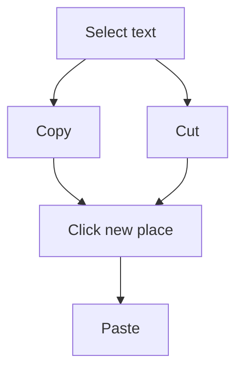

## Goal

By the end of this lesson, you can select text with the mouse, and copy, cut and paste it.

## Why It Matters

Sometimes you need the same words two times, for example a shop name at the top and bottom of a
bill. Sometimes a line is in the wrong place. Copy and paste saves you from typing the same words
again. Cut and paste moves words to a new place without typing them again.

**Diagram in words:** First select the text, then choose Copy or Cut. Click the new place and
paste. Copy keeps the text in its old place too. Cut takes it away from the old place.

## Key Terms

| Term | Simple meaning |
|------|----------------|
| Select | Mark text so Word knows which words you want to work with. |
| Selected text | Text you have marked. It has a coloured background. |
| Copy | Keep a copy of the selected text, ready to paste. The text stays where it is. |
| Cut | Take the selected text away, ready to paste somewhere else. |
| Paste | Put the copied or cut text where the cursor is. |
| Clipboard | The place where Word keeps the text you copy or cut, until you paste it. |

You learned to click, double-click and drag in
[Lesson 1.5](../module-01-computer-basics/using-the-mouse.mdx). You learned **Undo** in
[Lesson 4.2](./typing-and-correcting-text.mdx).

## Teacher Demo

Use one lab computer that the whole class can see. Open Word, start a blank document, and type
these four lines. Press **Enter** after each line.

**Please buy these things for the shop on Sunday.** / **Milk** / **Bread** / **Eggs**

**Selecting text**

1. Point right before the word **buy**. Hold down the left mouse button and drag to the end of
   the word. Let go. *The class sees a coloured background on the word. It is selected.*
2. Double-click the word **Sunday**. *The class sees the whole word selected.*
3. Point to the left of the line **Bread** and click once. *The class sees the whole line
   selected.*

   :::warning[UNVERIFIED]

   Steps 2 and 3 (double-click a word, click to the left of a line) are confirmed by Microsoft
   only for newer Word versions, not for Word 2016/2019. Test them on a lab computer before
   teaching. Dragging (steps 1 and 4) is confirmed for Word 2016/2019.

   :::

4. Point right before the first letter of line 1. Drag to the full stop at the end. *The class
   sees the whole paragraph selected.*

**Copy and paste**

5. Select the word **Milk**. Press **Ctrl+C**. Say: "Word has kept a copy on the Clipboard."
6. Click at the end of the word **Eggs**. Press **Enter**.
7. Press **Ctrl+V**. *The class sees **Milk** appear again. The first **Milk** is still there.*
   A small **Paste Options** button may appear. Say: "We can ignore this button for now."

**Cut and paste**

8. Select the word **Bread**. Press **Ctrl+X**. *The class sees **Bread** go away.*
9. Click at the end of the last line. Press **Enter**.
10. Press **Ctrl+V**. *The class sees **Bread** at the bottom of the list.*
11. Say: "Copy keeps the old text. Cut takes it away. If we make a mistake, we press
    **Ctrl+Z**."

**Another way: the buttons**

12. Select the **Home** tab and point to the **Clipboard** group. Point to **Cut**, **Copy** and
    **Paste**. Say: "These buttons do the same jobs as the keys."

    :::warning[UNVERIFIED]

    Microsoft's Word 2016/2019 pages confirm the **Clipboard** group on the **Home** tab and a
    **Paste** button. They do not say that **Cut** and **Copy** buttons are in that group. Check
    this on a lab computer before teaching.

    :::

:::info[Screenshot to add]

The **Home** tab in Word, with the **Clipboard** group and the **Cut**, **Copy** and **Paste**
buttons labelled.

:::

## Student Task

Work at your own lab computer. Type these four lines. Press **Enter** after each line.

| Line | Type this |
|------|-----------|
| 1 | Please buy these things for the shop on Sunday. |
| 2 | Milk |
| 3 | Bread |
| 4 | Eggs |

1. Open Word, select **Blank document** and type the four lines.
2. Drag across the word **shop** to select it.
3. Double-click the word **Sunday** to select it.
4. Click to the left of the line **Bread** to select the whole line.
5. Drag from the first letter of line 1 to its full stop to select the whole paragraph.
6. Select **Milk** and press **Ctrl+C**. Click at the end of **Eggs**, press **Enter**, then press
   **Ctrl+V**.
7. Select **Bread** and press **Ctrl+X**. Click at the end of the last line, press **Enter**, then
   press **Ctrl+V**.
8. If an empty line is left where **Bread** was, click in it and press **Backspace**.
9. If something goes wrong, press **Ctrl+Z** and try again.
10. Show your teacher: your list with **Milk** two times and **Bread** at the bottom, and select
    one word in front of your teacher.

## Check Questions

1. Show how you select one word by dragging.
   **Answer:** Point right before the word. Hold down the left mouse button, drag to the end of
   the word, and let go.
2. What is the difference between Copy and Cut?
   **Answer:** Copy keeps the text in its old place. Cut takes it away from the old place.
3. Which keys do you press to copy, to cut and to paste?
   **Answer:** **Ctrl+C** to copy, **Ctrl+X** to cut and **Ctrl+V** to paste.

## Common Mistakes

- **Pressing Ctrl+C before selecting any text** → Select the text first. You can see it has a
  coloured background. Then copy.
- **Pasting before clicking the new place** → Click where you want the text first, then paste.
- **Using Cut when you wanted Copy** → Press **Ctrl+Z** to undo, then use **Ctrl+C**.
- **Missing the first or last letter when dragging** → Start right before the first letter and drag
  slowly to right after the last letter.

## Sources

*For the teacher: these sources were checked before this lesson was written.*

- [Microsoft Support, "Word for new users"](https://support.microsoft.com/en-us/word/word-for-new-users) (applies to Word 2016 and Word 2019): to select text, place the cursor at the beginning, hold down the left mouse button and drag; a background colour shows the selected text.
- [Microsoft Support, "Keyboard shortcuts in Word"](https://support.microsoft.com/en-us/accessibility/word/keyboard-shortcuts-in-word) (applies to Word 2016 and Word 2019): **Ctrl+X** cuts and **Ctrl+C** copies the selected content to the Clipboard; **Ctrl+V** pastes the contents of the Clipboard; **Ctrl+Z** undoes.
- [Microsoft Support, "Control the formatting when you paste text"](https://support.microsoft.com/en-us/word/control-the-formatting-when-you-paste-text) (applies to Word 2016 and Word 2019): you can paste with **Ctrl+V** or the **Paste** button; after **Ctrl+V** a **Paste Options** button appears, and it is on by default.
- [Microsoft Support, "Use the Office Clipboard"](https://support.microsoft.com/en-us/office/use-the-office-clipboard-028903c7-66ea-4eb0-b0a1-bacdb952e3a1) (applies to Word 2016 and Word 2019): the **Clipboard** group is on the **Home** tab; the Clipboard stores text you copy or cut.
- [Microsoft Support, "Use the Spike to cut and paste multiple items in Word"](https://support.microsoft.com/en-us/word/use-the-spike-to-cut-and-paste-multiple-items-in-word) (applies to Word 2016 and Word 2019): cut text is taken out of the original document; the Windows clipboard pastes one copied item at a time.
- [Microsoft Support, "Select text"](https://support.microsoft.com/en-us/office/select-text-5ae24034-1c93-4805-bc2d-00aaf6235c97) and ["Add and edit text"](https://support.microsoft.com/en-us/office/add-and-edit-text-ed1e3147-a846-41ca-8087-49e324cb50bd) (apply to Word 2021, Word 2024 and Microsoft 365 only): double-click to select a word; click to the left of a line to select it. Used for the UNVERIFIED steps.
