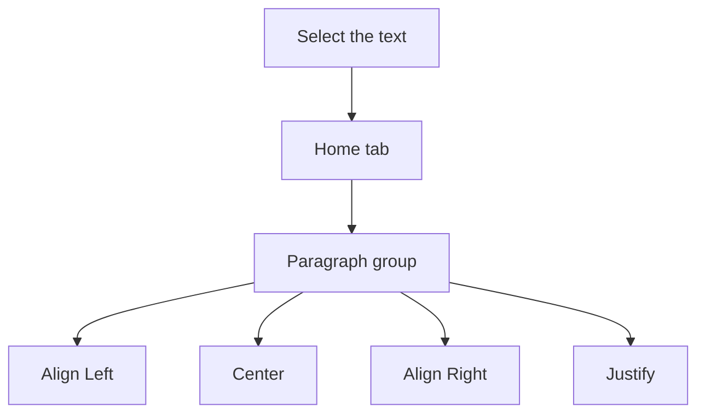

## Goal

By the end of this lesson, you can line up a paragraph left, centre, right or justified, and
change the space between its lines.

## Why It Matters

Look at a wedding card or a school notice. The heading sits in the middle of the page. The
name at the end often sits on the right. Neat lines with enough space between them are
clearer to read. Neat letters and forms look good at school and at work.

## Key Terms

| Term | Simple meaning |
|------|----------------|
| Paragraph | The text you type before you press **Enter**. It can be one line or many lines. |
| Alignment | Where the lines of a paragraph sit: on the left, in the centre or on the right. |
| Align Left | Lines start at the left side. |
| Center | Lines sit in the middle of the page. Word writes **Center**. |
| Align Right | Lines end at the right side. |
| Justify | Lines have straight edges on both the left and the right side. |
| Line spacing | The space between the lines of a paragraph. |
| Paragraph group | The part of the **Home** tab with the alignment buttons. |

**Diagram in words:** Select the text, then go to the Home tab and the Paragraph group. Choose
one of the four alignment buttons.

## Teacher Demo

Start a blank document. Type this notice. Press **Enter** only at the end of each paragraph,
not at the end of every line.

> Annual Prize Day
>
> Dear parents, you are invited to the Annual Prize Day of Green Valley School, Karachi. The
> function starts at 10 in the morning on Saturday. Students will get prizes for good results
> and for sports.
>
> Principal

**Alignment**

1. Select the first line, **Annual Prize Day** (see [Lesson 4.4](./copy-cut-paste.mdx)). *The
   class sees the line selected.*
2. On the **Home** tab, in the **Paragraph** group, select **Center**. *The heading moves to
   the middle.*
3. Select the last line, **Principal**. Select **Align Right**. *The word moves to the right
   side.*
4. Select the long paragraph. Select **Justify**. *Both sides of the paragraph become straight.
   The last line may be shorter.*
5. Select **Align Left**. *The right side becomes uneven again.* Then select **Justify** once
   more.

**Line spacing**

6. With the long paragraph still selected, go to **Home** > **Line and Paragraph Spacing**.
   *The class sees a list open.*
7. Select **Line Spacing Options**. *The class sees the **Paragraph** dialog box.*
8. In the **Line spacing** box, choose **1.5 lines**. Select **OK**. *The lines move further
   apart.*
9. Say: "There are keyboard shortcuts too." Press **Ctrl+1**. *The paragraph goes back to
   single spacing.* Press **Ctrl+2**. *It becomes double spacing.*

:::warning[UNVERIFIED]

The **Line and Paragraph Spacing** list may also show numbers such as 1.0, 1.5 and 2.0 that
you can choose directly. This could not be confirmed in official documentation for Word
2016/2019. Test it on a lab computer before teaching.

:::

:::info[Screenshot to add]

The **Home** tab with the **Paragraph** group circled. Show **Align Left**, **Center**,
**Align Right** and **Justify**. Also show **Line and Paragraph Spacing**.

:::

## Student Task

Make a small invitation. Type it first, then format it as the table shows.

| Paragraph | Type this | Format it like this |
|-----------|-----------|---------------------|
| 1 | Shop Opening | Center |
| 2 | Hamza Mobile Shop is opening on Monday in Saddar, Rawalpindi. Come and see new phones, covers and chargers. Every visitor gets a free cup of tea. | Justify, line spacing 1.5 lines |
| 3 | Hamza Ali | Align Right |

1. Start a blank document.
2. Type the three paragraphs from the table. Press **Enter** only at the end of each paragraph.
3. Select paragraph 1. On the **Home** tab, select **Center**.
4. Select paragraph 2. Select **Justify**.
5. With paragraph 2 still selected, go to **Home** > **Line and Paragraph Spacing** >
   **Line Spacing Options**.
6. In the **Line spacing** box, choose **1.5 lines**. Select **OK**.
7. Select paragraph 3. Select **Align Right**.
8. Save your work with the name **Shop Opening** (see
   [Lesson 4.3](./saving-closing-opening.mdx)).
9. Show your teacher: a centred heading, a justified paragraph with wider line spacing, and a
   name on the right.

## Check Questions

1. Point to the **Center** button and the **Justify** button.
   **Answer:** Both are on the Home tab, in the Paragraph group.
2. What does **Justify** do to a paragraph?
   **Answer:** It makes both the left and the right edges straight.
3. You want more space between the lines of a paragraph. What do you do?
   **Answer:** Select the paragraph. Go to Home > Line and Paragraph Spacing > Line Spacing
   Options. Choose 1.5 lines or Double, then select OK.

## Common Mistakes

- **Pressing Enter at the end of every line** → Each **Enter** starts a new paragraph (see
  [Lesson 4.2](./typing-and-correcting-text.mdx)). Press **Enter** only at the end of a
  paragraph.
- **Centring with the Spacebar** → Do not add many spaces. Select the text and use **Center**.
- **Changing the wrong paragraph** → Select the paragraph first. Press **Ctrl+Z** to undo a
  mistake.
- **Worrying about a short last line after Justify** → This is normal. The last line of a
  justified paragraph can be shorter.

## Sources

*For the teacher: these sources were checked before this lesson was written.*

- [Microsoft Support, "Align text left or right, center text, or justify text on a page"](https://support.microsoft.com/en-us/office/align-text-left-or-right-center-text-or-justify-text-on-a-page-70da744d-0f4d-472e-916d-1c42d94dc33f) (applies to Word 2016 and Word 2019): select the text; on the **Home** tab, in the **Paragraph** group, select **Align Left**, **Center**, **Align Right** or **Justify**; justify gives straight edges on both sides, and the last line can be much shorter.
- [Microsoft Support, "Change the line and paragraph spacing in Word"](https://support.microsoft.com/en-us/office/change-the-line-spacing-in-word-04ada056-b8ef-4b84-87dd-5d7c28a85712) (applies to Word 2016 and Word 2019): select paragraphs; **Home** > **Line and Paragraph Spacing** > **Line Spacing Options**; choose in the **Line spacing** box; select **OK**.
- [Microsoft Support, "Adjust indents and spacing in Word"](https://support.microsoft.com/en-us/word/adjust-indents-and-spacing-in-word) (applies to Word 2016 and Word 2019): the **Paragraph** dialog box; the line spacing choices **Single**, **1.5 lines** and **Double**.
- [Microsoft Support, "Keyboard shortcuts in Word"](https://support.microsoft.com/en-us/accessibility/word/keyboard-shortcuts-in-word) (applies to Word 2016 and Word 2019): **Ctrl+1** single spacing, **Ctrl+2** double spacing, **Ctrl+Z** undo.
