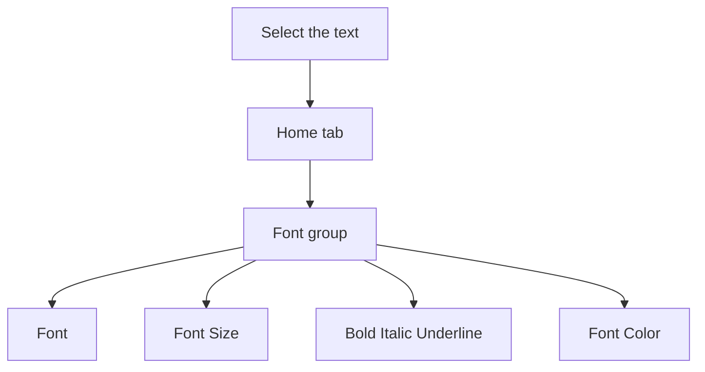

## Goal

By the end of this lesson, you can change the font, size, colour and style of text in Word.

## Why It Matters

Look at a shop sign in your bazaar. The shop name is big and bold, so you see it from far away.
In Word, you can make your own text look like this. A notice, a price list or a letter is
clearer when the important words stand out.

**Diagram in words:** First select the text. Then go to the Home tab, find the Font group, and
choose what you want to change.

## Key Terms

| Term | Simple meaning |
|------|----------------|
| Format | To change how text looks, but not what it says. |
| Font | The shape or design of the letters. |
| Font size | How big or small the letters are. A bigger number means bigger letters. |
| Bold | Makes letters thick and dark, so they stand out. |
| Italic | Makes letters slope to one side. |
| Underline | Draws a line under the text. |
| Font colour | The colour of the letters. Word writes it as **Font Color**. |
| Font group | The part of the **Home** tab with the buttons for font, size, style and colour. |

## Teacher Demo

Open Word and start a blank document (see [Lesson 4.1](./starting-word.mdx)). Type these three
lines. Press **Enter** at the end of each line.

> Bilal Fruit Shop
>
> Fresh mangoes: Rs 300 per kg
>
> Open every day

1. Say: "Before we change how text looks, we select it." Select the first line, **Bilal Fruit
   Shop** (see [Lesson 4.4](./copy-cut-paste.mdx)). *The class sees a background colour behind
   the line.*
2. Select the **Home** tab. Point to the **Font** group. *The class sees the font buttons.*
3. Select the **Font** box. Choose a different font from the list. *The letters change shape.*
4. Select the number in the **Font Size** box. Type **24** and press **Enter**. *The line
   becomes much bigger.*
5. Select **Bold**. *The letters become thick and dark.*
6. Choose the arrow next to **Font Color**. Select a colour, for example a red one. *The shop
   name changes colour.*
7. Select the second line. Select **Italic**. *The letters slope.*
8. Select the words **Open every day**. Select **Underline**. *A line appears under the words.*
9. Say: "You can also use the keyboard." Select the second line again. Hold down **Ctrl** and
   press **B**. *The second line becomes bold.*
10. Say: "Made a mistake? Press **Ctrl+Z** to undo it" (see [Lesson 4.2](./typing-and-correcting-text.mdx)). Press
    **Ctrl+Z**. *The bold goes away.*

:::info[Screenshot to add]

The **Home** tab in Word, with the **Font** group circled. Show the **Font** box, the **Font
Size** box, **Bold**, **Italic**, **Underline** and **Font Color**.

:::

## Student Task

Make a notice for a tailoring shop. Type these three lines first.

| Line | Type this | Format it like this |
|------|-----------|---------------------|
| 1 | Sana Tailoring Centre | A new font, size 24, bold, a colour you like |
| 2 | Ladies suits ready in 3 days | Italic |
| 3 | Only Rs 1,500 per suit | Underline the words **Rs 1,500** |

1. Open Word and start a blank document.
2. Type the three lines from the table. Press **Enter** at the end of each line.
3. Select line 1. In the **Font** box, choose a different font.
4. With line 1 still selected, type **24** in the **Font Size** box and press **Enter**.
5. Select **Bold**.
6. Choose the arrow next to **Font Color** and select a colour you like.
7. Select line 2. Select **Italic**.
8. In line 3, select only **Rs 1,500**. Select **Underline**.
9. Save your notice with the name **Tailor Notice** (see [Lesson 4.3](./saving-closing-opening.mdx)).
10. Show your teacher: your notice with a big, bold, coloured shop name, an italic line 2 and
    an underlined price.

## Check Questions

1. Point to the **Font** group on the **Home** tab.
   **Answer:** The student points to the Font group, with the Font box, Font Size box, Bold,
   Italic, Underline and Font Color.
2. What must you do first, before you make text bold?
   **Answer:** Select the text.
3. How do you change the colour of some words?
   **Answer:** Select the words. On the Home tab, choose the arrow next to Font Color. Then
   select a colour.

## Common Mistakes

- **Choosing a format before selecting the text** → Select the text first, then choose the
  format.
- **Making the wrong words bold or coloured** → Press **Ctrl+Z** to undo, then select the
  right words and try again.
- **Underlining by mistake** → Select the underlined text and press **Ctrl+U**. The underline
  goes away.
- **Using many fonts and colours on one page** → Use one or two fonts. Keep colour for the most
  important words, so the page stays clear.

## Sources

*For the teacher: these sources were checked before this lesson was written.*

- [Microsoft Support, "Word for new users"](https://support.microsoft.com/en-us/word/word-for-new-users) (applies to Word 2016 and Word 2019): select text by dragging, and a background colour shows the selection; most formatting tools are on the **Home** tab in the **Font** group; the jobs of **Font**, **Font Size**, **Bold**, **Italic**, **Underline** and **Font Color**.
- [Microsoft Support, "Use a screen reader to insert and change text in Word"](https://support.microsoft.com/en-us/accessibility/word/use-a-screen-reader-to-insert-and-change-text-in-word) (applies to Word 2016 and Word 2019): the **Font** box and **Font Size** box on the Home tab; you can type a font size and press Enter; **Ctrl+B**, **Ctrl+I** and **Ctrl+U** for bold, italic and underline.
- [Microsoft Support, "Change the font color in a Word document"](https://support.microsoft.com/en-us/office/change-the-font-color-37484b84-1605-48fc-8771-366913e5700c) (applies to Word 2016 and Word 2019): on the **Home** tab, in the **Font** group, choose the arrow next to **Font Color**, then select a colour.
- [Microsoft Support, "Underline text or spaces"](https://support.microsoft.com/en-us/office/underline-text-or-spaces-f09d6d22-aaa7-423e-8f50-09af37f289be) (applies to Word 2016 and Word 2019): **Home** > **Underline**, or **Ctrl+U**; select underlined text and press **Ctrl+U** to remove a single underline.
- [Microsoft Support, "Keyboard shortcuts in Word"](https://support.microsoft.com/en-us/accessibility/word/keyboard-shortcuts-in-word) (applies to Word 2016 and Word 2019): **Ctrl+B** bold, **Ctrl+I** italic, **Ctrl+U** underline, **Ctrl+Z** undo.
