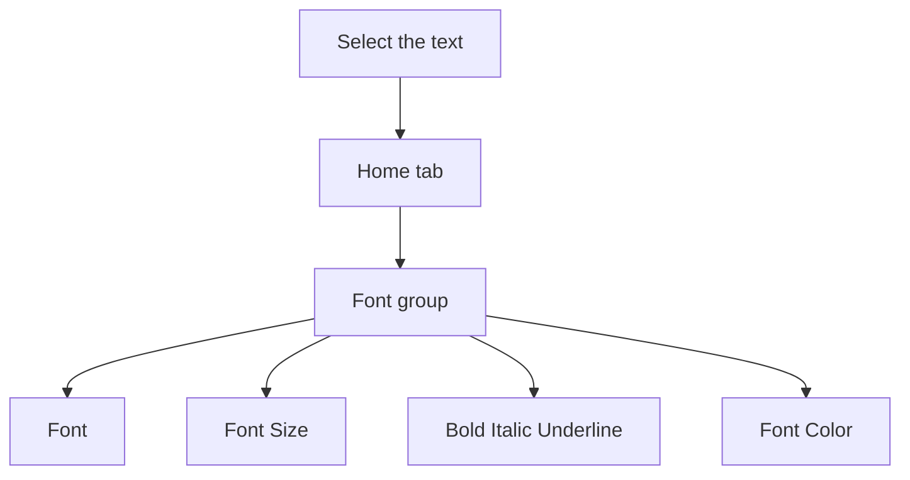

## Goal

By the end of this lesson, you can change the font, size, colour and style of text in Word.

## Why It Matters

Look at a shop sign in your bazaar. The shop name is big and bold, so you see it from far away.
On a school result card, the student's name and total marks often stand out too. In Word, you
can make your own text look like this. A notice, a price list or a job application is clearer
when the important words stand out.

**Diagram in words:** First select the text. Then go to the Home tab, find the Font group, and
choose what you want to change.

## Key Terms

| Term | Simple meaning |
|------|----------------|
| Format | To change how text looks, but not what it says. |
| Font | The shape or design of the letters. |
| Font size | How big or small the letters are. A bigger number means bigger letters. |
| Bold | Makes letters thick and dark, so they stand out. |
| Italic | Makes letters slope to one side. |
| Underline | Draws a line under the text. |
| Font colour | The colour of the letters. Word writes it as **Font Color**. |
| Font group | The part of the **Home** tab with the buttons for font, size, style and colour. |

## Step by Step

Open Word and start a blank document (see [Lesson 4.1](./starting-word.mdx)). You will make a
small sign for a fruit shop. Type these three lines. Press **Enter** at the end of each line.

> Bilal Fruit Shop
>
> Fresh mangoes: Rs 300 per kg
>
> Open every day

Formatting is like dressing up your words. The words stay the same. Only their look changes.

1. Select the first line, **Bilal Fruit Shop** (see [Lesson 4.4](./copy-cut-paste.mdx)). You
   always select text first, so that Word knows which words to change. *You see a background
   colour behind the line.*
2. Select the **Home** tab. Find the **Font** group. *You see the font buttons.* All the
   buttons for the look of letters are here.
3. Select the **Font** box. Choose a different font from the list. *The letters change shape.*
   A new font gives the shop name its own style.
4. Select the number in the **Font Size** box. Type **24** and press **Enter**. *The line
   becomes much bigger.* Big letters can be read from far away.
5. Select **Bold**. *The letters become thick and dark.* This makes the shop name stand out.
6. Choose the arrow next to **Font Color**. Select a colour, for example a red one. *The shop
   name changes colour.* Colour catches the eye of people walking past.
7. Select the second line. Select **Italic**. *The letters slope.* This makes the offer look
   different from the shop name.
8. Select the words **Open every day**. Select **Underline**. *A line appears under the words.*
   This draws attention to the opening days.
9. You can also use the keyboard. It is faster when your hands are on the keys. Select the
   second line again. Hold down **Ctrl** and press **B**. *The second line becomes bold.*
10. Made a mistake? Press **Ctrl+Z** to undo it (see
    [Lesson 4.2](./typing-and-correcting-text.mdx)). *The bold goes away.*

{/* Screenshot to add: The **Home** tab in Word, with the **Font** group circled. Show the **Font** box, the **Font Size** box, **Bold**, **Italic**, **Underline** and **Font Color**. */}

## Practice

Your neighbour Sana runs a tailoring shop. She wants a notice to stick on her door. Make it for
her. Type these three lines first.

| Line | Type this | Format it like this |
|------|-----------|---------------------|
| 1 | Sana Tailoring Centre | A new font, size 24, bold, a colour you like |
| 2 | Ladies suits ready in 3 days | Italic |
| 3 | Only Rs 1,500 per suit | Underline the words **Rs 1,500** |

1. Open Word and start a blank document.
2. Type the three lines from the table. Press **Enter** at the end of each line.
3. Select line 1. In the **Font** box, choose a different font.
4. With line 1 still selected, type **24** in the **Font Size** box and press **Enter**. The
   shop name must be the biggest thing on the notice.
5. Select **Bold**, so that the name stands out.
6. Choose the arrow next to **Font Color** and select a colour you like.
7. Select line 2. Select **Italic**.
8. In line 3, select only **Rs 1,500**. Select **Underline**, so that customers notice the price.
9. Save your notice with the name **Tailor Notice** (see
   [Lesson 4.3](./saving-closing-opening.mdx)), so that Sana can print it later.
10. Check your work: line 1 is in a new font, size 24, bold and in colour. Line 2 is in italic.
    In line 3, only **Rs 1,500** is underlined. The title bar shows **Tailor Notice**.

## Check Questions

1. Point to the **Font** group on the **Home** tab.

   

   
Show answer

   **Answer:** You point to the Font group, with the Font box, Font Size box, Bold,
   Italic, Underline and Font Color.

   

2. What must you do first, before you make text bold?

   

   
Show answer

   **Answer:** Select the text.

   

3. How do you change the colour of some words?

   

   
Show answer

   **Answer:** Select the words. On the Home tab, choose the arrow next to Font Color. Then
   select a colour.

   

## Common Mistakes

- **Choosing a format before selecting the text** → Select the text first, then choose the
  format.
- **Making the wrong words bold or coloured** → Press **Ctrl+Z** to undo, then select the
  right words and try again.
- **Underlining by mistake** → Select the underlined text and press **Ctrl+U**. The underline
  goes away.
- **Using many fonts and colours on one page** → Use one or two fonts. Keep colour for the most
  important words, so the page stays clear.

## Sources

*These official pages were checked when this lesson was written.*

- [Microsoft Support, "Word for new users"](https://support.microsoft.com/en-us/word/word-for-new-users) (applies to Word 2021, Word 2024, Word 2019, Word 2016 and Word for Microsoft 365): "A background color is added in the location of the selected text"; "You can find most text formatting tools by clicking the Home tab and then choosing from the Font group"; the buttons **Font** ("Changes the font"), **Font Size** ("Changes the size of the text"), **Bold**, **Italic**, **Underline** and **Font Color** ("Changes the text color").
- [Microsoft Support, "Add and edit text"](https://support.microsoft.com/en-us/office/add-and-edit-text-ed1e3147-a846-41ca-8087-49e324cb50bd) (applies to Word 2021, Word 2024 and Word for Microsoft 365): "Select the text you want to format"; "From the pop up toolbar or the Home tab, select an option to change the Font, Font Size, Font Color, or make the text bold, italics, or underline."
- [Microsoft Support, "Use a screen reader to insert and change text in Word"](https://support.microsoft.com/en-us/accessibility/word/use-a-screen-reader-to-insert-and-change-text-in-word) (applies to Word 2021, Word 2024, Word 2019, Word 2016 and Word for Microsoft 365): the **Font** box lists fonts ("Press the Down arrow key until you hear the font you want"); for the font size, "Type the font size you want, and then press Enter"; "To apply bold formatting, press Ctrl+B"; "To apply italic formatting, press Ctrl+I"; "To apply underlined formatting, press Ctrl+U".
- [Microsoft Support, "Change the font color in a Word document"](https://support.microsoft.com/en-us/office/change-the-font-color-37484b84-1605-48fc-8771-366913e5700c) (applies to Word 2021, Word 2024, Word 2019, Word 2016 and Word for Microsoft 365): "On the Home tab, in the Font group, choose the arrow next to Font Color, and then select a color."
- [Microsoft Support, "Underline text or spaces"](https://support.microsoft.com/en-us/office/underline-text-or-spaces-f09d6d22-aaa7-423e-8f50-09af37f289be) (applies to Word 2021, Word 2024, Word 2019, Word 2016 and Word for Microsoft 365): "Go to Home > Underline. Or press Ctrl+U"; "To remove single underlining from words and spaces, select the underlined text and press Ctrl+U."
- [Microsoft Support, "Keyboard shortcuts in Word"](https://support.microsoft.com/en-us/accessibility/word/keyboard-shortcuts-in-word) (applies to Word 2021, Word 2024, Word 2019, Word 2016 and Word for Microsoft 365): "Apply bold formatting to text. Ctrl+B"; "Apply italic formatting to text. Ctrl+I"; "Apply underline formatting to text. Ctrl+U"; "Undo the previous action. Ctrl+Z".
