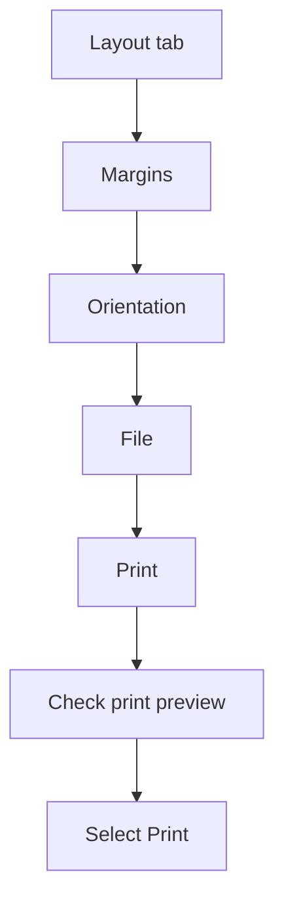

## Goal

By the end of this lesson, you can change the margins and orientation of a page, check it in
print preview, and print it.

## Why It Matters

Before you print, you set up the page. A wide shop price list or timetable may need a page
turned sideways. A school notice or a job application letter must look neat on one page. Print
preview shows the page before it goes to the printer. Checking first saves paper, ink and money.

**Diagram in words:** On the Layout tab, set the margins and the orientation. Then select File
and Print, check the print preview, and select Print.

## Key Terms

| Term | Simple meaning |
|------|----------------|
| Margin | The empty space between the text and the edge of the page, like the blank border in a school copy. |
| Orientation | Which way the page stands: tall or wide. |
| Portrait | A tall page. This is the normal way, like a photo of one person. |
| Landscape | A wide page, turned on its side, like a photo of a wide view. |
| Paper size | How big the sheet of paper is. |
| Print preview | A picture of how your page will look on paper. |
| Printer | A machine that puts your document on paper. |

## Step by Step

Follow these steps on your own computer. Open a document that has some text, such as the
**Price List** from [Lesson 4.9](tables.mdx). See [Lesson 4.3](saving-closing-opening.mdx) to
open a document.

**Margins**

1. In Word, each page starts with a one-inch margin on every side. You can change it, so that
   more or less text fits on the page.
2. Select the **Layout** tab, then **Margins**. *You see a list of margin choices.*
3. Select a different margin choice. *The text moves closer to, or further from, the edges.*

**Orientation**

A wide table, like a price list with many columns, fits better on a wide page.

4. Select **Layout**, then **Orientation**, then **Landscape**. *The page turns wide.*
5. Select **Layout**, then **Orientation**, then **Portrait**. *The page is tall again.* Most
   letters and notices use a tall page.

**Paper size**

6. Paper comes in different sizes. Check the paper size before printing, so that your page
   fits the paper. Select **Layout**, then **Size**, then **A4**.

   :::tip[If your screen looks different]

   You may not find a **Size** button. Do this instead: select **File**, then **Print**.
   Choose the paper size in the boxes under **Settings**.

   :::

**Print preview and printing**

7. Select **File**, then **Print**. *You see a picture of the page: the print preview.* Here
   you can spot problems before you use any paper.
8. Use the arrows at the bottom to go to the next or previous page.
9. Use the zoom slider at the bottom to make the page bigger. *The text is easier to read.*
10. Look at the boxes under **Settings**. Here you can check the orientation before you print.
11. If you have a printer: choose **1** copy and select **Print**. *The page comes out.* One
    copy is enough to check your work.
12. If there is no printer, stop at the preview. The preview shows what would print.
13. Press **Esc** to leave the print screen. *You see the document again.* The **Back** arrow
    at the top left does the same job.

{/* Screenshot to add: The File, then Print screen in Word, showing the print preview and the Settings boxes. */}

## Practice

Bright Future School is going on a picnic. You are asked to type the notice that goes home with
every child. You do not need a printer for this task.

| Line | Type this |
|------|-----------|
| 1 | Bright Future School |
| 2 | Notice: School Picnic |
| 3 | The picnic is on Friday, 20 November. |
| 4 | Please bring Rs 300 and a water bottle. |
| 5 | The bus leaves at 8 in the morning. |

1. Open a new blank document. Type the five lines. Press **Enter** after each line.
2. Select **Layout**, then **Margins**. Choose a different margin.
3. Select **Layout**, then **Orientation**, then **Landscape**.
4. Select **File**, then **Print**. Look at the wide page in the print preview.
5. Press **Esc** to go back to your document. Change the orientation back to **Portrait**.
   A notice for parents looks normal on a tall page.
6. Look at the print preview again. Check that the page is tall.
7. Save the document as **Picnic Notice** ([Lesson 4.3](saving-closing-opening.mdx)).
8. Print only if you have a printer and need a paper copy. Choose **1** copy, so that you do
   not waste paper.
9. Check your work: the print preview shows one tall (portrait) page. It has all five lines,
   from **Bright Future School** to **The bus leaves at 8 in the morning.** The document is
   saved as **Picnic Notice**.

## Check Questions

1. Show your document in print preview.
   **Answer:** Select **File**, then **Print**. The preview shows the page.
2. What is the difference between portrait and landscape?
   **Answer:** Portrait is a tall page. Landscape is a wide page.
3. Why should you look at the print preview before you print?
   **Answer:** You can find problems first. This saves paper and ink.

## Common Mistakes

- **Looking for Margins on the Home tab** → Margins and Orientation are on the **Layout** tab.
- **Printing many copies by mistake** → Check the number of copies before you select **Print**.
- **Selecting Print when there is no printer** → Stop at the print preview instead. It shows what would print.
- **Forgetting that the page is still landscape** → Check the orientation under **Settings** in the print preview.

## Sources

*These official pages were checked when this lesson was written.*

- [Microsoft Support, "Change the margins in your Word document"](https://support.microsoft.com/en-gb/office/change-the-margins-in-your-word-document-c95c1ea1-70b1-4dde-a1da-f5aa2042c829): applies to Word 2016 and Word 2019; each page has a one-inch margin; Layout, then Margins, then choose a margin or Custom Margins.
- [Microsoft Support, "Print with landscape orientation in Word"](https://support.microsoft.com/en-us/office/print-with-landscape-orientation-in-word-c3499035-7f70-4835-b4d6-444e5d1993c5): applies to Word 2019; Layout, then Orientation, then Landscape; under Settings in File, then Print, the orientation box shows the orientation.
- [Microsoft Support, "Change page orientation to landscape or portrait"](https://support.microsoft.com/en-us/word/training/change-page-orientation-to-landscape-or-portrait): Layout, then Orientation, then Portrait or Landscape (this page lists Word 2021 and later only; the page above covers Word 2019).
- [Microsoft Support, "Page Setup - Paper options"](https://support.microsoft.com/en-US/Word/page-setup-paper-options): applies to Word 2016 and Word 2019; the Paper tab of the Page Setup box has a Paper size list. It does not say how to open the box, so the paper-size step has a backup way in the box.
- [Microsoft Support, "Page Setup - Layout options"](https://support.microsoft.com/en-us/word/page-setup-layout-options): applies to Word 2016 and Word 2019; use "the choices for pages, orientation, paper size, margins, and so on under Settings (Go to File > Print)". Confirms the backup way in the paper-size box.
- [Microsoft Support, "Start Backstage with the File tab" (archived Microsoft page, August 2019)](https://web.archive.org/web/20190819060248/https://support.office.com/en-us/article/Start-Backstage-with-the-File-tab-04610088-406C-43D0-98A0-C1999AB4EF53): applies to Word 2019 and Word 2016 (**Office 2010 - 2019** tab); the **Print** command is in Backstage view, which opens from the **File** tab; "If you want to exit Backstage, and return to the document you were working on ... click the Back arrow that is at the top left of the navigation pane, or just press the Escape key on your keyboard."
- [Microsoft Support, "Keyboard shortcuts for the File menu in Microsoft 365 for Windows"](https://support.microsoft.com/en-us/office/keyboard-shortcuts-for-the-file-menu-in-microsoft-365-for-windows-1c4b07af-be2e-4c19-8d33-c600a8904043): applies to Word 2019; the **Print** page is in the File menu; **Esc**: "Exit the File menu and return to the normal, editing, or Inbox view."
- [Microsoft Support, "Print a document in Word for Windows"](https://support.microsoft.com/en-us/office/print-a-document-in-word-591022c4-53e3-4242-95b5-58ca393ba0ee): applies to Word 2016 and Word 2019; File, then Print shows the preview; arrows and zoom slider at the bottom; choose the number of copies and select Print.
- [Microsoft Support, "Keyboard shortcuts in Word"](https://support.microsoft.com/en-us/office/keyboard-shortcuts-in-word-95ef89dd-7142-4b50-afb2-f762f663ceb2): applies to Word 2016 and Word 2019; Esc cancels a command.
