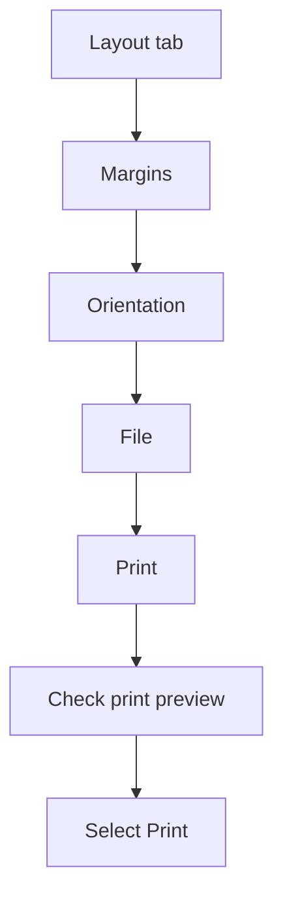

## Goal

By the end of this lesson, you can change the margins and orientation of a page, check it in
print preview, and print it.

## Why It Matters

Before you print, you set up the page. A wide timetable may need a page turned sideways.
Print preview shows the page before it goes to the printer. Checking first saves paper, ink and
money.

**Diagram in words:** On the Layout tab, set the margins and the orientation. Then select File
and Print, check the print preview, and select Print.

## Key Terms

| Term | Simple meaning |
|------|----------------|
| Margin | The empty space between the text and the edge of the page. |
| Orientation | Which way the page stands: tall or wide. |
| Portrait | A tall page. This is the normal way. |
| Landscape | A wide page, turned on its side. |
| Paper size | How big the sheet of paper is. |
| Print preview | A picture of how your page will look on paper. |
| Printer | A machine that puts your document on paper. |

## Teacher Demo

Open a document that has some text, such as the **Price List** from
[Lesson 4.9](tables.mdx). See [Lesson 4.3](saving-closing-opening.mdx) to open a document.

**Margins**

1. Say: "In Word, each page starts with a one-inch margin on every side."
2. Select the **Layout** tab, then **Margins**. *The class sees a list of margin choices.*
3. Select a different margin choice. *The text moves closer to, or further from, the edges.*

**Orientation**

4. Select **Layout**, then **Orientation**, then **Landscape**. *The page turns wide.*
5. Select **Layout**, then **Orientation**, then **Portrait**. *The page is tall again.*

**Paper size**

6. Say: "Paper comes in different sizes. We check the paper size before printing."

   :::warning[UNVERIFIED]

   This step could not be confirmed in official documentation for Word 2016/2019.
   Test it on a lab computer before teaching. Select **Layout**, then **Size**, then **A4**.
   Microsoft's page confirms a **Paper size** list on the **Paper** tab of the **Page Setup**
   box, but not the **Size** button for these versions.

   :::

**Print preview and printing**

7. Select **File**, then **Print**. *The class sees a picture of the page: the print preview.*
8. Use the arrows at the bottom to go to the next or previous page.
9. Use the zoom slider at the bottom to make the page bigger. *The text is easier to read.*
10. Point to the boxes under **Settings**. Say: "Here you can check the orientation."
11. If the lab has a printer: choose **1** copy and select **Print**. *The page comes out.*
12. If there is no printer, stop at the preview. Say: "The preview shows what would print."

    :::warning[UNVERIFIED]

    This step could not be confirmed in official documentation for Word 2016/2019.
    Test it on a lab computer before teaching. Press **Esc** to leave the print screen and go
    back to your document.

    :::

:::info[Screenshot to add]

The File, then Print screen in Word, showing the print preview and the Settings boxes.

:::

## Student Task

Type this notice. You do not need a printer for this task.

| Line | Type this |
|------|-----------|
| 1 | Bright Future School |
| 2 | Notice: School Picnic |
| 3 | The picnic is on Friday, 20 November. |
| 4 | Please bring Rs 300 and a water bottle. |
| 5 | The bus leaves at 8 in the morning. |

1. Open a new blank document. Type the five lines. Press **Enter** after each line.
2. Select **Layout**, then **Margins**. Choose a different margin.
3. Select **Layout**, then **Orientation**, then **Landscape**.
4. Select **File**, then **Print**. Look at the wide page in the print preview.
5. Go back to your document (your teacher shows you how). Change the orientation back to
   **Portrait**.
6. Look at the print preview again. Check that the page is tall.
7. Save the document as **Picnic Notice** ([Lesson 4.3](saving-closing-opening.mdx)).
8. Print only if your teacher says yes. Choose **1** copy.
9. Show your teacher: your notice in print preview, with a tall (portrait) page.

## Check Questions

1. Show your document in print preview.
   **Answer:** Select **File**, then **Print**. The preview shows the page.
2. What is the difference between portrait and landscape?
   **Answer:** Portrait is a tall page. Landscape is a wide page.
3. Why should you look at the print preview before you print?
   **Answer:** You can find problems first. This saves paper and ink.

## Common Mistakes

- **Looking for Margins on the Home tab** → Margins and Orientation are on the **Layout** tab.
- **Printing many copies by mistake** → Check the number of copies before you select **Print**.
- **Selecting Print when the lab has no printer** → Stop at the print preview. Ask your teacher first.
- **Forgetting that the page is still landscape** → Check the orientation under **Settings** in the print preview.

## Sources

*For the teacher: these sources were checked before this lesson was written.*

- [Microsoft Support, "Change the margins in your Word document"](https://support.microsoft.com/en-gb/office/change-the-margins-in-your-word-document-c95c1ea1-70b1-4dde-a1da-f5aa2042c829): applies to Word 2016 and Word 2019; each page has a one-inch margin; Layout, then Margins, then choose a margin or Custom Margins.
- [Microsoft Support, "Print with landscape orientation in Word"](https://support.microsoft.com/en-us/office/print-with-landscape-orientation-in-word-c3499035-7f70-4835-b4d6-444e5d1993c5): applies to Word 2019; Layout, then Orientation, then Landscape; under Settings in File, then Print, the orientation box shows the orientation.
- [Microsoft Support, "Change page orientation to landscape or portrait"](https://support.microsoft.com/en-us/word/training/change-page-orientation-to-landscape-or-portrait): Layout, then Orientation, then Portrait or Landscape (this page lists Word 2021 and later only; the page above covers Word 2019).
- [Microsoft Support, "Page Setup - Paper options"](https://support.microsoft.com/en-US/Word/page-setup-paper-options): applies to Word 2016 and Word 2019; the Paper tab of the Page Setup box has a Paper size list. It does not say how to open the box, so the paper-size step is marked UNVERIFIED.
- [Microsoft Support, "Print a document in Word for Windows"](https://support.microsoft.com/en-us/office/print-a-document-in-word-591022c4-53e3-4242-95b5-58ca393ba0ee): applies to Word 2016 and Word 2019; File, then Print shows the preview; arrows and zoom slider at the bottom; choose the number of copies and select Print.
- [Microsoft Support, "Keyboard shortcuts in Word"](https://support.microsoft.com/en-us/office/keyboard-shortcuts-in-word-95ef89dd-7142-4b50-afb2-f762f663ceb2): applies to Word 2016 and Word 2019; Esc cancels a command (it does not say Esc leaves the print screen, so that step is marked UNVERIFIED).
