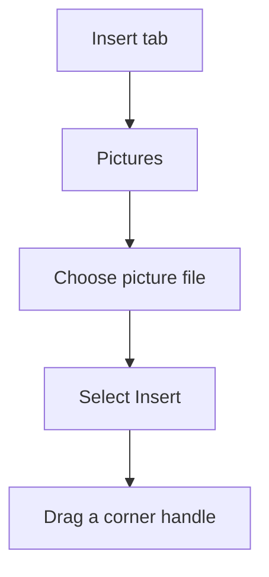

## Goal

By the end of this lesson, you can insert a picture and a shape in a Word document and change
the picture's size.

## Why It Matters

Pictures make a document easier to understand. A shop poster looks better with a picture of the
goods. A school notice can use a shape to show an important word. People notice a poster with a
picture.

**Diagram in words:** Select the Insert tab, then Pictures. Choose your picture file and select
Insert. Then drag a corner handle to make the picture bigger or smaller.

## Key Terms

| Term | Simple meaning |
|------|----------------|
| Picture file | A photo or drawing saved on the computer. |
| Shape | A ready-made drawing, such as a circle, square, star or arrow. |
| Sizing handle | A small mark on the edge or corner of a selected picture or shape. You drag it to change the size. |
| Resize | To make a picture or shape bigger or smaller. |
| Drag | To hold down the left mouse button, move the mouse, then let go. |

## Teacher Demo

:::tip[Before class]

Copy one picture file onto every lab computer. Use a simple photo, such as fruit or a shop.
Put it in the same folder on every computer. Write the folder name on the board.

:::

Open a new blank document ([Lesson 4.1](starting-word.mdx)). You will make a small shop poster.

**Inserting a picture**

1. Type **Rafiq Fruit Shop**. Press **Enter**. *The class sees the shop name.*
2. Type **Fresh fruit every day**. Press **Enter**. *The cursor is on a new empty line.*
3. Say: "The picture goes where the cursor is."
4. Select the **Insert** tab. *The class sees the Insert tab buttons.*
5. Select **Pictures**.

   :::warning[UNVERIFIED]

   This step could not be confirmed in official documentation for Word 2016/2019.
   Test it on a lab computer before teaching. Microsoft's page says to select **This Device**
   after **Pictures**. On Word 2016/2019 this choice may not appear. If you see it, select
   **This Device**.

   :::

6. Go to the folder on the board. Select the picture file. *The class sees the file is chosen.*
7. Select **Insert**. *The picture appears in the document.*

**Resizing the picture**

8. Click the picture to select it. *The class sees sizing handles on its edges and corners.*
9. Drag a corner handle towards the middle of the picture. *The picture gets smaller.*
10. Say: "Hold **Shift** while you drag. The picture keeps its shape."

**Inserting a shape**

11. Click at the end of your text.
12. Select the **Insert** tab, then **Shapes**. *The class sees a gallery of shapes.*
13. Select any shape from the gallery.
14. Click on the page and drag. *The shape appears as you drag.*
15. Say: "Hold **Shift** while you drag to make a perfect circle or square."
16. With the shape still selected, type **SALE**. *The word appears inside the shape.*
17. Save the document as **Fruit Poster** ([Lesson 4.3](saving-closing-opening.mdx)).

:::info[Screenshot to add]

A selected picture in Word, with its sizing handles showing on the edges and corners.

:::

## Student Task

Make a poster for a made-up shop. Use the picture file your teacher shows you.

1. Open a new blank document.
2. Type **Noor Fruit Shop**. Press **Enter**.
3. Type **Open from 9 in the morning**. Press **Enter**.
4. Insert the picture file from the folder on the board (**Insert**, **Pictures**).
5. Select the picture. Hold **Shift** and drag a corner handle to make it smaller.
6. Insert a shape (**Insert**, **Shapes**). Drag on the page to draw it.
7. With the shape selected, type **New**.
8. Save the document as **My Poster** ([Lesson 4.3](saving-closing-opening.mdx)).
9. Show your teacher: your poster with the shop name, a smaller picture and a shape with text.

## Check Questions

1. Select your picture. Point to one sizing handle.
   **Answer:** The student points to a small mark on a corner or edge of the selected picture.
2. Which tab do you use to insert a picture or a shape?
   **Answer:** The **Insert** tab. Pictures are under **Pictures**. Shapes are under **Shapes**.
3. How do you resize a picture and keep its shape the same?
   **Answer:** Hold **Shift** while you drag a corner handle.

## Common Mistakes

- **Not finding the picture file** → Look at the folder name on the board. Ask your teacher to show you the folder.
- **The picture looks stretched or squashed** → Undo it with **Ctrl+Z**. Then hold **Shift** and drag a corner handle.
- **The shape is too big or too small** → Select the shape and drag a sizing handle.
- **The word does not go inside the shape** → Click the shape to select it first. Then type.

## Sources

*For the teacher: these sources were checked before this lesson was written.*

- [Microsoft Support, "Insert pictures"](https://support.microsoft.com/en-us/office/insert-pictures-3c51edf4-22e1-460a-b372-9329a8724344): applies to Word 2016 and Word 2019; Insert, then Pictures, then This Device for a picture on your PC; then select Insert; resize by dragging corner handles.
- [Microsoft Support, "Change the size of a picture, shape, text box, or WordArt in Word"](https://support.microsoft.com/en-us/office/change-the-size-of-a-picture-shape-text-box-or-wordart-in-word-901ec456-33ce-40d3-828d-5552ee794aa1): applies to Word 2016 and Word 2019; select the object and drag a sizing handle; hold Shift while dragging to keep the proportions.
- [Microsoft Support, "Add shapes"](https://support.microsoft.com/en-us/office/add-shapes-0e492bb4-3f91-43b5-803f-dd0998e0eb89): applies to Word 2016 and Word 2019; Insert tab, then Shapes; select a shape, then click and drag; hold Shift for a perfect square or circle; select the shape and type to add text.
- [Microsoft Support, "Keyboard shortcuts in Word"](https://support.microsoft.com/en-us/office/keyboard-shortcuts-in-word-95ef89dd-7142-4b50-afb2-f762f663ceb2): applies to Word 2016 and Word 2019; Ctrl+Z undoes the last action.
