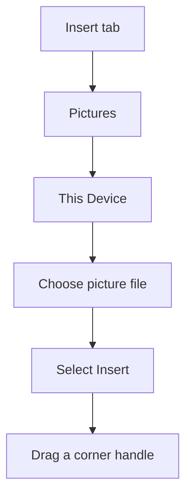

## Goal

By the end of this lesson, you can insert a picture and a shape in a Word document and change
the picture's size.

## Why It Matters

Pictures make a document easier to understand. A fruit shop poster looks better with a picture
of fresh fruit. A mobile shop can put a star shape around the word "SALE". A school notice can
use a shape to show an important word. People stop and look at a poster with a picture.

**Diagram in words:** Select the Insert tab, then Pictures, then This Device. Choose your
picture file and select Insert. Then drag a corner handle to make the picture bigger or smaller.

## Key Terms

| Term | Simple meaning |
|------|----------------|
| Picture file | A photo or drawing saved on the computer, like a photo kept in an album. |
| Shape | A ready-made drawing, such as a circle, square, star or arrow. |
| Sizing handle | A small mark on the edge or corner of a selected picture or shape. You drag it to change the size. |
| Resize | To make a picture or shape bigger or smaller. |
| Drag | To hold down the left mouse button, move the mouse, then let go. |

## Step by Step

Follow these steps on your own computer. You need one picture file saved on your computer,
such as a photo of fruit or a shop. Find out which folder it is in before you start.

Open a new blank document ([Lesson 4.1](starting-word.mdx)). You will make a small poster for
a fruit shop.

**Inserting a picture**

1. Type **Rafiq Fruit Shop**. Press **Enter**. *You see the shop name.*
2. Type **Fresh fruit every day**. Press **Enter**. *The cursor is on a new empty line.*
3. The picture goes where the cursor is. That is why you move to a new line first.
4. Select the **Insert** tab. *You see the Insert tab buttons.*
5. Select **Pictures**, then **This Device**. *The Insert Picture box opens.* **This Device**
   means a picture saved on your own computer.
6. Go to the folder where your picture is saved. Select the picture file. *The file is chosen.*
7. Select **Insert**. *The picture appears in the document.*

**Resizing the picture**

Your picture may be too big for a poster. You make it smaller, so that the shop name and text
have room too.

8. Click the picture to select it. *You see sizing handles on its edges and corners.*
9. Drag a corner handle towards the middle of the picture. *The picture gets smaller.*
10. Hold **Shift** while you drag. The picture keeps its shape, so the fruit does not look
    stretched or squashed.

**Inserting a shape**

A shape catches the eye, like a bright sticker on a shop window.

11. Click at the end of your text.
12. Select the **Insert** tab, then **Shapes**. *You see a gallery of shapes.*
13. Select any shape from the gallery.
14. Click on the page and drag. *The shape appears as you drag.*
15. Hold **Shift** while you drag to make a perfect circle or square.
16. With the shape still selected, type **SALE**. *The word appears inside the shape.* The
    word inside the shape tells customers about the offer.
17. Save the document as **Fruit Poster** ([Lesson 4.3](saving-closing-opening.mdx)), so that
    your poster is not lost.

{/* Screenshot to add: A selected picture in Word, with its sizing handles showing on the edges and corners. */}

## Practice

Your neighbour is opening Noor Fruit Shop. Make a poster for the shop window, so that people
passing by know when the shop opens. Use a picture file saved on your computer.

1. Open a new blank document.
2. Type **Noor Fruit Shop**. Press **Enter**.
3. Type **Open from 9 in the morning**. Press **Enter**, so that the picture goes on a new line.
4. Insert your picture file (**Insert**, **Pictures**, **This Device**). Go to the folder where
   it is saved.
5. Select the picture. Hold **Shift** and drag a corner handle to make it smaller. This keeps
   the picture's shape.
6. Insert a shape (**Insert**, **Shapes**). Drag on the page to draw it.
7. With the shape selected, type **New**. This tells people the shop is new.
8. Save the document as **My Poster** ([Lesson 4.3](saving-closing-opening.mdx)).
9. Check your work: your poster shows **Noor Fruit Shop** and **Open from 9 in the morning**.
   Below them is your picture, smaller than before and not stretched. There is one shape with
   the word **New** inside it. The document is saved as **My Poster**.

## Check Questions

1. Select your picture. Point to one sizing handle.

   

   
Show answer

   **Answer:** You point to a small mark on a corner or edge of the selected picture.

   

2. Which tab do you use to insert a picture or a shape?

   

   
Show answer

   **Answer:** The **Insert** tab. Pictures are under **Pictures**, then **This Device**. Shapes
   are under **Shapes**.

   

3. How do you resize a picture and keep its shape the same?

   

   
Show answer

   **Answer:** Hold **Shift** while you drag a corner handle.

   

## Common Mistakes

- **Not finding the picture file** → Think about where the picture was saved, and go to that folder. Ask for help if you cannot find it.
- **The picture looks stretched or squashed** → Undo it with **Ctrl+Z**. Then hold **Shift** and drag a corner handle.
- **The shape is too big or too small** → Select the shape and drag a sizing handle.
- **The word does not go inside the shape** → Click the shape to select it first. Then type.

## Sources

*These official pages were checked when this lesson was written.*

- [Microsoft Support, "Insert pictures"](https://support.microsoft.com/en-us/office/insert-pictures-3c51edf4-22e1-460a-b372-9329a8724344) (applies to Word 2021, **Windows** tab): "Select Insert > Pictures > This Device for a picture on your PC"; "Select the picture you want, and then select Insert"; "To resize a picture, select the picture and drag a corner handle."
- [Microsoft Support, "Use a screen reader to insert a picture or image in Word"](https://support.microsoft.com/en-us/accessibility/word/use-a-screen-reader-to-insert-a-picture-or-image-in-word) (applies to Word 2021): "place the insertion point where you want to insert an image"; then "The Insert Picture dialog box opens."
- [Microsoft Support, "Change the size of a picture, shape, text box, or WordArt in Word"](https://support.microsoft.com/en-us/office/change-the-size-of-a-picture-shape-text-box-or-wordart-in-word-901ec456-33ce-40d3-828d-5552ee794aa1) (applies to Word 2021, **Windows** tab): select the object and "drag a sizing handle away from or toward the center"; "To maintain the proportions, press and hold Shift while you drag the sizing handle."
- [Microsoft Support, "Add shapes"](https://support.microsoft.com/en-us/office/add-shapes-0e492bb4-3f91-43b5-803f-dd0998e0eb89) (applies to Word 2021, **Windows** tab): "On the Insert tab, click Shapes"; "Select the shape you want, click in the workspace and drag to draw the shape"; "To create a perfect square or circle ... press and hold Shift while you drag"; "Insert a shape or select an existing shape, and then enter text."
- [Microsoft Support, "Keyboard shortcuts in Word"](https://support.microsoft.com/en-us/office/keyboard-shortcuts-in-word-95ef89dd-7142-4b50-afb2-f762f663ceb2) (applies to Word 2021): **Ctrl+Z** "Undo the previous action."
