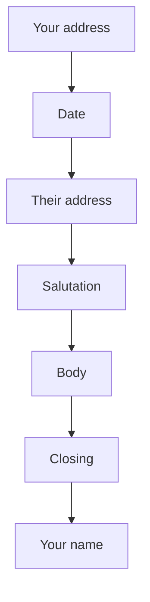

## Goal

By the end of this lesson, you can type, format and save a job application letter in Word.

## Why It Matters

Many offices, shops and schools ask for a letter when you apply for a job. A neat letter with
no mistakes makes a good first impression. In this project you use the Word skills from
Lessons 4.1 to 4.11 together.



**Diagram in words:** A formal letter starts with your address, then the date, then the
address of the person you write to. Then come the salutation, the body, the closing and your
name.

## Key Terms

| Term | Simple meaning |
|------|----------------|
| Formal letter | A polite letter to an office or a person you do not know well. |
| Application letter | A formal letter that asks for a job. It says who you are and why you fit the job. |
| Sender's address | Your own address. It goes at the top of the letter. |
| Inside address | The name and address of the person you write to. It goes below the date. |
| Salutation | The greeting at the start, such as "Dear Mr. Qureshi:". |
| Body | The main part of the letter: your paragraphs. |
| Closing | The polite word before your name, such as "Sincerely,". |
| Enclosure | A paper you send with the letter, such as your CV. |

## Teacher Demo

Show the model letter in the Student Task. Point to each part as you say its name.

**The parts of the letter**

1. Point to the first two lines. Say: "This is the sender's address. It is your address."
2. Point to the date. Say: "Write the full date: day, month and year."
3. Point to the inside address. Say: "This is the person and office you write to."
4. Point to **Dear Mr. Qureshi:**. Say: "This is the salutation."
5. Point to the three paragraphs. Say: "This is the body."
6. Say: "Paragraph 1 says which job you want. Paragraph 2 says why you fit the job."
7. Say: "Paragraph 3 thanks the reader and asks for an interview."
8. Point to **Sincerely,** and the name. Say: "This is the closing. Then comes your name."
9. Say: "Leave four empty lines above your name. You sign there with a pen."
10. Point to **Enclosure: CV**. Say: "This tells the reader your CV is with the letter."

**Starting the letter in Word**

11. Open a new blank document ([Lesson 4.1](starting-word.mdx)).
12. Type the sender's address. Press **Enter** after each line. *Two lines appear.*
13. Press **Enter** once more. *An empty line appears.* Say: "An empty line goes between
    each part."
14. Type the date. Say: "We keep every line on the left. That is the usual way for this
    letter."
15. Say: "Word already gives one-inch margins. Those are good for a letter."

## Student Task

Type this model letter. All names, addresses and numbers are made up. Do not use your real
phone number in class.

```text
House 123, Street 45
Sample Town, Lahore

14 October 2026

Mr. Imran Qureshi
Office Manager
Bright Star Traders
Shop 7, Main Market
Sample Town, Lahore

Dear Mr. Qureshi:

I am writing to apply for the job of Office Assistant at Bright Star
Traders. I saw your notice in the newspaper.

I am learning computer skills in the AICT course. I can type letters
and make tables in Microsoft Word. I am careful, polite and on time.

Thank you for reading my letter. I would be happy to come for an
interview. You can call me at 0300-0000000.

Sincerely,


Ayesha Khan

Enclosure: CV
```

1. Open a new blank document ([Lesson 4.1](starting-word.mdx)).
2. Type the letter. Press **Enter** at the end of each part. Leave the empty lines as shown.
3. In the body, press **Enter** only at the end of each paragraph, not at the end of each line.
   The lines in the model break early only to fit this page.
4. Leave four empty lines between **Sincerely,** and **Ayesha Khan**.
5. Check that every line is on the left ([Lesson 4.6](formatting-paragraphs.mdx)).
6. Use one font and one size for the whole letter ([Lesson 4.5](formatting-text.mdx)).
7. Check the spelling and grammar ([Lesson 4.8](spelling-and-grammar.mdx)).
8. Save the letter as **Application Letter** ([Lesson 4.3](saving-closing-opening.mdx)).
9. Look at the print preview ([Lesson 4.11](page-setup-and-printing.mdx)). Check it fits on one page.
10. Show your teacher: your saved letter in print preview, with all the parts and no spelling mistakes.

## Check Questions

1. Point to the salutation in your letter.
   **Answer:** The student points to **Dear Mr. Qureshi:**.
2. What does the first paragraph of an application letter say?
   **Answer:** Who you are, and which job you are applying for.
3. Why do you leave four empty lines between the closing and your typed name?
   **Answer:** You sign your name there with a pen.

## Common Mistakes

- **Forgetting the date** → Type the full date below your address: day, month and year.
- **No space to sign** → Leave four empty lines between the closing and your typed name.
- **Pressing Enter at the end of every line in a paragraph** → Keep typing. Press **Enter** only at the end of the paragraph ([Lesson 4.2](typing-and-correcting-text.mdx)).
- **Spelling mistakes in the letter** → Run the spelling and grammar check before you save ([Lesson 4.8](spelling-and-grammar.mdx)).
- **Typing a real phone number in class practice** → Use the made-up number from the model letter.

## Sources

*For the teacher: these sources were checked before this lesson was written.*

- [Purdue OWL (Purdue University), "Writing the Basic Business Letter"](https://owl.purdue.edu/owl/subject_specific_writing/professional_technical_writing/basic_business_letters/index.html): the parts of a business letter in order (sender's address, date, inside address, salutation, body, closing, enclosures); block format is left justified and single spaced, with a blank line between paragraphs; salutation with title and last name followed by a colon; four lines between the closing and the sender's name for a signature; first paragraph gives the main point, the last restates it.
- [Purdue OWL (Purdue University), "Cover Letters: Formatting and Organization"](https://owl.purdue.edu/owl/job_search_writing/job_search_letters/cover_letters_workshop/formatting_and_organization.html): a job letter says who you are and why you are writing, argues why you fit the job, and closes by thanking the reader; standard one-inch margins; paragraphs aligned to the left.
- [Microsoft Support, "Change the margins in your Word document"](https://support.microsoft.com/en-gb/office/change-the-margins-in-your-word-document-c95c1ea1-70b1-4dde-a1da-f5aa2042c829): applies to Word 2016 and Word 2019; each page in Word has a one-inch margin.
