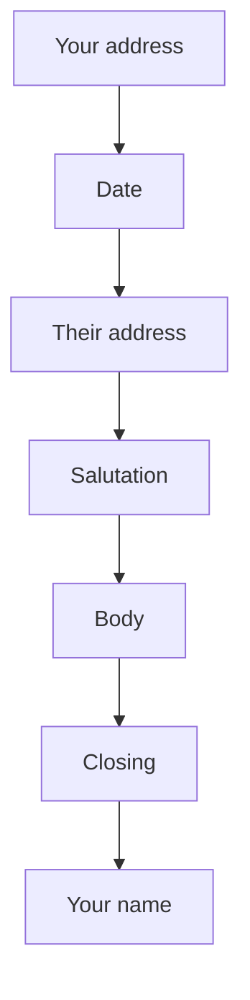

## Goal

By the end of this lesson, you can type, format and save a job application letter in Word.

## Why It Matters

Many offices, shops and schools in Pakistan ask for a letter when you apply for a job. A
trading office may need an office assistant. A mobile shop may need a sales helper. A neat
letter with no mistakes makes a good first impression. In this project you use the Word skills
from Lessons 4.1 to 4.11 together.



**Diagram in words:** A formal letter starts with your address, then the date, then the
address of the person you write to. Then come the salutation, the body, the closing and your
name.

## Key Terms

| Term | Simple meaning |
|------|----------------|
| Formal letter | A polite letter to an office or a person you do not know well. |
| Application letter | A formal letter that asks for a job. It says who you are and why you fit the job. |
| Sender's address | Your own address. It goes at the top of the letter. |
| Inside address | The name and address of the person you write to. It goes below the date. |
| Salutation | The greeting at the start, such as "Dear Mr. Qureshi:". It is like saying hello. |
| Body | The main part of the letter: your paragraphs. |
| Closing | The polite word before your name, such as "Sincerely,". It is like saying goodbye. |
| Enclosure | A paper you send with the letter, such as your CV. |

## Step by Step

Ayesha Khan is learning computers. She saw a notice in the newspaper. Bright Star Traders in
Lahore needs an Office Assistant. Here is the letter she wrote to apply. All names, addresses
and numbers are made up.

```text
House 123, Street 45
Sample Town, Lahore

14 October 2026

Mr. Imran Qureshi
Office Manager
Bright Star Traders
Shop 7, Main Market
Sample Town, Lahore

Dear Mr. Qureshi:

I am writing to apply for the job of Office Assistant at Bright Star
Traders. I saw your notice in the newspaper.

I am learning computer skills in the AICT course. I can type letters
and make tables in Microsoft Word. I am careful, polite and on time.

Thank you for reading my letter. I would be happy to come for an
interview. You can call me at 0300-0000000.

Sincerely,


Ayesha Khan

Enclosure: CV
```

**The parts of the letter**

Read the letter from top to bottom. Find each part as you read its name.

1. Find the first two lines. This is the sender's address: Ayesha's own address. It tells the
   reader who wrote the letter and where she lives.
2. Find the date. Write the full date: day, month and year. The office then knows when you
   applied.
3. Find the inside address. This is the person and the office you write to.
4. Find **Dear Mr. Qureshi:**. This is the salutation.
5. Find the three paragraphs. This is the body.
6. Paragraph 1 says which job you want. Paragraph 2 says why you fit the job.
7. Paragraph 3 thanks the reader and asks for an interview. It also gives a phone number, so
   the office can call you.
8. Find **Sincerely,** and the name. This is the closing. Then comes your name.
9. There are four empty lines above the name. You sign there with a pen after you print.
10. Find **Enclosure: CV**. This tells the reader your CV is with the letter. You make your CV
    in [Lesson 4.13](project-cv.mdx).

**Starting the letter in Word**

Now start typing Ayesha's letter on your own computer.

11. Open a new blank document ([Lesson 4.1](starting-word.mdx)).
12. Type the sender's address. Press **Enter** after each line. *Two lines appear.*
13. Press **Enter** once more. *An empty line appears.* An empty line goes between each part,
    so that each part stands out.
14. Type the date. Keep every line on the left. That is the usual way for this letter.
15. You do not need to change the margins. Word already gives one-inch margins, and those are
    good for a letter.

## Practice

Finish Ayesha's letter, so that it is ready to send with her CV. Go on in the same document.
Do not use your real phone number while you practise.

1. Press **Enter** after the date to leave an empty line. Then type the rest of the letter from
   the model above. Press **Enter** at the end of each part. Leave the empty lines as shown.
2. In the body, press **Enter** only at the end of each paragraph, not at the end of each line.
   The lines in the model break early only to fit this page.
3. Leave four empty lines between **Sincerely,** and **Ayesha Khan**. This is the space for the
   signature.
4. Check that every line is on the left ([Lesson 4.6](formatting-paragraphs.mdx)).
5. Use one font and one size for the whole letter ([Lesson 4.5](formatting-text.mdx)). This
   makes the letter look neat and serious.
6. Check the spelling and grammar ([Lesson 4.8](spelling-and-grammar.mdx)). One mistake can
   give a bad first impression.
7. Save the letter as **Application Letter** ([Lesson 4.3](saving-closing-opening.mdx)).
8. Look at the print preview ([Lesson 4.11](page-setup-and-printing.mdx)). Check it fits on one
   page, so that the office gets one neat sheet.
9. Check your work: the print preview shows one page. From top to bottom it has Ayesha's
   address, **14 October 2026**, the inside address, **Dear Mr. Qureshi:**, three paragraphs,
   **Sincerely,**, four empty lines, **Ayesha Khan** and **Enclosure: CV**. Every line is on
   the left, and no word has a spelling line under it.

## Check Questions

1. Point to the salutation in your letter.

   <details>
   <summary>Show answer</summary>

   **Answer:** You point to **Dear Mr. Qureshi:**.

   </details>

2. What does the first paragraph of an application letter say?

   <details>
   <summary>Show answer</summary>

   **Answer:** Who you are, and which job you are applying for.

   </details>

3. Why do you leave four empty lines between the closing and your typed name?

   <details>
   <summary>Show answer</summary>

   **Answer:** You sign your name there with a pen.

   </details>

## Common Mistakes

- **Forgetting the date** → Type the full date below your address: day, month and year.
- **No space to sign** → Leave four empty lines between the closing and your typed name.
- **Pressing Enter at the end of every line in a paragraph** → Keep typing. Press **Enter** only at the end of the paragraph ([Lesson 4.2](typing-and-correcting-text.mdx)).
- **Spelling mistakes in the letter** → Run the spelling and grammar check before you save ([Lesson 4.8](spelling-and-grammar.mdx)).
- **Typing your real phone number while you practise** → Use the made-up number from the model letter. Use your real number only in a letter you really send.

## Sources

*These official pages were checked when this lesson was written.*

- [Purdue OWL (Purdue University), "Writing the Basic Business Letter"](https://owl.purdue.edu/owl/subject_specific_writing/professional_technical_writing/basic_business_letters/index.html): the parts of a business letter in order (sender's address, date, inside address, salutation, body, closing, enclosures); block format is left justified and single spaced, with a blank line between paragraphs; salutation with title and last name followed by a colon; four lines between the closing and the sender's name for a signature; first paragraph gives the main point, the last restates it.
- [Purdue OWL (Purdue University), "Cover Letters: Formatting and Organization"](https://owl.purdue.edu/owl/job_search_writing/job_search_letters/cover_letters_workshop/formatting_and_organization.html): a job letter says who you are and why you are writing, argues why you fit the job, and closes by thanking the reader; standard one-inch margins; paragraphs aligned to the left.
- [Microsoft Support, "Change the margins in your Word document"](https://support.microsoft.com/en-gb/office/change-the-margins-in-your-word-document-c95c1ea1-70b1-4dde-a1da-f5aa2042c829): applies to Word 2016 and Word 2019; each page in Word has a one-inch margin.
