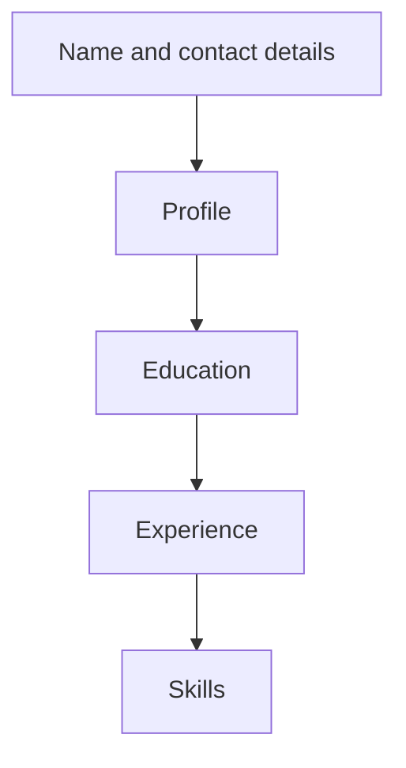

## Goal

By the end of this lesson, you can make a simple one-page CV in Word with headings, a table
and bulleted lists.

## Why It Matters

When you apply for your first job, you usually send a CV. A shop, an office or a school reads
it to learn about your education, work and skills. You send it with your application letter
from [Lesson 4.12](project-application-letter.mdx). A clear, neat CV helps you get to the next
step, such as an interview. In this project you use the Word skills from Lessons 4.3 to 4.11.

**Diagram in words:** A simple CV starts with your name and contact details at the top. Then come
the profile, education, experience and skills.

## Key Terms

| Term | Simple meaning |
|------|----------------|
| CV | A short document about your education, work and skills. You send it when you apply for a job. It is like your introduction on paper. |
| Contact details | Your phone number, email and address, so an employer can reach you. |
| Profile | Two or three sentences about you and the job you want. |
| Education | The schools, colleges and courses you have studied at. |
| Experience | The work you have done, paid or unpaid. |
| Skills | The things you can do well, such as typing or speaking a language. |
| Heading | A short title for one part of the CV, such as Education. |
| Most recent first | The newest item goes at the top of a list, and the oldest at the bottom. |

## Step by Step

Bilal Ahmed has finished Intermediate and is doing the AICT course. He helps part-time at a
mobile shop. Now he wants his first office job. Here is the CV he made. All names, places and
numbers are made up.

:::note[Model CV]

**BILAL AHMED**

House 45, Street 12, Sample Town, Karachi

Phone: 0300-0000000. Email: bilal.ahmed@example.com

**Profile**

I am a hard-working young person. I can use Microsoft Word for letters, tables and lists. I
want to work as an office assistant.

**Education**

| Year | Qualification | Institution |
|------|---------------|-------------|
| 2026 | AICT Computer Course | Bright Future Computer Centre, Karachi |
| 2025 | Intermediate | Sample Town College, Karachi |
| 2023 | Matric | Sample Town High School, Karachi |

**Experience**

- 2024 to now: Sales Helper, Hamid Mobile Shop, Sample Town.
- I help customers and keep the daily sales list.

**Skills**

- Typing in English
- Microsoft Word: letters, tables and lists
- Languages: Urdu and English

:::

**The parts of the CV**

Read the model CV from top to bottom. Find each part as you read about it.

1. Find the name. The name goes at the top, in a large, clear font, so the reader sees it first.
2. Find the contact details. Phone and email go right below the name, so the employer can call
   you.
3. Find **Profile**. These few sentences say who you are and what job you want.
4. Find the **Education** table. The newest course is at the top, so the employer sees your
   latest study first.
5. Find **Experience** and **Skills**. Short bullet points are easier to read than long
   paragraphs.
6. A CV is usually one or two pages. Bilal's CV fits on one page, and yours will too.

**Making the top of the CV in Word**

Now start Bilal's CV on your own computer. Do not use your real phone number or address while
you practise.

7. Open a new blank document ([Lesson 4.1](starting-word.mdx)). Type **Bilal Ahmed** and press
   **Enter**.
8. Select the name. Make it bold and a bigger size ([Lesson 4.5](formatting-text.mdx)).
   *The name stands out.*
9. Type the address line and the phone and email line. Press **Enter** after each one.
10. Type the heading **Profile**. Make it bold, so that each part of the CV is quick to find.
    Press **Enter** and type the three profile sentences.
11. Type the heading **Education**. Make it bold. Press **Enter**.
12. Insert a table with 3 columns and 4 rows ([Lesson 4.9](tables.mdx)). *An empty table
    appears.* You need one top row and three courses.
13. Type the top row: **Year**, **Qualification**, **Institution**. Press **Tab** between
    cells.
14. Type the three courses, newest first: 2026, then 2025, then 2023.

{/* Screenshot to add: A finished one-page CV in print preview, with a large bold name, bold headings, the Education table and bulleted skills. */}

## Practice

Finish Bilal's CV, so that it is ready to send with an application letter. Go on in the same
document, below the Education table.

1. Click below the table. Type the heading **Experience** and make it bold.
2. Type the two experience lines from the model CV. Make them a bulleted list
   ([Lesson 4.7](bulleted-and-numbered-lists.mdx)). Bullets make each point quick to read.
3. Type the heading **Skills** and make it bold.
4. Type the three skills. Make them a bulleted list too.
5. Check the spelling and grammar ([Lesson 4.8](spelling-and-grammar.mdx)). A CV should have
   no spelling or grammar mistakes.
6. Save the document as **My CV** ([Lesson 4.3](saving-closing-opening.mdx)), so that you can
   update it when you learn new skills.
7. Look at the print preview ([Lesson 4.11](page-setup-and-printing.mdx)). Check that the CV
   fits on one page.
8. Check your work: the print preview shows one page. **Bilal Ahmed** is bold and bigger than
   the rest. The four headings, **Profile**, **Education**, **Experience** and **Skills**, are
   bold. The Education table has 4 rows, with **2026** in the first row under the top row.
   Experience has 2 bullets, and Skills has 3 bullets.

## Check Questions

1. Point to the Education table in your CV. Which course is in the first row under the top row?

   

   
Show answer

   **Answer:** The newest one: the AICT Computer Course, 2026.

   

2. Name four parts of a simple CV.

   

   
Show answer

   **Answer:** Any four of: name and contact details, profile, education, experience, skills.

   

3. Show how you check that your CV fits on one page.

   

   
Show answer

   **Answer:** Select **File**, then **Print**, and look at the print preview.

   

## Common Mistakes

- **Putting the oldest course first** → Put the most recent first. The newest goes at the top.
- **Writing long paragraphs** → Use short bullet points for experience and skills.
- **The name is small, like the rest of the text** → Make the name bold and bigger, so it stands out.
- **The CV goes onto a second page** → Shorten the profile and the bullet points. Check the print preview again.
- **Spelling mistakes** → Run the spelling and grammar check before you save ([Lesson 4.8](spelling-and-grammar.mdx)).

## Sources

*These official pages were checked when this lesson was written.*

- [Imperial College London Careers Service, "CVs and resumes"](https://www.imperial.ac.uk/careers/applications-and-interviews/cv/): the usual CV sections (name and contact details as a header, personal profile, education, experience, skills); a CV fills one or two whole pages; reverse chronological order (most recent first); bullet points instead of long paragraphs; no spelling or grammar errors; a CV helps you get to the next stage of hiring.
- [Purdue OWL (Purdue University), "Introduction to and Expectations for Résumés"](https://owl.purdue.edu/owl/job_search_writing/resumes_and_vitas/introduction.html): a résumé summarises your education, work history and experience; almost every résumé has education, experience and contact information.
- [Purdue OWL (Purdue University), "Contact Information Section"](https://owl.purdue.edu/owl/job_search_writing/resumes_and_vitas/resume_sections/index.html): the name goes at the top in a large, readable font, with contact details directly below.
- [Purdue OWL (Purdue University), "Résumé Sections Part 1"](https://owl.purdue.edu/owl/job_search_writing/skilled_labor_job_search_resources/resumes/resume_sections_part_1.html): a short objective names the job you want; the work experience section lists the company, dates, job title and duties.
- [Microsoft Support, "Insert a table"](https://support.microsoft.com/en-us/word/training/insert-a-table) (applies to Word 2021, **Windows** tab): "For a larger table, or to customize a table, select Insert > Table > Insert Table."
- [Microsoft Support, "Use a screen reader to insert a table in Word"](https://support.microsoft.com/en-us/office/use-a-screen-reader-to-insert-a-table-in-word-a28f35dc-9a0d-4075-92ca-798c27d34db0) (applies to Word 2021, **Windows** tab): in the **Insert Table** dialog box you type the number of columns and rows; Word then adds the table.
- [Microsoft Support, "Keyboard shortcuts in Word"](https://support.microsoft.com/en-us/office/keyboard-shortcuts-in-word-95ef89dd-7142-4b50-afb2-f762f663ceb2) (applies to Word 2021): **Tab** "Move to the next cell in the row."
- [Microsoft Support, "Print a document in Word for Windows"](https://support.microsoft.com/en-us/office/print-a-document-in-word-591022c4-53e3-4242-95b5-58ca393ba0ee) (applies to Word 2021): "Before you print, you can preview your document"; "Select File > Print."
