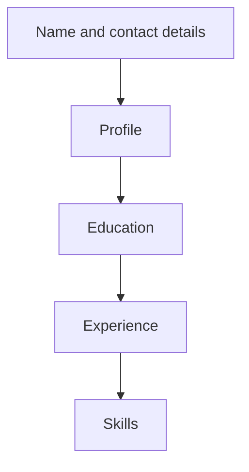

## Goal

By the end of this lesson, you can make a simple one-page CV in Word with headings, a table
and bulleted lists.

## Why It Matters

When you apply for a job, you usually send a CV. It tells an employer about your education,
work and skills. A clear, neat CV helps you get to the next step, such as an interview. In this
project you use the Word skills from Lessons 4.3 to 4.11.

**Diagram in words:** A simple CV starts with your name and contact details at the top. Then come
the profile, education, experience and skills.

## Key Terms

| Term | Simple meaning |
|------|----------------|
| CV | A short document about your education, work and skills. You send it when you apply for a job. |
| Contact details | Your phone number, email and address, so an employer can reach you. |
| Profile | Two or three sentences about you and the job you want. |
| Education | The schools, colleges and courses you have studied at. |
| Experience | The work you have done, paid or unpaid. |
| Skills | The things you can do well, such as typing or speaking a language. |
| Heading | A short title for one part of the CV, such as Education. |
| Most recent first | The newest item goes at the top of a list, and the oldest at the bottom. |

## Teacher Demo

Show the model CV in the Student Task. It belongs to a made-up person.

**The parts of the CV**

1. Point to the name. Say: "The name goes at the top, in a large, clear font."
2. Point to the contact details. Say: "Phone and email go right below the name."
3. Point to **Profile**. Say: "These few sentences say who you are and what job you want."
4. Point to the **Education** table. Say: "The newest course is at the top."
5. Point to **Experience** and **Skills**. Say: "Short bullet points are easier to read than
   long paragraphs."
6. Say: "A CV is usually one or two pages. Yours will fit on one page."

**Making the CV in Word**

7. Open a new blank document. Type **Bilal Ahmed** and press **Enter**.
8. Select the name. Make it bold and a bigger size ([Lesson 4.5](formatting-text.mdx)).
   *The name stands out.*
9. Type the heading **Education**. Make it bold. Press **Enter**.
10. Insert a table with 3 columns and 4 rows ([Lesson 4.9](tables.mdx)). *An empty table
    appears.*
11. Type the top row: **Year**, **Qualification**, **Institution**. Press **Tab** between
    cells.
12. Type the heading **Skills** below the table. Make it bold.
13. Type two skills. Make them a bulleted list ([Lesson 4.7](bulleted-and-numbered-lists.mdx)).
    *A bullet appears before each skill.*
14. Select **File**, then **Print** to show the print preview
    ([Lesson 4.11](page-setup-and-printing.mdx)). Say: "Check that it fits on one page."

:::info[Screenshot to add]

A finished one-page CV in print preview, with a large bold name, bold headings, the Education
table and bulleted skills.

:::

## Student Task

Type this model CV. All names, places and numbers are made up. Do not use your real phone
number or address in class.

:::note[Model CV]

**BILAL AHMED**

House 45, Street 12, Sample Town, Karachi

Phone: 0300-0000000. Email: bilal.ahmed@example.com

**Profile**

I am a hard-working young person. I can use Microsoft Word for letters, tables and lists. I
want to work as an office assistant.

**Education**

| Year | Qualification | Institution |
|------|---------------|-------------|
| 2026 | AICT Computer Course | Bright Future Computer Centre, Karachi |
| 2025 | Intermediate | Sample Town College, Karachi |
| 2023 | Matric | Sample Town High School, Karachi |

**Experience**

- 2024 to now: Sales Helper, Hamid Mobile Shop, Sample Town.
- I help customers and keep the daily sales list.

**Skills**

- Typing in English
- Microsoft Word: letters, tables and lists
- Languages: Urdu and English

:::

1. Open a new blank document ([Lesson 4.1](starting-word.mdx)).
2. Type the name and the contact details. Make the name bold and bigger.
3. Type each heading: **Profile**, **Education**, **Experience** and **Skills**. Make each
   heading bold ([Lesson 4.5](formatting-text.mdx)).
4. Type the profile sentences under **Profile**.
5. Under **Education**, insert a table with 3 columns and 4 rows. Type the rows, newest first
   ([Lesson 4.9](tables.mdx)).
6. Make the **Experience** lines and the **Skills** lines bulleted lists
   ([Lesson 4.7](bulleted-and-numbered-lists.mdx)).
7. Check the spelling and grammar ([Lesson 4.8](spelling-and-grammar.mdx)).
8. Save the document as **My CV** ([Lesson 4.3](saving-closing-opening.mdx)).
9. Look at the print preview. Check that the CV fits on one page
   ([Lesson 4.11](page-setup-and-printing.mdx)).
10. Show your teacher: your saved CV in print preview, on one page, with a bold name, bold
    headings, the Education table and bulleted skills.

## Check Questions

1. Point to the Education table in your CV. Which course is in the first row under the top row?
   **Answer:** The newest one: the AICT Computer Course, 2026.
2. Name four parts of a simple CV.
   **Answer:** Any four of: name and contact details, profile, education, experience, skills.
3. Show how you check that your CV fits on one page.
   **Answer:** Select **File**, then **Print**, and look at the print preview.

## Common Mistakes

- **Putting the oldest course first** → Put the most recent first. The newest goes at the top.
- **Writing long paragraphs** → Use short bullet points for experience and skills.
- **The name is small, like the rest of the text** → Make the name bold and bigger, so it stands out.
- **The CV goes onto a second page** → Shorten the profile and the bullet points. Check the print preview again.
- **Spelling mistakes** → Run the spelling and grammar check before you save ([Lesson 4.8](spelling-and-grammar.mdx)).

## Sources

*For the teacher: these sources were checked before this lesson was written.*

- [Imperial College London Careers Service, "CVs and resumes"](https://www.imperial.ac.uk/careers/applications-and-interviews/cv/): the usual CV sections (name and contact details as a header, personal profile, education, experience, skills); a CV fills one or two whole pages; reverse chronological order (most recent first); bullet points instead of long paragraphs; no spelling or grammar errors; a CV helps you get to the next stage of hiring.
- [Purdue OWL (Purdue University), "Introduction to and Expectations for Résumés"](https://owl.purdue.edu/owl/job_search_writing/resumes_and_vitas/introduction.html): a résumé summarises your education, work history and experience; almost every résumé has education, experience and contact information.
- [Purdue OWL (Purdue University), "Contact Information Section"](https://owl.purdue.edu/owl/job_search_writing/resumes_and_vitas/resume_sections/index.html): the name goes at the top in a large, readable font, with contact details directly below.
- [Purdue OWL (Purdue University), "Résumé Sections Part 1"](https://owl.purdue.edu/owl/job_search_writing/skilled_labor_job_search_resources/resumes/resume_sections_part_1.html): a short objective names the job you want; the work experience section lists the company, dates, job title and duties.
- [Microsoft Support, "Insert a table"](https://support.microsoft.com/en-us/word/training/insert-a-table): applies to Word 2016 and Word 2019; Insert, then Table, then Insert Table to set the columns and rows.
- [Microsoft Support, "Print a document in Word for Windows"](https://support.microsoft.com/en-us/office/print-a-document-in-word-591022c4-53e3-4242-95b5-58ca393ba0ee): applies to Word 2016 and Word 2019; File, then Print shows the print preview.
