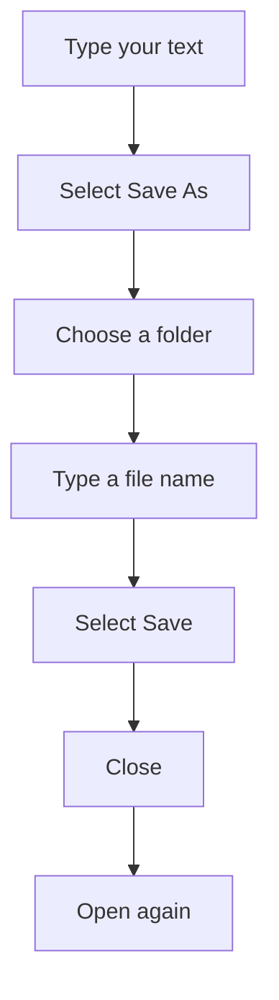

## Goal

By the end of this lesson, you can save a document with a name in a folder, close it, and open it again.

## Why It Matters

A shopkeeper keeps the day's bills in a file cover, so he can find them next week. Your work in
Word is the same. If you do not save it, it is lost when you close Word. When you save it with a
good name in the right folder, you can open it again tomorrow and keep working.

**Diagram in words:** The first time you save, select Save As, choose a folder, type a file name
and select Save. After that, you can close the document and open it again later.

## Key Terms

| Term | Simple meaning |
|------|----------------|
| Save | Keep your work on the computer so it is not lost. |
| Save As | Save a document for the first time, and choose its folder and name. |
| File | One piece of saved work, such as one Word document. Each file has a name. |
| File name | The name you give your file, for example **Ali Store Price List**. |
| Folder | A place on the computer that holds files, like a file cover holds papers. |
| Documents | A folder on the computer that is made for keeping your documents. |
| Open | Bring a saved file back onto the screen so you can see it and change it. |

You met the title bar in [Lesson 4.1](./starting-word.mdx) and the Quick Access Toolbar in
[Lesson 4.2](./typing-and-correcting-text.mdx).

## Teacher Demo

Use one lab computer that the whole class can see. Open Word and start a blank document, as in
[Lesson 4.1](./starting-word.mdx).

**Saving for the first time**

1. Type **Ali Store Price List** and press **Enter**. Type **Rice: Rs 300 per kg**.
2. Select the **File** tab. *The class sees a page with commands such as **New**, **Open**,
   **Save As**, **Print** and **Close**.*
3. Select **Save As**.
4. Select **Browse**. *The class sees the **Save As** box open.*
5. In the **Save As** box, find and select the **Documents** folder. Say: "This is the folder
   where we keep our work."

   :::warning[UNVERIFIED]

   Microsoft's Word 2016/2019 pages say to choose a folder, but they do not say where the
   **Documents** folder appears in the **Save As** box. Check this on a lab computer before
   teaching.

   :::

6. Select the **File name** box. Type **Ali Store Price List**.
7. Select **Save**. *The class sees the name **Ali Store Price List** in the title bar.*

**Saving again after a change**

8. Click at the end of the last line. Press **Enter** and type **Sugar: Rs 160 per kg**.
9. Select **Save** on the Quick Access Toolbar (or press **Ctrl+S**). *No box opens this time.
   Word saves the change with the same name.*

**Closing and opening**

10. Select the **File** tab, then **Close**. *The class sees the document close.*
11. Select the **File** tab, then **Open**.
12. Select **Recent**. *The class sees **Ali Store Price List** in the list.*
13. Select **Ali Store Price List**. *The class sees the document open again, with both
    prices.*

:::info[Screenshot to add]

The **Save As** box in Word, with the **Documents** folder, the **File name** box and the
**Save** button labelled.

:::

## Student Task

Work at your own lab computer. Type this price list. Use your own shop name if you like.

| Line | Type this |
|------|-----------|
| 1 | Ali Store Price List |
| 2 | Rice: Rs 300 per kg |
| 3 | Sugar: Rs 160 per kg |

1. Open Word and select **Blank document**.
2. Type lines 1 and 2 from the table.
3. Select **File**, then **Save As**, then **Browse**.
4. In the **Save As** box, select the **Documents** folder.
5. In the **File name** box, type your own name and **Price List**. For example: **Hina Price
   List**.
6. Select **Save**. Check that your file name is now in the title bar.
7. Type line 3. Then press **Ctrl+S** to save again.
8. Select **File**, then **Close**.
9. Select **File**, then **Open**, then **Recent**. Select your file to open it.
10. Show your teacher: your price list, open again, with all three lines and your file name in
    the title bar.

## Check Questions

1. Show how you save a document for the first time.
   **Answer:** Select **File**, then **Save As**, then **Browse**. Choose a folder, type a file
   name and select **Save**.
2. You already saved your document. You add one more line. How do you save the change?
   **Answer:** Select **Save** on the Quick Access Toolbar, or press **Ctrl+S**. No box opens,
   because the file already has a name.
3. Where can you see the name of the document you have open?
   **Answer:** In the title bar at the top of the window.

## Common Mistakes

- **Saving without choosing a folder** → You will not know where your file went. Always choose
  the **Documents** folder (or the folder your teacher gives you) before you select **Save**.
- **Giving the file a name like "abc" or "new"** → Use a name that tells you what is inside, such
  as **Hina Price List**.
- **Closing the document without saving your last change** → Word asks if you want to save.
  Choose to save, or press **Ctrl+S** before you close.
- **Using Save As every time** → Use **Save As** only the first time. After that, use **Save** or
  **Ctrl+S**.

## Sources

*For the teacher: these sources were checked before this lesson was written.*

- [Microsoft Support, "Basic tasks in Word"](https://support.microsoft.com/en-us/office/basic-tasks-in-word-87b3243c-b0bf-4a29-82aa-09a681999fdc) (applies to Word 2016 and Word 2019): on the **File** tab, click **Save As**; choose a folder under **This PC** or click **Browse**; click **File**, then **Open**, to open a document.
- [Microsoft Support, "Word for new users"](https://support.microsoft.com/en-us/word/word-for-new-users) (applies to Word 2016 and Word 2019): when you save, the document is stored as a file on your computer; the **File** tab has **New**, **Open**, **Save as**, **Print** and **Close**; enter a name in the **File name** box and click **Save**; once saved, **Save** on the Quick Access Toolbar saves with the same name and no more steps are needed; **File**, then **Open**, then **Recent** opens a recent document; the title bar shows the file name; documents may be stored in **Documents**; if you quit after changes, a message asks if you want to save.
- [Microsoft Support, "Save, back up, and recover a file in Microsoft Office"](https://support.microsoft.com/en-us/office/save-back-up-and-recover-a-file-in-microsoft-office-a7f0a209-ad22-4212-bb53-6cd8e801a6fb) (applies to Word 2016 and Word 2019): **Ctrl+S** saves; you must enter a name the first time you save; **Browse** lets you go to any location on your computer.
- [Microsoft Support, "Keyboard shortcuts in Word"](https://support.microsoft.com/en-us/accessibility/word/keyboard-shortcuts-in-word) (applies to Word 2016 and Word 2019): **Ctrl+S** saves the document.
