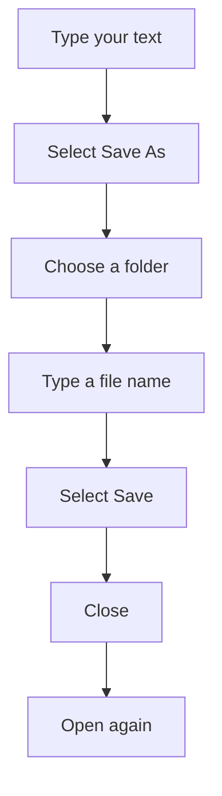

## Goal

By the end of this lesson, you can save a document with a name in a folder, close it, and open it again.

## Why It Matters

A shopkeeper keeps the day's bills in a file cover, so he can find them next week. A tuition
centre keeps a fee record for every month. Your work in Word is the same. If you do not save
it, it is lost when you close Word. Save it with a good name in the right folder. Then you can
open it again tomorrow and keep working.

**Diagram in words:** The first time you save, select Save As, choose a folder, type a file name
and select Save. After that, you can close the document and open it again later.

## Key Terms

| Term | Simple meaning |
|------|----------------|
| Save | Keep your work on the computer so it is not lost. |
| Save As | Save a document for the first time, and choose its folder and name. |
| File | One piece of saved work, such as one Word document. Each file has a name. |
| File name | The name you give your file, for example **Ali Store Price List**. |
| Folder | A place on the computer that holds files, like a file cover holds papers. |
| Documents | A folder on the computer that is made for keeping your documents. |
| Open | Bring a saved file back onto the screen so you can see it and change it. |

You met the title bar in [Lesson 4.1](./starting-word.mdx) and the Quick Access Toolbar in
[Lesson 4.2](./typing-and-correcting-text.mdx).

## Step by Step

Follow these steps on your own computer. Open Word and start a blank document, as in
[Lesson 4.1](./starting-word.mdx). You will save a small price list for a shop called Ali Store.

**Saving for the first time**

1. Type **Ali Store Price List** and press **Enter**. Type **Rice: Rs 300 per kg**. Now you have
   some work to save.
2. Select the **File** tab. *You see a page with commands such as **New**, **Open**,
   **Save As**, **Print** and **Close**.*
3. Select **Save As**, because this is the first time you save this document.
4. Select **Browse**. *You see the **Save As** box open.* This box lets you choose where the
   file goes.
5. In the **Save As** box, find and select the **Documents** folder. This is the folder where
   you keep your work, so you can find it again.

   :::tip[If your screen looks different]

   If you cannot find **Documents** in the box, save in the folder the box suggests. It is
   usually the place you saved before. Remember that folder name, so you can find your file.

   :::

6. Select the **File name** box. Type **Ali Store Price List**. A clear name tells you what is
   inside without opening the file.
7. Select **Save**. *You see the name **Ali Store Price List** in the title bar.* This shows
   that your work is saved.

**Saving again after a change**

Saving is like writing in a register with a pen. If you add a new line, you write it in, so it
is kept too.

8. Click at the end of the last line. Press **Enter** and type **Sugar: Rs 160 per kg**.
9. Select **Save** on the Quick Access Toolbar (or press **Ctrl+S**), so that the new line is
   kept. *No box opens this time. Word saves the change with the same name.*

**Closing and opening**

10. Select the **File** tab, then **Close**. *You see the document close.* Your work is safe,
    because you saved it.
11. Select the **File** tab, then **Open**, to bring a saved file back.
12. Select **Recent**. *You see **Ali Store Price List** in the list.* Recent shows the files
    you used last.
13. Select **Ali Store Price List**. *You see the document open again, with both prices.*

{/* Screenshot to add: The **Save As** box in Word, with the **Documents** folder, the **File name** box and the **Save** button labelled. */}

## Practice

Your uncle runs a small grocery shop. He wants a price list he can change every week. Make it
and save it with your own name. Use your own shop name if you like.

| Line | Type this |
|------|-----------|
| 1 | Ali Store Price List |
| 2 | Rice: Rs 300 per kg |
| 3 | Sugar: Rs 160 per kg |

1. Open Word and select **Blank document**.
2. Type lines 1 and 2 from the table.
3. Select **File**, then **Save As**, then **Browse**, so that you can choose a place and a name.
4. In the **Save As** box, select the **Documents** folder.
5. In the **File name** box, type your own name and **Price List**. For example: **Hina Price
   List**. Next week, this name helps you find the right file.
6. Select **Save**. Look at the title bar to make sure your file name is there.
7. Type line 3. Then press **Ctrl+S** to save again, so that the new price is kept.
8. Select **File**, then **Close**.
9. Select **File**, then **Open**, then **Recent**. Select your file to open it. This is how
   you come back to your work another day.
10. Check your work: your price list is open again. It shows all three lines. The title bar
    shows your file name, for example **Hina Price List**.

## Check Questions

1. Show how you save a document for the first time.

   

   
Show answer

   **Answer:** Select **File**, then **Save As**, then **Browse**. Choose a folder, type a file
   name and select **Save**.

   

2. You already saved your document. You add one more line. How do you save the change?

   

   
Show answer

   **Answer:** Select **Save** on the Quick Access Toolbar, or press **Ctrl+S**. No box opens,
   because the file already has a name.

   

3. Where can you see the name of the document you have open?

   

   
Show answer

   **Answer:** In the title bar at the top of the window.

   

## Common Mistakes

- **Saving without choosing a folder** → You will not know where your file went. Always choose
  the **Documents** folder before you select **Save**.
- **Giving the file a name like "abc" or "new"** → Use a name that tells you what is inside, such
  as **Hina Price List**.
- **Closing the document without saving your last change** → Word asks if you want to save.
  Choose to save, or press **Ctrl+S** before you close.
- **Using Save As every time** → Use **Save As** only the first time. After that, use **Save** or
  **Ctrl+S**.

## Sources

*These official pages were checked when this lesson was written.*

- [Microsoft Support, "Basic tasks in Word"](https://support.microsoft.com/en-us/office/basic-tasks-in-word-87b3243c-b0bf-4a29-82aa-09a681999fdc) (applies to Word 2021, Word 2024, Word 2019, Word 2016 and Word for Microsoft 365): "If you'd rather not use a template, click Blank document"; "To save a document for the first time": "On the File tab, click Save As"; "choose a folder under This PC or click Browse"; "Click Save"; "If you're already in Word, click File > Open".
- [Microsoft Support, "Word for new users"](https://support.microsoft.com/en-us/word/word-for-new-users) (applies to Word 2021, Word 2024, Word 2019, Word 2016 and Word for Microsoft 365): the File tab has commands "such as New, Open, Save as, Print, and Close"; "enter a file name in the File name box"; "If you've previously saved your document, it is now saved using its current file name and no more steps are needed"; "click the File tab and then clicking Open. To open a document you saved recently, click Recent"; the title bar "Displays the file name of the document"; "Your documents may be stored in Documents, OneDrive, or another location"; when you quit after changes, "a message box appears asking if you want to save changes".
- [Microsoft Support, "Save, back up, and recover a file in Microsoft Office"](https://support.microsoft.com/en-us/office/save-back-up-and-recover-a-file-in-microsoft-office-a7f0a209-ad22-4212-bb53-6cd8e801a6fb) (applies to Word 2021, Word 2024, Word 2019, Word 2016 and Word for Microsoft 365): "Press CTRL+S or select File > Save"; "You must enter a name for the file if you are saving it for the first time"; **Browse** "Opens the File Explorer so you can navigate to any location on your computer".
- [Microsoft Support, "Save your files"](https://support.microsoft.com/en-us/office/save-your-files-cf7536a3-6842-4056-b9cc-443a7f44b104) (applies to Word 2021, Word 2024, Word 2019, Word 2016 and Word for Microsoft 365): "Go to File > Save As"; "select Browse and navigate to the location where you want to save the file"; "In the Enter file name here box or File name box, type a file name and then select Save." It does not say where **Documents** appears in the box.
- [Microsoft Support, "Keyboard shortcuts in Word"](https://support.microsoft.com/en-us/accessibility/word/keyboard-shortcuts-in-word) (applies to Word 2021, Word 2024, Word 2019, Word 2016 and Word for Microsoft 365): "Save the document. Ctrl+S".
- [Microsoft Support, "Use a screen reader to save a document in Word"](https://support.microsoft.com/en-us/accessibility/word/use-a-screen-reader-to-save-a-document-in-word) (applies to Word 2021, Word 2024, Word 2019, Word 2016 and Word for Microsoft 365): "The dialog box suggests the same location where you have saved your Word documents previously". Confirms the backup way in the box.
- [Microsoft Support, "Customize the save experience in Office"](https://support.microsoft.com/en-us/office/customize-the-save-experience-in-office-786200a7-f5f2-4d26-a3ae-b78c60dd5d3b) (applies to Word 2021 and Word for Microsoft 365): "The Documents folder is the default working folder for all of the files that you create in your Microsoft Office programs." Supporting note for the box: it does not say where **Documents** appears in the **Save As** box.
