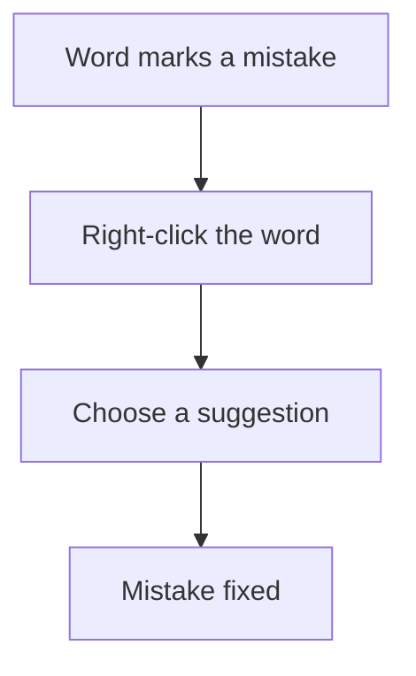

## Goal

By the end of this lesson, you can find spelling and grammar mistakes in Word and fix them.

## Why It Matters

A job application letter with spelling mistakes can lose you the job. A note to a shopkeeper
with wrong words can bring you the wrong order. A school notice full of mistakes looks careless.
Word helps you find mistakes before anyone else sees them. It marks words that may be wrong and
suggests a fix, but you still decide if the fix is right.

## Key Terms

| Term | Simple meaning |
|------|----------------|
| Spelling mistake | A word with wrong letters, like "frend" instead of "friend". |
| Grammar mistake | Words that do not fit together correctly, like "She are" instead of "She is". |
| Underline mark | A line Word draws under a word or words that may be wrong. It is like a friend pointing and saying "check this word". |
| Suggestion | A fix that Word offers for a mistake. |
| Right-click | Press the right mouse button once. It shows a menu (see [Lesson 1.5](../module-01-computer-basics/using-the-mouse.mdx)). |
| Pane | A part of the Word window that opens to help you with one job. |
| Review tab | A tab on the ribbon (see [Lesson 4.1](./starting-word.mdx)) with tools for checking your document. |

**Diagram in words:** Word marks a word that may be wrong. Right-click it and choose a
suggestion to fix it.

## Step by Step

Follow these steps on your own computer. Start a blank document
([Lesson 4.1](./starting-word.mdx)). Type this sentence with its mistakes, exactly as shown.
The mistakes are there on purpose, so that you can practise fixing them.

> My frend Sara lives in Lahore. She are a good student.

**Fixing one mistake at a time**

1. Look for words with lines under them. These are the words Word thinks may be wrong.
   *Word may draw a line under **frend** and under **She are**.*
2. Look at the colour of each line. A red wavy line marks a possible spelling mistake. A blue
   line marks a possible grammar mistake. The colour tells you what kind of mistake to look for.
3. Right-click **frend**. *A menu opens with suggestions.* Select **friend**. *The word changes
   to "friend".* This fixes the word without typing it again.
4. Right-click **She are**. Select the correct suggestion. *The words change to "She is".*
   If Word did not mark a mistake, click in it and fix it yourself. Word may miss some mistakes,
   so always read your work too.

**Checking the whole document**

A long letter can have many mistakes. Checking the whole document at once means you do not
miss any.

5. Type this second sentence with its mistakes: **We goes to scool by bus.**
6. Click at the start of the document, so that the check starts from the top. Press **F7**.
   *The **Editor** pane opens. It puts the mistakes in groups, such as **Spelling** and
   **Grammar**.*
7. Under **Corrections**, select **Spelling**. *Word shows the first spelling mistake and its
   suggestions.* Checking one group at a time keeps the job tidy.
8. Choose the correct suggestion. *Word fixes the word and shows the next mistake.*
9. Do the same for **Grammar**, until no mistakes are left. If the pane is not clear to you,
   fix each mistake by right-clicking it, as in steps 3 and 4.
10. You can also open the Editor pane from the **Review** tab. This helps if you forget the
    **F7** key. Select the **Review** tab, then **Editor**. *The Editor pane opens.*

{/* Screenshot to add: A short sentence in Word with lines under a spelling mistake and a grammar mistake, and the right-click menu open with suggestions. */}

## Practice

You want to order flour from your local shop. You type a short note to send to the shopkeeper.
Type the mistakes too, then fix them, so the shopkeeper reads a clear note.

| Type this, with its mistakes | The mistakes to find |
|------------------------------|----------------------|
| Dear Sir, plese send two bags of flour to my house. My adress is House 12, Street 4, Faisalabad. My son are at home today. Thank you. | plese, adress, My son are |

1. Start a blank document.
2. Type the note from the table, with its mistakes.
3. Look for the words with lines under them. Word may mark **plese**, **adress** and **My son
   are**.
4. Right-click **plese**. Choose **please**.
5. Right-click **adress**. Choose **address**. A wrong address could send your flour to the
   wrong house.
6. Right-click **My son are**. Choose the correct suggestion.
7. Press **F7** to check the whole note. Fix anything else Word finds.
8. Read the note yourself, slowly, from start to end. If Word did not mark a mistake from the
   table, click in it and fix it yourself.
9. Save your note with the name **Shop Note** (see [Lesson 4.3](./saving-closing-opening.mdx)),
   so that you can print or send it later.
10. Check your work: your note reads "Dear Sir, please send two bags of flour to my house. My
    address is House 12, Street 4, Faisalabad. My son is at home today. Thank you." No word has
    a line under it. The note is saved as **Shop Note**.

## Check Questions

1. Right-click a word that has a line under it. Point to Word's suggestions.

   

   
Show answer

   **Answer:** You right-click the marked word and point to the suggestions in the menu.

   

2. Which key starts the spelling and grammar check?

   

   
Show answer

   **Answer:** F7.

   

3. What does a line under a word tell you?

   

   
Show answer

   **Answer:** Word thinks the word may be wrong. You check it, and fix it if it is wrong.

   

## Common Mistakes

- **Choosing the first suggestion without reading it** → Read every suggestion. Choose only the
  one that means what you want.
- **Leaving the lines and not fixing the mistakes** → Right-click each marked word and fix it,
  or press **F7** before you save your work.
- **Changing a correct word because Word marked it** → Word can be wrong. If you know the word is
  correct, leave it.
- **Choosing the wrong fix** → Press **Ctrl+Z** to undo (see
  [Lesson 4.2](./typing-and-correcting-text.mdx)).

## Sources

*These official pages were checked when this lesson was written.*

- [Microsoft Support, "Check spelling and grammar in Office"](https://support.microsoft.com/en-us/office/check-spelling-and-grammar-in-office-5cdeced7-d81d-47de-9096-efd0ee909227) (applies to Word 2021): "To start a check of the spelling and grammar in your document, just press F7"; "Office marks potential spelling errors with a red squiggly line, and potential grammatical errors are marked with a blue squiggly line"; "right-click on the underlined word or phrase and choose one of the options to fix the error."
- [Microsoft Support, "Check grammar, spelling, and more in Word"](https://support.microsoft.com/en-us/office/check-grammar-spelling-and-more-in-word-0f43bf32-ccde-40c5-b16a-c6a282c0d251) (applies to Word 2021, **Windows** tab): "Right-click the underlined word, and then choose the suggestion you want"; "On the Review tab, select Editor"; "The Editor pane categorizes spelling, grammar, and stylistic issues. Click each category to address the issues"; the pane has a **Corrections** section.
- [Microsoft Support, "Keyboard shortcuts in Word"](https://support.microsoft.com/en-us/office/keyboard-shortcuts-in-word-95ef89dd-7142-4b50-afb2-f762f663ceb2) (applies to Word 2021): "F7 alone: displays the Editor task pane to check spelling and grammar in the document or the selected text"; **Ctrl+Z**: "Undo the previous action."
- [Microsoft Support, "Use a screen reader to check spelling and grammar in Word"](https://support.microsoft.com/en-us/office/use-a-screen-reader-to-check-spelling-and-grammar-in-word-42655b8c-b0d0-4b58-bed0-6690e1cc89db) (applies to Word 2021, **Newer Windows versions** tab): "press F7. The Editor pane opens"; the pane lists **Corrections** in groups such as **Spelling** and **Grammar**; "After you correct or ignore an error, the focus moves to the next error in the category."
- [Microsoft Support, "Design and edit in Word"](https://support.microsoft.com/en-us/word/training/design-and-edit-in-word) (applies to Word 2021): "Word marks misspelled words with a red squiggly underline and grammar mistakes with a blue double underline"; right-click the word and select a correction.
- [Microsoft Support, "Select grammar and writing style options" (archived Microsoft page, December 2019)](https://web.archive.org/web/20191217052245/https://support.office.com/en-us/article/select-grammar-and-writing-style-options-ecd60e9f-6b2e-4070-b30c-42efa6cff55a) (supporting note only; written for Word 2019 and Word 2016): Word's grammar checker has a **Subject-Verb Agreement** rule ("The subject and verb should agree in number"). It does not promise to mark every mistake, so the lesson says Word *may* mark them.
