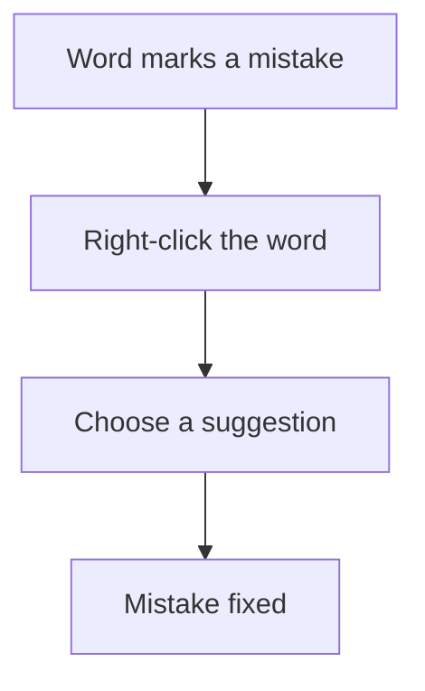

## Goal

By the end of this lesson, you can find spelling and grammar mistakes in Word and fix them.

## Why It Matters

A job letter with spelling mistakes can lose you the job. Word helps you find mistakes before
anyone else sees them. It marks words that may be wrong and suggests a fix. You still decide if
the fix is right.

## Key Terms

| Term | Simple meaning |
|------|----------------|
| Spelling mistake | A word with wrong letters, like "frend" instead of "friend". |
| Grammar mistake | Words that do not fit together correctly, like "She are" instead of "She is". |
| Underline mark | A line Word draws under a word or words that may be wrong. |
| Suggestion | A fix that Word offers for a mistake. |
| Right-click | Press the right mouse button once. It shows a menu (see [Lesson 1.5](../module-01-computer-basics/using-the-mouse.mdx)). |
| Pane | A part of the Word window that opens to help you with one job. |
| Review tab | A tab on the ribbon (see [Lesson 4.1](./starting-word.mdx)) with tools for checking your document. |

**Diagram in words:** Word marks a word that may be wrong. Right-click it and choose a
suggestion to fix it.

## Teacher Demo

Start a blank document. Type this sentence with its mistakes, exactly as shown:

> My frend Sara lives in Lahore. She are a good student.

**Fixing one mistake at a time**

1. Point to the words with lines under them. Say: "Word thinks these words may be wrong." *The
   class sees lines under **frend** and under **She are**.*

   :::warning[UNVERIFIED]

   The colour and style of the lines could not be confirmed for Word 2016/2019. Microsoft's
   general Office page says a red wavy line marks a spelling mistake and a blue wavy line marks
   a grammar mistake. Newer Word may draw a different style of blue line. Teacher: before
   class, type the sentence above on a lab computer and note the colours you see.

   :::

2. Right-click **frend**. *A menu opens with suggestions.*
3. Select **friend**. *The word changes to "friend".*
4. Right-click **She are**. Select the correct suggestion. *The words change to "She is".*

**Checking the whole document**

5. Type this second sentence with its mistakes: **We goes to scool by bus.**
6. Click at the start of the document. Press **F7**. *A pane opens to check spelling and
   grammar.*
7. Read the first mistake with the class. Choose the correct suggestion. *Word fixes the word.*
8. Do the same for each mistake, until no mistakes are left.

   :::warning[UNVERIFIED]

   The pane and its buttons could not be confirmed for Word 2016/2019. Microsoft's pages for
   newer Word name it the **Editor** pane, and you choose a suggestion or **Ignore Once**. Older
   versions may show a **Spelling** or **Grammar** pane with a **Change** button. Teacher: press
   **F7** on a lab computer and note what you see.

   :::

9. Say: "You can also start the check from the **Review** tab."

   :::warning[UNVERIFIED]

   The name of the button on the **Review** tab could not be confirmed for Word 2016/2019.
   Microsoft's Windows page says **Editor**. It may say **Spelling & Grammar** on the lab
   computers. Teacher: check the **Review** tab before teaching.

   :::

:::info[Screenshot to add]

A short sentence in Word with lines under a spelling mistake and a grammar mistake, and the
right-click menu open with suggestions.

:::

## Student Task

Type this short note to a shopkeeper. Type the mistakes too. Then fix them.

| Type this, with its mistakes | The mistakes to find |
|------------------------------|----------------------|
| Dear Sir, plese send two bags of flour to my house. My adress is House 12, Street 4, Faisalabad. My son are at home today. Thank you. | plese, adress, My son are |

1. Start a blank document.
2. Type the note from the table, with its mistakes.
3. Look for the words with lines under them.
4. Right-click **plese**. Choose **please**.
5. Right-click **adress**. Choose **address**.
6. Right-click **My son are**. Choose the correct suggestion.
7. Press **F7** to check the whole note. Fix anything else Word finds.
8. Read the note yourself, slowly, from start to end.
9. Save your note with the name **Shop Note** (see [Lesson 4.3](./saving-closing-opening.mdx)).
10. Show your teacher: your note with all three mistakes fixed and no lines under any word.

## Check Questions

1. Right-click a word that has a line under it. Point to Word's suggestions.
   **Answer:** The student right-clicks the marked word and points to the suggestions in the
   menu.
2. Which key starts the spelling and grammar check?
   **Answer:** F7.
3. What does a line under a word tell you?
   **Answer:** Word thinks the word may be wrong. You check it, and fix it if it is wrong.

## Common Mistakes

- **Choosing the first suggestion without reading it** → Read every suggestion. Choose only the
  one that means what you want.
- **Leaving the lines and not fixing the mistakes** → Right-click each marked word and fix it,
  or press **F7** before you save your work.
- **Changing a correct word because Word marked it** → Word can be wrong. If you know the word
  is correct, leave it.
- **Choosing the wrong fix** → Press **Ctrl+Z** to undo (see
  [Lesson 4.2](./typing-and-correcting-text.mdx)).

## Sources

*For the teacher: these sources were checked before this lesson was written.*

- [Microsoft Support, "Check grammar, spelling, and more in Word"](https://support.microsoft.com/en-us/office/check-grammar-spelling-and-more-in-word-0f43bf32-ccde-40c5-b16a-c6a282c0d251) (applies to Word 2016 and Word 2019): Word marks spelling, grammar and style issues with an underline; right-click the underlined word and choose the suggestion you want; the Windows section says to select **Editor** on the **Review** tab; the Editor pane has **Ignore Once**; it notes Word can mark a correct word as misspelled.
- [Microsoft Support, "Keyboard shortcuts in Word"](https://support.microsoft.com/en-us/accessibility/word/keyboard-shortcuts-in-word) (applies to Word 2016 and Word 2019): **F7** opens a pane to check spelling and grammar (the page calls it the Editor task pane); **Ctrl+Z** undo.
- [Microsoft Support, "Use a screen reader to check spelling and grammar in Word"](https://support.microsoft.com/en-us/office/use-a-screen-reader-to-check-spelling-and-grammar-in-word-42655b8c-b0d0-4b58-bed0-6690e1cc89db) (applies to Word 2016 and Word 2019): pressing **F7** opens the **Editor** pane.
- [Microsoft Support, "Check spelling and grammar in Office"](https://support.microsoft.com/en-us/office/check-spelling-and-grammar-in-office-5cdeced7-d81d-47de-9096-efd0ee909227) (applies to Word 2021 and Microsoft 365 only, used for the UNVERIFIED notes): red squiggly line for spelling, blue squiggly line for grammar; **Review** > **Spelling & Grammar**; **Change**, **Ignore Once**, **Ignore All**.
