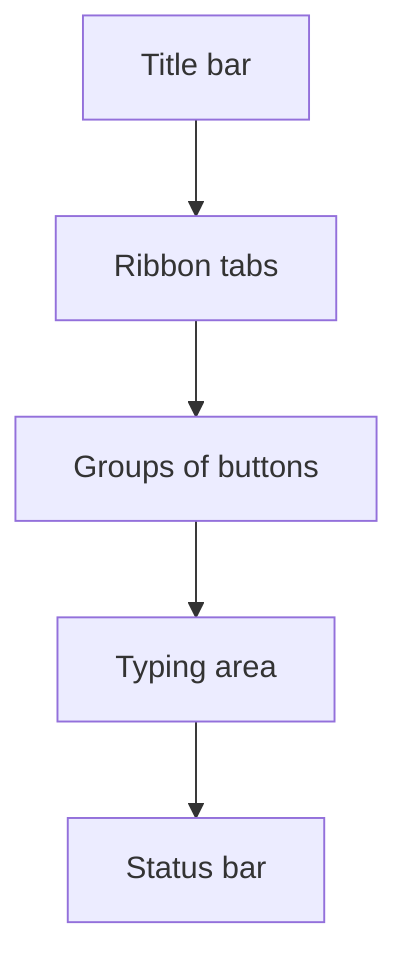

import Tabs from '@theme/Tabs';
import TabItem from '@theme/TabItem';

## Goal

By the end of this lesson, you can open Word, start a blank document and point to the main parts of the Word window.

## Why It Matters

Microsoft Word is a program for writing documents. People use it to write letters, job
applications, school notes and price lists for a shop. Before you can write, you need to open
Word and know your way around its window. This lesson is your first visit.

**Diagram in words:** At the top of the Word window are the title bar, the ribbon tabs and the
groups of buttons. Below them is the typing area. The status bar is at the bottom.

## Key Terms

| Term | Simple meaning |
|------|----------------|
| Blank document | A new, empty page in Word, ready for you to type on. |
| Title bar | The bar at the top of the window. It shows the name of the document and the program. |
| Ribbon | The wide strip of buttons near the top of Word. The commands you need are here. |
| Tab | A name on the ribbon, such as **Home** or **Insert**. Select a tab to see its buttons. |
| Group | A set of buttons on a tab that do similar jobs. For example, the **Font** group. |
| Typing area | The big part in the middle of the window. It shows your document. You type here. Microsoft calls it the edit window. |
| Cursor | The small line in the typing area. It shows where your typing will go. Microsoft also calls it the insertion point. |
| Status bar | The bar at the bottom of the window. It shows facts about your document, such as the number of words. |

## Teacher Demo

Use one lab computer that the whole class can see. You learned **Start** in
[Lesson 1.4](../module-01-computer-basics/starting-up-and-shutting-down.mdx) and clicking in
[Lesson 1.5](../module-01-computer-basics/using-the-mouse.mdx).

**Opening Word**

The steps are a little different on Windows 10 and Windows 11. Choose the tab for your computer.

<Tabs groupId="windows-version">
<TabItem value="win10" label="Windows 10">

1. Select **Start**. *The class sees the Start menu open, with a list of programs.*
2. Scroll down the list until you see **Word**. The list is in A to Z order.
3. Select **Word**. *The class sees Word start.*

</TabItem>
<TabItem value="win11" label="Windows 11">

1. Select **Start**. *The class sees the Start menu open.*
2. Select **All**. *The class sees a list of programs in A to Z order.*
3. Scroll down to **Word** and select it. *The class sees Word start.*

</TabItem>
</Tabs>

**Another way, on both Windows 10 and Windows 11:** press the **Windows key**, type **word**, then
select **Word** in the list of results.

**The Word window**

4. Point to the Word start screen. Say: "Each time Word starts, we choose what to make."
5. Select **Blank document**. *The class sees a new, empty page.*
6. Point to the title bar at the top. Say: "The title bar shows the name of the document."
7. Point to the ribbon. Say: "The ribbon holds the buttons we use to work."
8. Point to the tabs on the ribbon: **File**, **Home**, **Insert**, **Review** and **View**.
9. Select the **Insert** tab. *The class sees different buttons on the ribbon.*
10. Select the **Home** tab. Point to the **Font** group. Say: "These buttons are a group. They
    all change how letters look."
11. Point to the cursor in the typing area. Say: "This line shows where my typing will go. We
    will type in the next lesson."
12. Point to the status bar at the bottom. Say: "The status bar tells us about our document,
    for example how many words it has."
13. Select the **Close** button (**X**) in the upper-right corner of the window. *The class sees
    Word close.*

:::info[Screenshot to add]

The Word window with a blank document. Label the title bar, the ribbon tabs, the **Font** group,
the typing area, the cursor and the status bar.

:::

The ribbon can look a little different on a small screen. Word moves the buttons around to fit.

## Student Task

Work at your own lab computer.

1. Open Word from the Start menu, the same way your teacher did.
2. Select **Blank document**.
3. Point to the title bar and say its name to your partner.
4. Select the **Insert** tab. Look at the buttons.
5. Select the **Home** tab. Find the **Font** group.
6. Find the cursor in the typing area.
7. Find the status bar at the bottom of the window.
8. Close Word with the **Close** button (**X**) in the upper-right corner.
9. Open Word again and select **Blank document**.
10. Show your teacher: point to the ribbon, one tab, one group, the cursor and the status bar.

## Check Questions

1. Point to the ribbon on your screen. Then point to the **Home** tab.
   **Answer:** The ribbon is the wide strip of buttons near the top. **Home** is one of the tab
   names on it.
2. What does the cursor show you?
   **Answer:** It shows where your typing will go.
3. Where is the status bar, and what does it show?
   **Answer:** It is at the bottom of the window. It shows facts about the document, such as
   the number of words.

## Common Mistakes

- **Not finding Word in the Start menu list** → The list is in A to Z order. Scroll down to the
  letter W, or press the Windows key and type **word**.
- **Selecting a picture of a design instead of Blank document** → Close Word, open it again, and
  select **Blank document**.
- **Mixing up a tab and a group** → A tab is a name on the ribbon, like **Home**. A group is a set
  of buttons on that tab, like **Font**.

## Sources

*For the teacher: these sources were checked before this lesson was written.*

- [Microsoft Support, "Word for new users"](https://support.microsoft.com/en-us/word/word-for-new-users) (applies to Word 2016 and Word 2019): open Word from the Start menu or with the Windows key and the list of applications; quit Word with the X button in the upper-right corner; the title bar, ribbon, edit window and status bar and what each one does; the ribbon changes with the size of the screen; the **Font** group on the **Home** tab.
- [Microsoft Support, "Basic tasks in Word"](https://support.microsoft.com/en-us/office/basic-tasks-in-word-87b3243c-b0bf-4a29-82aa-09a681999fdc) (applies to Word 2016 and Word 2019): each time you start Word you can choose from a gallery; click **Blank document** to start without a template.
- [Microsoft Support, "Use a screen reader to explore and navigate Word"](https://support.microsoft.com/en-us/accessibility/word/use-a-screen-reader-to-explore-and-navigate-word) (applies to Word 2016 and Word 2019): the ribbon tabs include **File**, **Home**, **Insert**, **Review** and **View**; the status bar is at the bottom of the screen and shows page count and word count.
- [Microsoft Support, "Can't find Office applications in Windows 10?"](https://support.microsoft.com/en-us/office/can-t-find-office-applications-in-windows-10-907ce545-6ae8-459b-8d9d-de6764a635d6) (applies to Office 2016 and Office 2019): on Windows 10, choose **Start** and scroll to the application name, or start typing its name and click it in the results.
- [Microsoft Support, "Find your files and apps in Windows"](https://support.microsoft.com/en-us/windows/find-all-your-apps-and-programs-cadb9c4b-459d-dfcb-2964-14aac1d7d964) (Windows 10 and Windows 11 tabs): on Windows 11, select **Start**, select **All**, and scroll through the A to Z list; on both versions, press the Windows key and type the app name.
- [Microsoft Support, "Use keyboard to create and work with equations"](https://support.microsoft.com/en-us/accessibility/office-accessibility/use-keyboard-to-work-with-equations): Microsoft uses the name "insertion point" for the place where you type.
