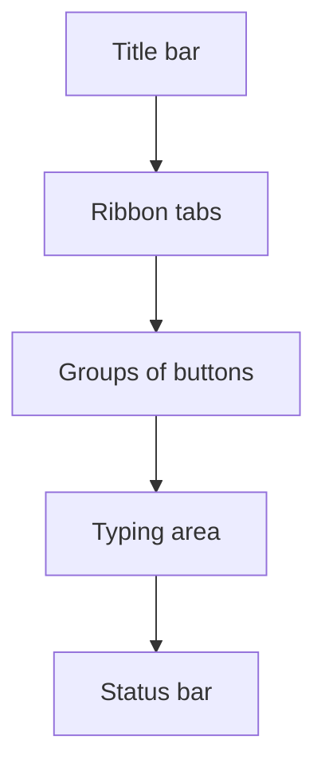

import Tabs from '@theme/Tabs';
import TabItem from '@theme/TabItem';

## Goal

By the end of this lesson, you can open Word, start a blank document and point to the main parts of the Word window.

## Why It Matters

Microsoft Word is a program for writing documents. A shopkeeper can type a price list for the
counter. A young person can write a job application. A student can type school notes. Before you
can write anything, you need to open Word and know your way around its window.

**Diagram in words:** At the top of the Word window are the title bar, the ribbon tabs and the
groups of buttons. Below them is the typing area. The status bar is at the bottom.

## Key Terms

| Term | Simple meaning |
|------|----------------|
| Blank document | A new, empty page in Word, ready for you to type on. |
| Title bar | The bar at the top of the window. It shows the name of the document and the program. |
| Ribbon | The wide strip of buttons near the top of Word. The commands you need are here. |
| Tab | A name on the ribbon, such as **Home** or **Insert**. Select a tab to see its buttons. |
| Group | A set of buttons on a tab that do similar jobs. For example, the **Font** group. |
| Typing area | The big part in the middle of the window. It shows your document. You type here. Microsoft calls it the edit window. |
| Cursor | The small line in the typing area. It shows where your typing will go. Microsoft also calls it the insertion point. |
| Status bar | The bar at the bottom of the window. It shows facts about your document, such as the number of words. |

Think of the ribbon like the shelves in a shop. Each tab is one shelf. Each group is one box on
that shelf. Things that do similar jobs are kept together, so you can find them fast.

## Step by Step

Follow these steps on your own computer. You learned **Start** in
[Lesson 1.4](../module-01-computer-basics/starting-up-and-shutting-down.mdx) and clicking in
[Lesson 1.5](../module-01-computer-basics/using-the-mouse.mdx).

**Opening Word**

The steps are a little different on Windows 10 and Windows 11. Choose the tab for your computer.

<Tabs groupId="windows-version">
<TabItem value="win10" label="Windows 10">

1. Select **Start**, so that you can see your programs. *You see the Start menu open, with a
   list of programs.*
2. Scroll down the list until you see **Word**. The list is in A to Z order, like names in a
   phone's contact list.
3. Select **Word** to start the program. *You see Word start.*

</TabItem>
<TabItem value="win11" label="Windows 11">

1. Select **Start**, so that you can see your programs. *You see the Start menu open.*
2. Select **All**. On an older Windows 11 computer, this button says **All apps**. This shows
   every program. *You see a list of programs in A to Z order.*
3. Scroll down to **Word** and select it to start the program. *You see Word start.*

</TabItem>
</Tabs>

**Another way, on both Windows 10 and Windows 11:** press the **Windows key**, type **word**, then
select **Word** in the list of results. This is faster when the list is long.

**The Word window**

4. Look at the Word start screen. Each time Word starts, you choose what to make.
5. Select **Blank document**, so that you get a clean page to write on. *You see a new, empty
   page.*
6. Find the title bar at the top. It shows the name of the document. This tells you which
   document you are working on.
7. Find the ribbon. It holds the buttons you use to work.
8. Find the tabs on the ribbon: **File**, **Home**, **Insert**, **Review** and **View**.
9. Select the **Insert** tab. *You see different buttons on the ribbon.* Each tab shows its own
   set of buttons.
10. Select the **Home** tab. Find the **Font** group. These buttons are a group. They all change
    how letters look.
11. Find the cursor in the typing area. This line shows where your typing will go. You will type
    in the next lesson.
12. Find the status bar at the bottom. It tells you about your document, for example how many
    words it has.
13. Select the **Close** button (**X**) in the upper-right corner of the window, so that Word
    closes when you finish. *You see Word close.*

{/* Screenshot to add: The Word window with a blank document. Label the title bar, the ribbon tabs, the **Font** group, the typing area, the cursor and the status bar. */}

The ribbon can look a little different on a small screen. Word moves the buttons around to fit.

## Practice

Imagine you will soon type a price list for a mobile shop. First, get to know the window.

1. Open Word from the Start menu, the same way as in Step by Step.
2. Select **Blank document**, so that you have an empty page.
3. Point to the title bar and say its name out loud. This helps you remember it.
4. Select the **Insert** tab. Look at the buttons.
5. Select the **Home** tab. Find the **Font** group. You will use it later to change letters.
6. Find the cursor in the typing area. Your price list would start there.
7. Find the status bar at the bottom of the window.
8. Close Word with the **Close** button (**X**) in the upper-right corner.
9. Open Word again and select **Blank document**. Doing it twice helps you remember the steps.
10. Check your work: Word is open with an empty page. You can point to the ribbon, the **Home**
    tab, the **Font** group, the cursor and the status bar without looking at this page.

## Check Questions

1. Point to the ribbon on your screen. Then point to the **Home** tab.

   

   
Show answer

   **Answer:** The ribbon is the wide strip of buttons near the top. **Home** is one of the tab
   names on it.

   

2. What does the cursor show you?

   

   
Show answer

   **Answer:** It shows where your typing will go.

   

3. Where is the status bar, and what does it show?

   

   
Show answer

   **Answer:** It is at the bottom of the window. It shows facts about the document, such as
   the number of words.

   

## Common Mistakes

- **Not finding Word in the Start menu list** → The list is in A to Z order. Scroll down to the
  letter W, or press the Windows key and type **word**.
- **Selecting a picture of a design instead of Blank document** → Close Word, open it again, and
  select **Blank document**.
- **Mixing up a tab and a group** → A tab is a name on the ribbon, like **Home**. A group is a set
  of buttons on that tab, like **Font**.

## Sources

*These official pages were checked when this lesson was written.*

- [Microsoft Support, "Word for new users"](https://support.microsoft.com/en-us/word/word-for-new-users) (applies to Word 2021, Word 2024, Word 2019, Word 2016 and Word for Microsoft 365): "Click the Start button or press the Windows key on your keyboard to display the Start menu. In the list of applications, find Word and click it"; "To quit Word, click the x button in the upper-right corner of your screen"; the title bar, ribbon, edit window and status bar and what each one does; "The appearance of the Ribbon will change depending on the size of your monitor"; the **Font** group on the **Home** tab.
- [Microsoft Support, "Basic tasks in Word"](https://support.microsoft.com/en-us/office/basic-tasks-in-word-87b3243c-b0bf-4a29-82aa-09a681999fdc) (applies to Word 2021, Word 2024, Word 2019, Word 2016 and Word for Microsoft 365): "Each time you start Word, you can choose a template from the gallery"; "If you'd rather not use a template, click **Blank document**."
- [Microsoft Support, "Use a screen reader to explore and navigate Word"](https://support.microsoft.com/en-us/accessibility/word/use-a-screen-reader-to-explore-and-navigate-word) (applies to Word 2021, Word 2024, Word 2019, Word 2016 and Word for Microsoft 365): "The Quick Access Toolbar and title bar at the top of the screen contain the document name"; the ribbon tabs include **File**, **Home**, **Insert**, **Review** and **View**; the ribbon shows "the options specific to the currently selected tab"; the status bar is at the bottom of the screen and shows page count and word count.
- [Microsoft Support, "Can't find Office applications in Windows 10?"](https://support.microsoft.com/en-us/office/can-t-find-office-applications-in-windows-10-907ce545-6ae8-459b-8d9d-de6764a635d6) (applies to Office 2021, Office 2024, Office 2019 and Office 2016): "For Microsoft 365, Office 2021, Office 2019, or Office 2016, choose Start and scroll to the Office application name"; or start typing its name and click it in the results.
- [Microsoft Support, "Find your files and apps in Windows"](https://support.microsoft.com/en-us/windows/find-all-your-apps-and-programs-cadb9c4b-459d-dfcb-2964-14aac1d7d964) (Windows 10 and Windows 11 tabs): on Windows 11, "Select Start, select All, and then scroll through the alphabetical list on the left"; on both versions, press the Windows key and start typing the app name.
- [Microsoft Support, "Find all your apps and programs" (archived Microsoft page, January 2024)](https://web.archive.org/web/20240120035001/https://support.microsoft.com/en-us/windows/find-all-your-apps-and-programs-cadb9c4b-459d-dfcb-2964-14aac1d7d964): the older Windows 11 wording, "Select Start, select All apps, and then scroll through the alphabetical list on the left."
- [Microsoft Support, "Use keyboard to create and work with equations"](https://support.microsoft.com/en-us/accessibility/office-accessibility/use-keyboard-to-work-with-equations) (Word, PowerPoint, OneNote and Excel): Microsoft uses the name "insertion point" for the place where you type.
