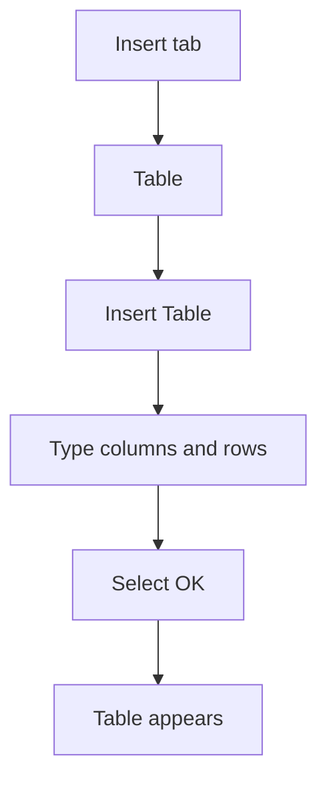

## Goal

By the end of this lesson, you can insert a table in Word, type in its cells and add a new row.

## Why It Matters

A table puts information in neat rows and columns. A shopkeeper can make a price list with a
table. A mobile shop can keep a stock list of phones and prices. A tuition centre can make a
weekly timetable. Tables make information quick to read and check.

**Diagram in words:** Select the Insert tab, then Table, then Insert Table. Type how many
columns and rows you want, select OK, and the table appears.

## Key Terms

| Term | Simple meaning |
|------|----------------|
| Table | Information set out in rows and columns, like a grid. It looks like a page of a ruled register. |
| Row | A line of boxes that goes across, from left to right. |
| Column | A line of boxes that goes down, from top to bottom. |
| Cell | One box in a table, where a row and a column meet. It is like one square on a chart. |
| Tab key | A key on the left side of the keyboard. In a table, it moves you to the next cell. |
| Insert | To add something new to your document, such as a table. |

## Step by Step

Follow these steps on your own computer. Open a new blank document
([Lesson 4.1](starting-word.mdx)). You will make a small weekly timetable for tuition classes.

| Day | Subject | Time |
|-----|---------|------|
| Monday | Computer | 10:00 |
| Tuesday | English | 11:00 |
| Wednesday | Maths | 10:00 |

**Inserting the table**

1. Count what you need first, so that the table is the right size. The timetable has 3
   columns. Start with 3 rows: the top row, Monday and Tuesday. You add Wednesday later.
2. Select the **Insert** tab. *You see the Insert tab buttons.*
3. Select **Table**. *You see a grid of small boxes and a list of choices.*
4. Select **Insert Table**. *The Insert Table box opens.* This box lets you type the exact size.
5. Type **3** for the number of columns. Type **3** for the number of rows.
6. Select **OK**. *An empty table with 3 columns and 3 rows appears.*
7. There is a second way to do the same job. After **Table**, move the mouse over the grid.
   Stop when 3 columns and 3 rows are highlighted.

**Typing and moving between cells**

8. Click in the first cell. Type **Day**. *The word appears in the top-left cell.* The top row
   names each column, so a reader knows what is below.
9. Press the **Tab** key. *The cursor moves to the next cell.* Type **Subject**.
10. Press **Tab** again and type **Time**.
11. Press **Tab**. *The cursor moves to the first cell of the next row.* Fill in Monday and
    Tuesday. Using **Tab** is faster than reaching for the mouse each time.
12. Press **Shift+Tab**. *The cursor moves back one cell.* Use this to go back and fix a cell.
13. You can also click in any cell, or use the arrow keys to move.

**Adding a row**

A timetable or price list often grows. You add a row, like adding a new line to a register.

14. Click in the last cell, at the bottom right. It holds **11:00**.
15. Press **Tab**. *A new empty row appears at the bottom.*
16. Type **Wednesday**, **Maths** and **10:00** in the new row.
17. To add a row in the middle, click in a row first. Then use **Insert Below**. Look for
    **Table Tools** at the top of the ribbon. Select its **Layout** tab and find
    **Insert Below**. These tabs appear only when you click in a table. In Microsoft 365, this
    tab is called **Table Layout**.

{/* Screenshot to add: The Insert Table box, with 3 typed for the columns and 3 for the rows. */}

## Practice

Your uncle runs Ali General Store. He wants a neat price list to stick on the wall, so that
customers can see the prices. Make it in Word.

| Item | Size | Price |
|------|------|-------|
| Sugar | 1 kg | Rs 160 |
| Rice | 1 kg | Rs 300 |
| Cooking oil | 1 litre | Rs 550 |
| Tea | 250 g | Rs 450 |

1. Open a new blank document.
2. Type **Ali General Store: Price List** on the first line. Press **Enter**. This title tells
   customers what the list is.
3. Insert a table with **3** columns and **5** rows (**Insert**, **Table**, **Insert Table**).
   You need 5 rows: one top row and four items.
4. Type the words from the table above. Use **Tab** to move to the next cell.
5. A new item has come to the shop. Click in the last cell (**Rs 450**). Press **Tab** to add a
   new row.
6. In the new row, type **Milk**, **1 litre** and **Rs 220**.
7. Make the top row bold ([Lesson 4.5](formatting-text.mdx)), so the column names stand out.
8. Save the document as **Price List** ([Lesson 4.3](saving-closing-opening.mdx)), so that you
   can change the prices next month.
9. Check your work: your price list has a title line and a table with 3 columns and 6 rows. The
   top row (**Item**, **Size**, **Price**) is bold. The last row is **Milk**, **1 litre**,
   **Rs 220**.

## Check Questions

1. Point to one cell in your table. Then point to one row and one column.

   

   
Show answer

   **Answer:** A cell is one box. A row goes across. A column goes down.

   

2. Which key moves you to the next cell? Which keys move you back?

   

   
Show answer

   **Answer:** **Tab** moves to the next cell. **Shift+Tab** moves back one cell.

   

3. Your table needs one more row at the bottom. Show how you add it.

   

   
Show answer

   **Answer:** Click in the last cell, at the bottom right, and press **Tab**.

   

## Common Mistakes

- **Pressing Enter to go to the next cell** → Press **Tab** to move to the next cell.
- **Choosing the wrong number of rows or columns** → Undo it ([Lesson 4.2](typing-and-correcting-text.mdx)) and insert the table again. If you need one more row, press **Tab** in the last cell.
- **An extra empty row appears at the bottom** → You pressed **Tab** in the last cell. Undo it with **Ctrl+Z**.
- **Typing outside the table** → Click inside the cell you want before you type.

## Sources

*These official pages were checked when this lesson was written.*

- [Microsoft Support, "Insert a table"](https://support.microsoft.com/en-us/word/training/insert-a-table): applies to Word 2016 and Word 2019; Insert, then Table, then Insert Table; type the number of columns and rows, then OK; the grid method.
- [Microsoft Support, "Use a screen reader to insert a table in Word"](https://support.microsoft.com/en-us/office/use-a-screen-reader-to-insert-a-table-in-word-a28f35dc-9a0d-4075-92ca-798c27d34db0): applies to Word 2016 and Word 2019; Tab moves to the next cell; pressing Tab in the last cell creates a new row; rows are added from the table's **Layout** tab.
- [Microsoft Support, "Add a cell, row, or column to a table in Word"](https://support.microsoft.com/en-us/word/add-a-cell-row-or-column-to-a-table-in-word): applies to Word 2016 and Word 2019 (current wording); click in a cell, then **Insert Above** or **Insert Below** on the **Table Layout** tab, which appears only after you click in a table.
- [Microsoft Support, "Add a cell, row, or column to a table" (archived Microsoft page, August 2019)](https://web.archive.org/web/20190813225323/https://support.office.com/en-us/article/add-a-cell-row-or-column-to-a-table-b030ef77-f219-4998-868b-ba85534867f1): applies to Word 2019 and Word 2016; "Under Table Tools, on the Layout tab"; "To add a row below the cell, click Insert Below in the Rows and Columns group"; the Design and Layout tabs "are only visible after you have clicked inside of a table".
- [Microsoft, "Word 2016 Quick Start Guide" (PDF, archived copy of the download.microsoft.com file)](https://web.archive.org/web/2016id_/http://download.microsoft.com/download/1/2/6/1269C192-F79E-4918-B737-D828E0522349/WORD%202016%20QUICK%20START%20GUIDE.PDF): "clicking within a table displays the Table Tools tab, which offers additional options for the Design and Layout of your tables."
- [Microsoft Support, "Keyboard shortcuts in Word"](https://support.microsoft.com/en-us/office/keyboard-shortcuts-in-word-95ef89dd-7142-4b50-afb2-f762f663ceb2): applies to Word 2016 and Word 2019; Tab (next cell), Shift+Tab (previous cell), arrow keys (next or previous row), Ctrl+Z (undo).
