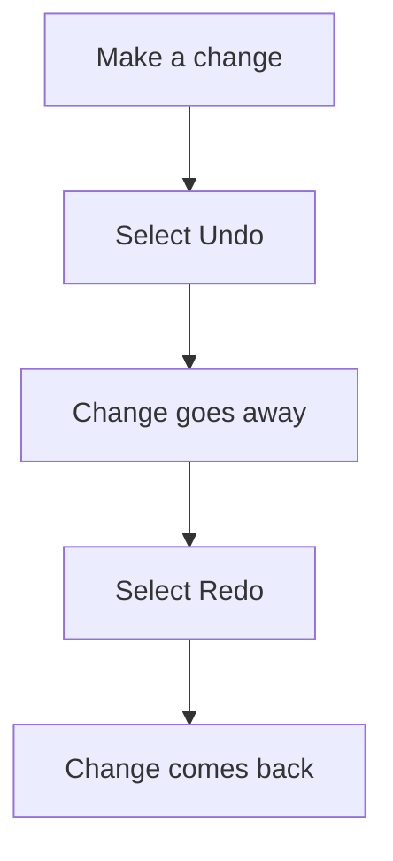

## Goal

By the end of this lesson, you can type a few lines in Word, fix your mistakes and undo a change.

## Why It Matters

Everyone makes typing mistakes, even fast typists in an office. A wrong price on a shop bill or
a wrong spelling in a job application looks bad. In Word, you can remove a wrong letter in a
second. If you change something by accident, Word can take the change back. So you can practise
without fear.

**Diagram in words:** When you make a change you do not want, select Undo and the change goes
away. If you change your mind again, select Redo and the change comes back.

## Key Terms

| Term | Simple meaning |
|------|----------------|
| Paragraph | One block of text. You start a new paragraph when you press **Enter**. |
| Delete key | The key marked **Delete**. It removes the letter after the cursor. |
| Home key | The key marked **Home**. It moves the cursor to the start of the line. |
| End key | The key marked **End**. It moves the cursor to the end of the line. |
| Undo | Take back the last change you made. |
| Redo | Make a change again after you undid it. |
| Quick Access Toolbar | A small set of buttons Word always shows. It has **Save**, **Undo** and **Redo**. |

You met **Enter**, **Backspace** and the **arrow keys** in
[Lesson 1.6](../module-01-computer-basics/keyboard-basics.mdx). You met the cursor in
[Lesson 4.1](./starting-word.mdx).

## Step by Step

Follow these steps on your own computer. Open Word and start a blank document, as in
[Lesson 4.1](./starting-word.mdx).

**Typing and new paragraphs**

1. Type **My name is Sana Malik.** *You see the letters appear where the cursor is.*
2. Press **Enter**, so that the next sentence starts on its own line. *You see the cursor move
   down. A new paragraph starts.*
3. Type **I live in Karachi.** and press **Enter**.

**Fixing mistakes**

A mistake on a page is like a wrong word on a whiteboard. You wipe off only that part and
write it again.

4. Type **Thank yuo** on purpose. Now there is a mistake to fix.
5. Press **Backspace** two times, so that the wrong letters go away. *You see the letters before
   the cursor go away.* Type **ou** to make **Thank you**.
6. Click at the start of the line **I live in Karachi.** This puts the cursor where you want to
   work. *You see the cursor move there.*
7. Press **Delete** one time. *You see the letter after the cursor (**I**) go away.* Type
   **We** to make **We live in Karachi.**

**Moving the cursor with the keyboard**

These keys move the cursor fast, so that you do not need the mouse for every small move.

8. Press the **End** key. *You see the cursor jump to the end of the line.*
9. Press the **Home** key. *You see the cursor jump to the start of the line.*
10. Press the **Right arrow** key a few times. *You see the cursor move along the line.*

**Undo and Redo**

Undo is your safety net. It takes back a change you did not want.

11. Find the **Quick Access Toolbar**. **Undo** and **Redo** are here.
12. Select **Undo** (or press **Ctrl+Z**). *You see the last change go away.*
13. Press **Ctrl+Y** to redo. *You see the change come back.*
14. Close Word. *You see a message that asks if you want to save your changes.* Choose not to
    save, because this was only practice. You learn to save in the next lesson.

    :::tip[If your screen looks different]

    The buttons in this message may have other names. If you see **Yes**, **No** and **Cancel**,
    choose **No**. It closes Word without saving. **Cancel** keeps Word open.

    :::

{/* Screenshot to add: The Quick Access Toolbar in Word, with the **Undo** and **Redo** buttons labelled. */}

## Practice

Sana is writing a few lines about her family for a short job form. Type them for her. Press
**Enter** at the end of each line.

| Line | Type this |
|------|-----------|
| 1 | My name is Sana Malik. |
| 2 | I live in Karachi. |
| 3 | My father has a small shop. |
| 4 | He sells rice, sugar and tea. |

1. Open Word and select **Blank document**.
2. Type the four lines from the table. Press **Enter** after each line, so that each one starts
   on a new line.
3. If you make a mistake, press **Backspace** to remove it. Then type the right letters.
4. Click in the middle of line 3. Press **Home**, then press **End**. Watch the cursor move.
   This shows you how to reach the start or end of a line fast.
5. Use the arrow keys to put the cursor right before the word **small** in line 3.
6. Press **Delete** six times. The word **small** and its space go away.
7. Press **Ctrl+Z** until the word **small** comes back. This shows that Undo can save you.
8. Press **Ctrl+Y** once. Watch what changes. Then press **Ctrl+Z** again.
9. Check your work: you see four lines, each on its own line, with no mistakes. Line 3 reads
   **My father has a small shop.** with the word **small** in it.

When you finish, close Word without saving, as in step 14 of Step by Step. You learn to save in
[Lesson 4.3](./saving-closing-opening.mdx).

## Check Questions

1. Show how you start a new paragraph.

   

   
Show answer

   **Answer:** Press **Enter**. The cursor moves down and a new paragraph starts.

   

2. What is the difference between Backspace and Delete?

   

   
Show answer

   **Answer:** **Backspace** removes the letter before the cursor. **Delete** removes the
   letter after the cursor.

   

3. You removed a word by mistake. How do you get it back?

   

   
Show answer

   **Answer:** Select **Undo** on the Quick Access Toolbar, or press **Ctrl+Z**.

   

## Common Mistakes

- **Pressing the Spacebar many times to reach a new line** → Press **Enter** once to start a new
  paragraph.
- **Pressing Backspace when the cursor is in the wrong place** → Check where the cursor is
  first. Click or use the arrow keys to move it.
- **Typing the whole line again to fix one letter** → Move the cursor to the mistake. Remove the
  wrong letter and type the right one.
- **Pressing Undo too many times** → Press **Ctrl+Y** to redo the changes you did not want to
  undo.

## Sources

*These official pages were checked when this lesson was written.*

- [Microsoft Support, "Keyboard shortcuts in Word"](https://support.microsoft.com/en-us/accessibility/word/keyboard-shortcuts-in-word) (applies to Word 2016 and Word 2019): **Ctrl+Z** undoes the previous action; **Ctrl+Y** redoes it; **Home** and **End** move the cursor to the start and end of the line; the arrow keys place the cursor.
- [Microsoft Support, "Word for new users"](https://support.microsoft.com/en-us/word/word-for-new-users) (applies to Word 2016 and Word 2019): the Quick Access Toolbar holds **Save**, **Undo** and **Redo**; clicking places the cursor; when you quit after changes, a message asks if you want to save, and **No** quits without saving.
- [Microsoft Support, "Indent the first line of a paragraph"](https://support.microsoft.com/en-us/word/training/indent-the-first-line-of-a-paragraph) (applies to Word 2016 and Word 2019): you press **Enter** to start the next paragraph.
- [Microsoft Support, "Keyboard shortcuts for Microsoft Word on Windows" (archived Microsoft page, May 2019)](http://web.archive.org/web/20190531102624/https://support.office.com/en-us/article/keyboard-shortcuts-for-microsoft-word-on-windows-95ef89dd-7142-4b50-afb2-f762f663ceb2) (applies to Word 2019 and Word 2016): **Backspace** deletes one character to the left; **Delete** deletes one character to the right.
- [Microsoft Support, "Use keyboard shortcuts to create PowerPoint presentations"](https://support.microsoft.com/en-us/office/use-keyboard-shortcuts-to-create-powerpoint-presentations-ebb3d20e-dcd4-444f-a38e-bb5c5ed180f4) (applies to PowerPoint 2016 and 2019, not Word): **Backspace** deletes one character to the left; **Delete** deletes one character to the right.
- [Microsoft Support, "Use keyboard to create and work with equations"](https://support.microsoft.com/en-us/accessibility/office-accessibility/use-keyboard-to-work-with-equations) (Word, PowerPoint, OneNote and Excel): **Backspace** removes the character before the insertion point; **Delete** removes the character after it.
