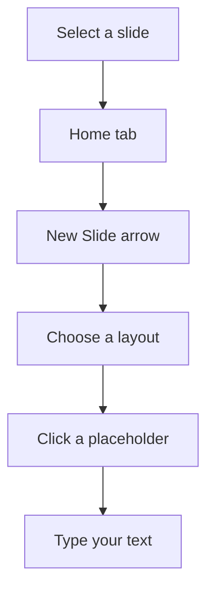

## Goal

By the end of this lesson, you can add new slides, choose a slide layout, and type a title and bullet points on each slide.

## Why It Matters

A school wants to tell parents about its sports day: the date, the races and the prizes. A
tuition centre wants to show its subjects and timings. Each idea goes on its own slide, with a
short title and a few points. When you can add slides and type on them, you can make a simple
presentation for any purpose.

**Diagram in words:** Select the slide that the new slide should follow. On the Home tab,
select the arrow by New Slide and choose a layout. Then click inside a placeholder and type.

## Key Terms

| Term | Simple meaning |
|------|----------------|
| New Slide | The button on the **Home** tab that adds a slide to your presentation. |
| Slide layout | The plan of a slide. It decides which placeholders the slide has and where they sit. |
| Title Slide | A layout for the first slide, like the cover of a book. It has a big title box. |
| Title and Content | A layout with a title at the top and a big box below for your points. |
| Bullet point | A short line of text with a small dot in front of it. |
| Bullets | The button on the **Home** tab that turns bullet points on or off. |

You met placeholders and the thumbnail pane in [Lesson 5.1](./starting-powerpoint.mdx).

A slide layout is like a printed form. The form already has a space for the name and a space for
the address. You only fill in the spaces.

## Step by Step

Open PowerPoint and start a blank presentation (see [Lesson 5.1](./starting-powerpoint.mdx)).
You will make three slides about Green Valley School's sports day.

| Slide | Layout | Title | Other text |
|-------|--------|-------|------------|
| 1 | Title Slide | Green Valley School Sports Day | Saturday, 10 am, school ground |
| 2 | Title and Content | Races and Games | 100 metre race; Sack race; Tug of war |
| 3 | Title and Content | Prizes | Medals for the top three; Certificates for all players |

**Slide 1: the title slide**

Your new presentation already has one slide. It uses the Title Slide layout.

1. Click inside the placeholder that says **Click to add title**. *You see the cursor blink
   inside the box.* PowerPoint needs to know which box your words go into.
2. Type **Green Valley School Sports Day**. *The words "Click to add title" go away, and your
   title appears.*
3. Click inside the smaller box below the title. Type **Saturday, 10 am, school ground**. This
   line tells people when and where.

**Slide 2: a slide with points**

4. In the thumbnail pane, select slide 1. A new slide always goes after the slide you select.
5. On the **Home** tab, select the arrow by **New Slide**. *You see a gallery of layouts.* Each
   picture shows where the boxes sit on that layout.
6. Select **Title and Content**. *You see slide 2 in the thumbnail pane and in the slide pane.*
   This layout is good for a title and a short list.
7. Click inside the title placeholder and type **Races and Games**.
8. Click inside the big box below the title. Click on the words in the box, not on the small
   pictures in its middle. Those pictures add other things, like a table.
9. Type **100 metre race** and press **Enter**. *A new bullet point appears on the next line.*
   Each time you press **Enter** in this box, you start a new point.
10. Type **Sack race**, press **Enter**, then type **Tug of war**. Do not press **Enter** after
    the last point, so that no empty bullet is left.

**Slide 3: a faster way**

11. With slide 2 selected, press **Ctrl+M**. *A new slide 3 appears with the same layout as
    slide 2.* This is quicker when you need many slides of the same kind.
12. Type the title **Prizes**. In the big box, type **Medals for the top three**, press
    **Enter**, and type **Certificates for all players**.

**Turning bullets off and on**

13. On slide 3, select both points by dragging across them (see
    [Lesson 4.4](../module-04-ms-word/copy-cut-paste.mdx)).
14. On the **Home** tab, in the **Paragraph** group, select **Bullets**. *The dots go away.*
    Select **Bullets** again. *The dots come back.* Now you know what the button does.

{/* Screenshot to add: PowerPoint 2021 with the New Slide layout gallery open on the Home tab, showing the Title Slide and Title and Content layouts. */}

Keep each point short, on one line. People should listen to you, not read a long paragraph.

## Practice

A Basic Health Unit is giving a talk on healthy habits. Make three slides for the talk. Use the
table below.

| Slide | Layout | Title | Other text |
|-------|--------|-------|------------|
| 1 | Title Slide | Healthy Habits | A health talk for families |
| 2 | Title and Content | Every Day | Wash hands before meals; Drink clean water; Eat fresh fruit |
| 3 | Title and Content | A Clean Home | Cover food; Empty standing water; Put rubbish in a bin |

1. Open PowerPoint and select **Blank Presentation**.
2. On slide 1, type the title **Healthy Habits**. In the box below it, type **A health talk for
   families**.
3. Select slide 1 in the thumbnail pane, so that the new slide goes after it.
4. On the **Home** tab, select the arrow by **New Slide**. Select **Title and Content**.
5. Type the title **Every Day**. In the big box, type the three points. Press **Enter** after
   the first and second points only.
6. Press **Ctrl+M** to add slide 3 with the same layout.
7. Type the title **A Clean Home** and its three points.
8. Look at the thumbnail pane. Select each slide in turn, so that you check every slide.
9. Keep PowerPoint open. You will save and show slides in the next lesson.
10. Check your work: the thumbnail pane shows three slides. Slide 1 has the title **Healthy
    Habits** and one line below it. Slides 2 and 3 each have a title and three bullet points,
    with no empty bullet at the end.

## Check Questions

1. Show how you add a new slide with the **Title and Content** layout.

   

   
Show answer

   **Answer:** Select the slide it should follow. On the **Home** tab, select the arrow by
   **New Slide**, then select **Title and Content**.

   

2. You are typing in the big box of a Title and Content slide. What happens when you press
   **Enter**?

   

   
Show answer

   **Answer:** A new bullet point starts on the next line.

   

3. Which layout is best for the first slide of a presentation?

   

   
Show answer

   **Answer:** **Title Slide**. It works like the cover of a book.

   

## Common Mistakes

- **Typing before clicking inside a placeholder** → Click inside the box first. Then type.
- **Choosing the wrong layout** → Select the slide. On the **Home** tab, select **Layout**, then
  choose the layout you want.
- **The new slide appears in the wrong place** → Before you add a slide, select the slide it
  should follow in the thumbnail pane.
- **Writing long sentences on a slide** → Use a few short points, one line each.

## Sources

*These official pages were checked when this lesson was written.*

- [Microsoft Support, "Add, rearrange, duplicate, and delete slides in PowerPoint"](https://support.microsoft.com/en-us/office/add-rearrange-duplicate-and-delete-slides-in-powerpoint-e35a232d-3fd0-4ee1-abee-d7d4d6da92fc) (applies to PowerPoint 2021): "Select the slide you want your new slide to follow. On the Home tab, select the arrow by New Slide. Select a layout. Select the text box and type."
- [Microsoft Support, "Basic tasks for creating a PowerPoint presentation"](https://support.microsoft.com/en-us/office/basic-tasks-for-creating-a-powerpoint-presentation-efbbc1cd-c5f1-4264-b48e-c8a7b0334e36) (applies to PowerPoint 2021): "On the Home tab, click the bottom half of New Slide, and pick a slide layout"; "Select a text placeholder, and begin typing."
- [Microsoft Support, "Title a slide"](https://support.microsoft.com/en-us/powerpoint/title-a-slide) (applies to PowerPoint 2021): "Click Home > Layout"; "Select Title Slide for a standalone title page or select Title and Content for a slide that contains a title and a full slide text box"; "Select the Click to add title text box. Enter your title for that slide."
- [Microsoft Support, "What is a slide layout?"](https://support.microsoft.com/en-us/office/what-is-a-slide-layout-99da5716-92ee-4b6a-a0b5-beea45150f3a) (applies to PowerPoint 2021): "Slide layouts contain formatting, positioning, and placeholder boxes for all of the content that appears on a slide"; to change a slide's layout, "select Home > Layout (or Slide Layout) and choose a layout".
- [Microsoft Support, "Apply a slide layout"](https://support.microsoft.com/en-us/office/apply-a-slide-layout-158e6dba-e53e-479b-a6fc-caab72609689) (applies to PowerPoint 2021): "The predefined layouts include a Title slide to begin with, a general Title and Content layout"; "Select the slide that you want to change the layout for."
- [Microsoft Support, "Add, edit, or remove a placeholder on a slide layout"](https://support.microsoft.com/en-us/powerpoint/add-edit-or-remove-a-placeholder-on-a-slide-layout) (applies to PowerPoint 2021): "The (lower) Content placeholder accepts text, or a table, chart, SmartArt graphic, picture, or video, as indicated by the selectable icons at its center."
- [Microsoft Support, "Add text to a slide"](https://support.microsoft.com/en-us/powerpoint/add-text-to-a-slide) (applies to PowerPoint 2021): "Click inside the placeholder, and then type or paste the text"; custom prompt text "disappears when you begin typing".
- [Microsoft Support, "Use a screen reader to work with slides in PowerPoint"](https://support.microsoft.com/en-us/office/use-a-screen-reader-to-work-with-slides-in-powerpoint-566c021b-7fe5-4f96-a0f7-eca68335f991) (applies to PowerPoint 2021): "In a new presentation, the title slide is added automatically"; "Add a new slide based on current slide's layout … Press Ctrl+M."
- [Microsoft Support, "Add bullets or numbers to text"](https://support.microsoft.com/en-us/office/add-bullets-or-numbers-to-text-a6f1b87e-fca8-47da-ade9-5d99b7f41f04) (applies to PowerPoint 2021): "On the Home tab, in the Paragraph group, click Bullets or Numbering"; "In a Text box, you get a number or bullet every time you press Enter"; "To stop creating bullets or numbers and return to text, click Bullets or Numbering again to turn it off."
- [Microsoft Support, "Tips for creating and delivering an effective presentation"](https://support.microsoft.com/en-us/powerpoint/tips-for-creating-and-delivering-an-effective-presentation) (applies to PowerPoint 2021): "Use bullets or short sentences, and try to keep each to one line"; "You want your audience to listen to you present your information, rather than read the screen."
