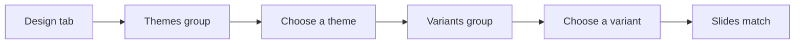

## Goal

By the end of this lesson, you can give your slides a matching look with a theme and a variant.

## Why It Matters

Think of a school uniform. Every student wears the same colours, so the group looks neat. A
theme does the same for your slides. A tuition centre can show its fees on slides that all
match. A mobile shop can show its new phones in its own colours. With a few clicks, plain white
slides get colours, fonts and backgrounds that go well together.

**Diagram in words:** On the Design tab, choose a theme in the Themes group. Then you can choose
a variant in the Variants group. Your slides get a matching look.

## Key Terms

| Term | Simple meaning |
|------|----------------|
| Theme | A ready-made look for your slides: colours, fonts and a background that go well together. |
| Design tab | The tab on the ribbon where you choose a theme for your presentation. |
| Themes group | The part of the **Design** tab that shows the themes you can choose. |
| Variant | A different colour choice of the same theme. The design stays, the colours change. |
| Variants group | The part of the **Design** tab that shows the variants of the theme you chose. |
| Office Theme | The plain theme with a white background. |
| Background | The colour or pattern behind everything on a slide, like the wall behind a notice board. |

A theme is like choosing one set of clothes for a whole family photo. Everyone matches, but each
person is still different. Your slides keep their own words. Only their look changes.

## Step by Step

Open PowerPoint and start a blank presentation (see [Lesson 5.1](./starting-powerpoint.mdx)).
You will make three slides for Star Tuition Centre. Make them in the way you learned in
[Lesson 5.2](./adding-slides-and-text.mdx).

| Slide | Layout | Title | Other text |
|-------|--------|-------|------------|
| 1 | Title Slide | Star Tuition Centre | Grades 6 to 10 |
| 2 | Title and Content | Subjects | Maths; English; Science |
| 3 | Title and Content | Timings | Monday to Friday; 4 pm to 7 pm |

*You see three plain white slides.* Now you will give them a matching look.

**Choosing a theme**

1. Select the **Design** tab. *You see a row of small theme pictures in the **Themes** group.*
   Each picture shows how your slides will look with that theme.
2. Select the down arrow in the **Themes** group. *You see the whole gallery of themes.* The
   gallery shows more themes than the row on the ribbon.
3. Select a theme that you like. *Your slides get new colours, fonts and a background.* Your
   words stay the same.
4. Look at the thumbnail pane on the left. *All three slides have the same new look.* This is
   why you use a theme: the whole presentation matches.

   :::tip[If your screen looks different]

   If only one slide has the new look, open the themes gallery again. Right-click the theme you
   want, then select **Apply to All Slides**.

   :::

5. Select a different theme. *The look changes again.* You can change your theme at any time,
   so try a few before you decide.

**Choosing a variant**

6. On the **Design** tab, find the **Variants** group. *You see the same theme in different
   colours.*
7. Select a variant. *Your slides keep the same design, but the colours change.* Use a variant
   when you like a theme but want other colours, for example the colours of your centre's
   sign.

If you see no variants, your theme may be an old or custom one. Choose another theme from the
gallery.

**Going back to plain slides**

8. Open the themes gallery again. Select **Office Theme**, the one with the white background.
   *Your slides are plain white again.* This is useful if a theme makes your slides hard to
   read.
9. Choose the theme and variant you liked best. Save the presentation as **Tuition Centre**
   (see [Lesson 5.3](./saving-and-slide-show.mdx)), so that your work is kept.

{/* Screenshot to add: The Design tab in PowerPoint 2021, with the Themes group and the Variants group circled. */}

**Choosing a good theme**

- Choose a calm theme that is not too bright or busy. The background should not pull eyes away
  from your words.
- Keep one theme for the whole presentation, so that the slides look like one set.
- Make sure the text is clear to read. Themes put dark text on a light background, or light text
  on a dark background.

## Practice

Your local Basic Health Unit is giving a talk on clean drinking water. Make the slides and give
them a theme.

| Slide | Layout | Title | Other text |
|-------|--------|-------|------------|
| 1 | Title Slide | Clean Water, Healthy Family | A health talk |
| 2 | Title and Content | Boil Your Water | Boil for a few minutes; Let it cool; Keep it covered |
| 3 | Title and Content | Store It Safely | Use a clean pot; Use a clean cup to take water out |

1. Open PowerPoint and select **Blank Presentation**.
2. Make the three slides in the table, so that you have something to design.
3. Select the **Design** tab. Select the down arrow in the **Themes** group to see all themes.
4. Choose a calm theme that fits a health talk.
5. Look at all three slides in the thumbnail pane, so that you check that they match.
6. In the **Variants** group, try two or three variants. Keep the one where the text is clearest
   to read.
7. Start the slide show from the beginning (see [Lesson 5.3](./saving-and-slide-show.mdx)).
   Look at each slide on the full screen. Press **Esc** at the end.
8. Save the presentation as **Clean Water**, so that the health worker can use it later.
9. Check your work: all three slides have the same theme. The text is clear to read on every
   slide. The title bar shows **Clean Water**.

## Check Questions

1. Point to the **Themes** group and the **Variants** group on your screen.

   

   
Show answer

   **Answer:** Both are on the **Design** tab. The **Themes** group shows the themes. The
   **Variants** group shows the colour choices of your theme.

   

2. What is the difference between a theme and a variant?

   

   
Show answer

   **Answer:** A theme gives your slides a whole new look: colours, fonts and background. A
   variant keeps the same theme but changes its colours.

   

3. Your slides have a busy theme and the text is hard to read. How do you get plain white slides
   again?

   

   
Show answer

   **Answer:** On the **Design** tab, open the themes gallery and select **Office Theme**.

   

## Common Mistakes

- **Choosing a very bright, busy theme** → Choose a calm theme, so that people look at your
  words, not the background.
- **Only one slide gets the new theme** → Open the themes gallery, right-click the theme, and
  select **Apply to All Slides**.
- **Looking for themes on the Home tab** → Themes are on the **Design** tab.
- **Text is hard to read after choosing a variant** → Try another variant, or select **Office
  Theme** to go back to plain slides.

## Sources

*These official pages were checked when this lesson was written.*

- [Microsoft Support, "Add color and design to your slides with Themes"](https://support.microsoft.com/en-us/office/add-color-and-design-to-your-slides-with-themes-a54d6866-8c32-4fbc-b15d-6fcc4bd1edf6) (applies to PowerPoint 2021, PowerPoint 2024, PowerPoint 2019, PowerPoint 2016 and PowerPoint for Microsoft 365): "PowerPoint provides a variety of design themes—including coordinated color schemes, backgrounds, font styles, and placement of placeholders"; "you can always change the theme or variant later on the Design tab"; "On the Design tab, pick a theme with the colors, fonts, and effects that you like"; "To apply a different color variation of a particular theme, select a variant in the Variants group"; "If you don't see any variants, it could be because you're using a custom theme, an older theme designed for earlier versions of PowerPoint"; "select the Themes down arrow in the Themes group".
- [Microsoft Support, "Remove or change the current theme"](https://support.microsoft.com/en-us/office/remove-or-change-the-current-theme-f1e47128-cea7-42b5-9cb3-790b080d4c83) (applies to PowerPoint 2021): "On the Design tab, in the Themes group, select the Themes button to open the entire gallery of themes"; "To remove a colorful theme, apply the Office Theme for a simple design with a plain white background"; for all slides, "Point the mouse at the theme you want to apply. Right-click it, and then select Apply to All Slides"; "Select Blank Presentation. A presentation with a white background opens."
- [Microsoft Support, "Design in PowerPoint"](https://support.microsoft.com/en-us/office/design-in-powerpoint-2659f76c-3297-4ff2-ac55-4aa5eda8113b) (applies to PowerPoint 2021): "Select the Design tab. Select one of the Themes. Select one of the Variants."
- [Microsoft Support, "Tips for creating and delivering an effective presentation"](https://support.microsoft.com/en-us/powerpoint/tips-for-creating-and-delivering-an-effective-presentation) (applies to PowerPoint 2021): "Choose an appealing, consistent template or theme that is not too eye-catching. You don't want the background or design to detract from your message"; "Themes automatically set the contrast between a light background with dark colored text or dark background with light colored text."
