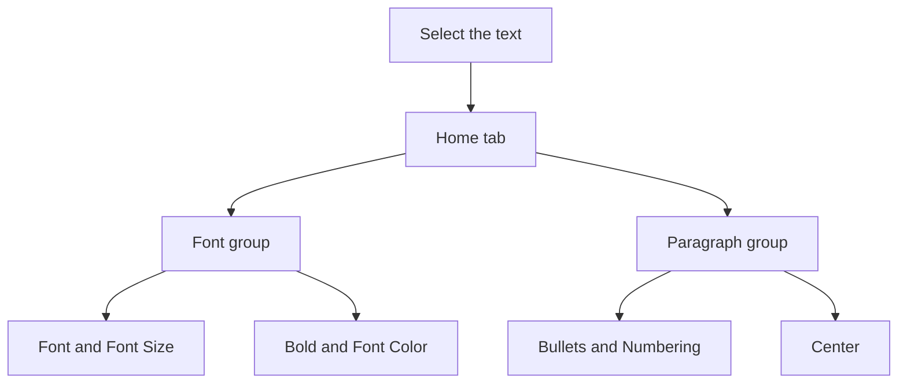

## Goal

By the end of this lesson, you can format text on a slide: font, size, colour, bold, bullets, numbers and alignment.

## Why It Matters

People often watch slides from far away, at the back of a hall or a shop. Big, clear letters
help them read. A tuition centre can make its fees stand out for parents. A mobile shop can make
the price of a new phone stand out. Good formatting makes your slides clear, not only
colourful.

**Diagram in words:** First select the text. On the Home tab, the Font group changes how the
letters look. The Paragraph group changes bullets, numbers and alignment.

## Key Terms

| Term | Simple meaning |
|------|----------------|
| Format | To change how text looks, but not what it says. |
| Font | The shape or design of the letters. |
| Font size | How big the letters are. A bigger number means bigger letters. |
| Font Color | The button that changes the colour of letters. |
| Numbering | The button that puts 1, 2, 3 in front of your points, in place of dots. |
| Alignment | Where a line sits in its box: on the left, in the middle or on the right. |

Formatting in PowerPoint works like formatting in Word. See
[Lesson 4.5](../module-04-ms-word/formatting-text.mdx) for fonts and colours,
[Lesson 4.6](../module-04-ms-word/formatting-paragraphs.mdx) for alignment and
[Lesson 4.7](../module-04-ms-word/bulleted-and-numbered-lists.mdx) for bullets and numbers.

Think of a shop sign. The shop name is big and bold. The phone number is smaller. You format a
slide in the same way: the most important words are the biggest.

## Step by Step

Open PowerPoint and start a blank presentation (see [Lesson 5.1](./starting-powerpoint.mdx)).
Make these two slides (see [Lesson 5.2](./adding-slides-and-text.mdx)).

| Slide | Layout | Title | Other text |
|-------|--------|-------|------------|
| 1 | Title Slide | Bright Future Tuition Centre | Grades 6 to 10 |
| 2 | Title and Content | Monthly Fees | Maths: Rs 2,500; English: Rs 2,000; Science: Rs 3,000 |

**Font, size, bold and colour on the title slide**

1. On slide 1, select the words **Bright Future Tuition Centre** by dragging across them (see
   [Lesson 4.4](../module-04-ms-word/copy-cut-paste.mdx)). You always select first, so that
   PowerPoint knows which words to change.
2. On the **Home** tab, in the **Font** group, open the **Font** list. Choose **Arial**. *The
   letters change shape.* People can read a plain font like Arial from far away.
3. Select the number in the **Font Size** box. Type **48** and press **Enter**. *The title
   becomes bigger.* The name of the centre is the most important part.
4. Select **Bold**. *The letters become thick and dark.* This makes the name stand out.
5. Select **Font Color**, then select a dark blue colour. *The title changes colour.* A dark
   colour on a light slide is clear to read.
6. Made a mistake? Press **Ctrl+Z** to undo it. *The last change goes away.*

**Centring a title**

7. Go to slide 2. Click inside the title **Monthly Fees**.
8. On the **Home** tab, in the **Paragraph** group, select **Center**. *The title moves to the
   middle of its box.* A centred title looks neat at the top of a slide.

   :::tip[If your screen looks different]

   If you cannot find **Center**, right-click the title and select **Paragraph**. *You see the
   **Paragraph** box.* In the **Alignment** list, choose **Center**. Then select **OK**.

   :::

**Bullets and numbers**

9. On slide 2, select all three fee lines.
10. In the **Paragraph** group, select **Numbering**. *The dots change to 1, 2 and 3.* Numbers
    are useful when the order matters, like steps.
11. Select **Bullets**. *The dots come back.* For a list of fees, the order does not matter, so
    bullets are fine.
12. With the three lines still selected, type **28** in the **Font Size** box and press
    **Enter**. *The fees become bigger.* Text smaller than 18 is hard to read on a big screen.
13. Select the word **Science** and press **Ctrl+B**. *Science becomes bold.* The keyboard is
    faster when your hands are on the keys.
14. Save the presentation as **Tuition Fees** (see [Lesson 5.3](./saving-and-slide-show.mdx)),
    so that your work is kept.

{/* Screenshot to add: The Home tab in PowerPoint 2021 with the Font group and the Paragraph group circled. Show Font, Font Size, Bold, Font Color, Bullets, Numbering and Center. */}

Use one or two fonts in a whole presentation. Too many fonts and colours make slides look messy.

## Practice

Rehman Mobiles has three new phones this month. Make a slide to show the customers. Type the
slides first.

| Slide | Layout | Title | Other text |
|-------|--------|-------|------------|
| 1 | Title Slide | Rehman Mobiles | New phones this month |
| 2 | Title and Content | Our New Phones | Nova 5: Rs 35,000; Sky 10: Rs 52,000; Zen Pro: Rs 78,000 |

1. Open PowerPoint, start a blank presentation and make the two slides from the table.
2. On slide 1, select the title **Rehman Mobiles**. Choose **Calibri** in the **Font** list.
3. Type **54** in the **Font Size** box and press **Enter**, so that the shop name is the
   biggest text.
4. Select **Bold**. Then select **Font Color** and choose a colour you like. Choose a dark
   colour if the slide is white.
5. On slide 2, click inside the title **Our New Phones**. Select **Center**.
6. Select the three phone lines. Select **Numbering**, so that customers can say "number 2".
7. With the three lines selected, type **32** in the **Font Size** box and press **Enter**.
8. Select only **Rs 78,000** and press **Ctrl+B**, so that the price of the best phone stands out.
9. Save the presentation as **New Phones**.
10. Check your work: on slide 1, **Rehman Mobiles** is in Calibri, size 54, bold and in colour.
    On slide 2, the title is in the middle. The phones are numbered 1, 2 and 3 in size 32.
    Only **Rs 78,000** is bold. The title bar shows **New Phones**.

## Check Questions

1. Point to the **Font Color** button on your screen.

   

   
Show answer

   **Answer:** It is on the **Home** tab, in the **Font** group.

   

2. What is the smallest font size you should use on a slide?

   

   
Show answer

   **Answer:** Try not to use sizes smaller than 18. In a big room, use bigger sizes.

   

3. How do you change a bulleted list into a numbered list?

   

   
Show answer

   **Answer:** Select the lines. On the **Home** tab, in the **Paragraph** group, select
   **Numbering**.

   

## Common Mistakes

- **Choosing a format before selecting the text** → Select the text first, then choose the
  format.
- **Using very small text** → Keep slide text at 18 or bigger, so people at the back can read
  it.
- **Using many fonts and colours on one slide** → Use one or two plain fonts. Keep strong colour
  for the most important words.
- **Typing a list in the title box** → A title box treats all its lines as one line. You get only
  one bullet or number. Type your list in the big box below the title.

## Sources

*These official pages were checked when this lesson was written.*

- [Microsoft Support, "Create a presentation in PowerPoint"](https://support.microsoft.com/en-us/office/create-a-presentation-in-powerpoint-422250f8-5721-4cea-92cc-202fa7b89617) (applies to PowerPoint 2021): "Select the text, and then select one or more options from the Font section of the Home tab, such as Font, Increase Font Size, Decrease Font Size, Bold, Italic, Underline"; "To create bulleted or numbered lists, select the text, and then select Bullets or Numbering."
- [Microsoft Support, "Change the fonts in a presentation"](https://support.microsoft.com/en-us/office/change-the-fonts-in-a-presentation-0109d7b7-4f3e-4d0a-b8a8-2604f21e977f) (applies to PowerPoint 2021): "select the text that you want to change"; "On the Home tab, in the Font group, select a font in the Font list."
- [Microsoft Support, "Change the font size"](https://support.microsoft.com/en-us/office/change-the-font-size-931e064e-f99f-4ba4-a1bf-8047a35552be) (applies to PowerPoint 2021): "Select the text or cells with text you want to change. On the Home tab, click the font size in the Font Size box. You can also type in any size you want".
- [Microsoft Support, "Change the color of text on a PowerPoint slide"](https://support.microsoft.com/en-us/powerpoint/change-the-color-of-text-on-a-powerpoint-slide) (applies to PowerPoint 2021): "Select the text that you want to change. On the Home tab, choose Font Color, and then select the color".
- [Microsoft Support, "Basic tasks to create a presentation in PowerPoint with a screen reader"](https://support.microsoft.com/en-us/office/basic-tasks-to-create-a-presentation-in-powerpoint-with-a-screen-reader-1ada02d7-2f1c-496e-92fd-6a811547a7c3) (applies to PowerPoint 2021): "Press Ctrl+B to make the selected text bold."
- [Microsoft Support, "Undo, redo, or repeat an action"](https://support.microsoft.com/en-us/office/undo-redo-or-repeat-an-action-84bdb9bc-4e23-4f06-ba78-f7b893eb2d28) (applies to PowerPoint 2021): "To undo an action press Ctrl+Z on your keyboard".
- [Microsoft Support, "Add bullets or numbers to text"](https://support.microsoft.com/en-us/office/add-bullets-or-numbers-to-text-a6f1b87e-fca8-47da-ade9-5d99b7f41f04) (applies to PowerPoint 2021): "select the lines of text in a text placeholder or table that you want to add bullets or numbering to. On the Home tab, in the Paragraph group, click Bullets or Numbering"; "In a Title box, the text is expected to be a single line heading or title. You can use numbers or bullets, but it treats all lines of text as a single line, resulting in a single bullet or number."
- [Microsoft Support, "Change text alignment, indentation, and spacing in PowerPoint"](https://support.microsoft.com/en-us/office/change-text-alignment-indentation-and-spacing-in-powerpoint-36df6486-0118-4e95-b9bd-835eb047ac88) (applies to PowerPoint 2021): "The Paragraph dialog box appears"; "To change the horizontal placement of text, in the Alignment box, choose Left, Center, Right, Justified, or Distributed." This page is the source for the backup way in the box.
- [Microsoft Support, "Align text left or right, center text, or justify text on a page"](https://support.microsoft.com/en-us/office/align-text-left-or-right-center-text-or-justify-text-on-a-page-70da744d-0f4d-472e-916d-1c42d94dc33f) (applies to Word 2021): "On the Home tab, in the Paragraph group, select Center". This is the same button in Word; PowerPoint has a **Paragraph** group on its **Home** tab too.
- [Microsoft Support, "Tips for creating and delivering an effective presentation"](https://support.microsoft.com/en-us/powerpoint/tips-for-creating-and-delivering-an-effective-presentation) (applies to PowerPoint 2021): "Choosing a simple font style, such as Arial or Calibri, helps to get your message across"; "Try to avoid using font sizes smaller than 18 pt, and you may need to go larger for a large room where the audience is far away"; "Use high contrast between background color and text color."
- [Microsoft Support, "Set or clear tab stops in PowerPoint"](https://support.microsoft.com/en-us/office/set-or-clear-tab-stops-in-powerpoint-3d4b97ee-306f-48d1-88f8-bfb5a2855996) (applies to PowerPoint 2021): "Right-click the paragraph, and then select Paragraph" opens the **Paragraph** dialog box (the backup way in the box).
